# Flujos de Usuario y Navegación

**Proyecto:** DietDelivery  
**Versión:** 1.0  
**Estado:** Análisis y planificación  
**Alcance:** Producto Mínimo Viable (MVP)

---

## 1. Introducción

Este documento define los flujos de navegación e interacción de DietDelivery, una plataforma de reparto de alimentos que combina pedidos convencionales con programación recurrente de comidas.

El propósito es describir cómo los actores interactuarán con las interfaces, qué decisiones podrán tomar y cómo responderá el sistema ante diferentes situaciones.

Los flujos servirán como referencia para:

- Diseñar las interfaces y prototipos.
- Definir la navegación entre pantallas.
- Identificar componentes reutilizables.
- Diseñar los endpoints necesarios.
- Implementar validaciones.
- Preparar pruebas funcionales y de experiencia de usuario.

## 2. Principios generales de navegación

### 2.1. Navegación basada en roles

La plataforma contará con cuatro experiencias principales:

| Rol | Interfaz principal | Objetivo |
|---|---|---|
| USER | Aplicación de usuario | Configurar alimentación, programar y realizar pedidos. |
| RESTAURANT | Panel de restaurante | Administrar catálogo y preparar pedidos. |
| DELIVERY | Interfaz de repartidor | Consultar y completar entregas. |
| ADMIN | Panel administrativo | Supervisar y administrar operaciones. |

Cada actor accederá únicamente a las funciones autorizadas para su rol.

### 2.2. Principios de diseño

La navegación deberá cumplir las siguientes condiciones:

1. Minimizar los pasos necesarios para realizar acciones frecuentes.
2. Mostrar información clara antes de confirmar una compra.
3. Mantener visibles los estados importantes.
4. Permitir regresar a pantallas anteriores sin perder información no confirmada cuando sea posible.
5. Informar errores y ofrecer acciones de recuperación.
6. Mantener consistencia visual entre módulos.
7. Respetar las preferencias de accesibilidad.
8. No interpretar una notificación como autorización automática de compra.

### 2.3. Estados generales de interfaz

Las pantallas que consulten información deberán contemplar:

- **Cargando:** operación en proceso.
- **Contenido disponible:** datos recuperados correctamente.
- **Vacío:** no existen elementos que mostrar.
- **Error:** la operación no pudo completarse.
- **Sin conexión:** no existe comunicación con el servidor.
- **Acceso restringido:** el actor no tiene permisos.
- **Sesión expirada:** se requiere autenticación.

## 3. Mapa general de navegación

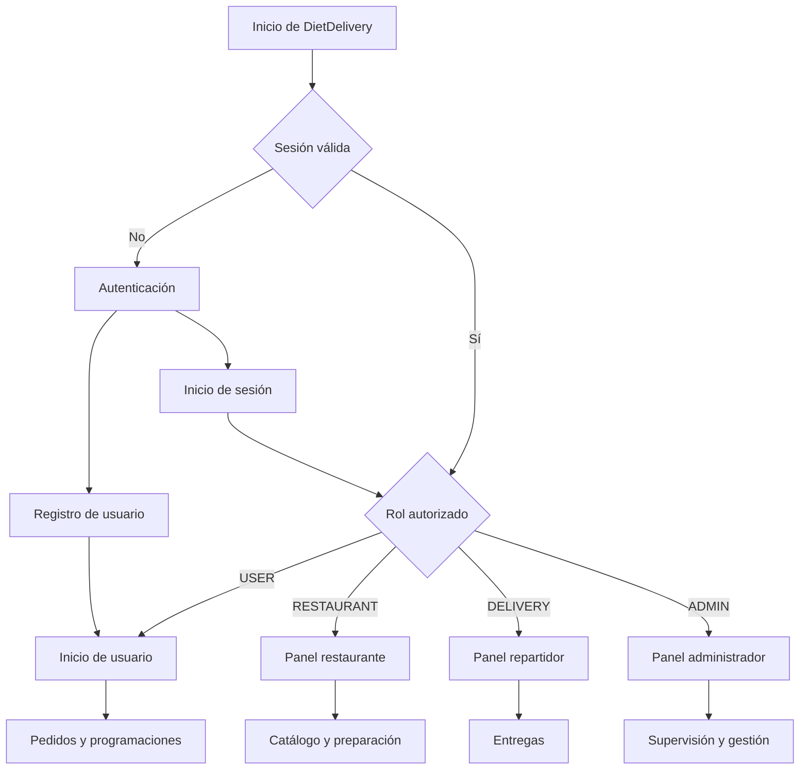

Este diagrama representa las rutas principales. Las verificaciones de permisos se realizarán también en el servidor.

---

# 4. Flujos del usuario

## 4.1. Estructura de navegación

La aplicación del usuario contará con las siguientes secciones principales:

| Pantalla | Contenido |
|---|---|
| Inicio | Recomendaciones, próximos pedidos y accesos rápidos. |
| Explorar | Restaurantes, categorías y búsqueda. |
| Programaciones | Programaciones activas, pausadas y futuras. |
| Pedidos | Pedidos actuales e historial. |
| Perfil | Datos personales, direcciones y preferencias alimenticias. |
| Notificaciones | Avisos y propuestas pendientes. |

### Diagrama de navegación

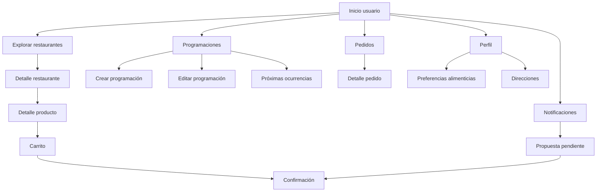

## 4.2. Registro e inicio de sesión

**Casos relacionados:** CU-USR-01, CU-USR-02

### Recorrido

1. El usuario abre DietDelivery.
2. Selecciona registrarse o iniciar sesión.
3. Introduce la información solicitada.
4. El sistema valida los datos.
5. Si la autenticación es exitosa, muestra la pantalla de inicio.
6. Si es un usuario nuevo, se le ofrece configurar sus preferencias alimenticias.

### Diagrama

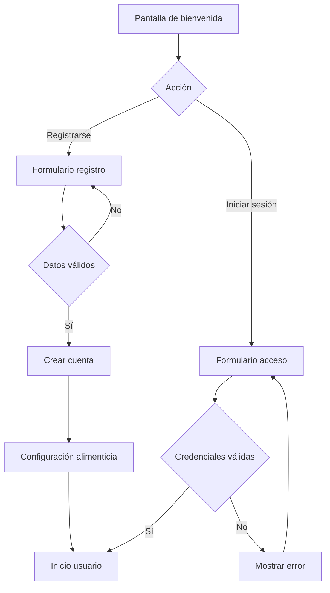

## 4.3. Configuración alimenticia

**Caso relacionado:** CU-USR-03

### Recorrido

1. El usuario accede a su perfil alimenticio.
2. Selecciona las categorías de comida que prefiere.
3. Registra ingredientes, alérgenos o restricciones que desea evitar.
4. Revisa la configuración.
5. Guarda los cambios.
6. El sistema actualiza sus preferencias para futuras recomendaciones.

### Categorías iniciales sugeridas

- Carnes.
- Pollo.
- Pescados y mariscos.
- Ensaladas.
- Comida vegetariana.
- Comida vegana.
- Otros alimentos disponibles.

Las categorías son preferencias de búsqueda y no constituyen diagnósticos ni planes médicos.

### Diagrama

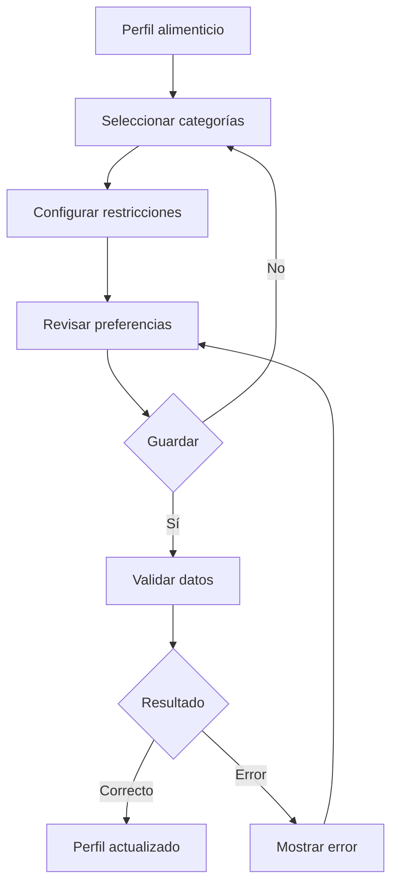

## 4.4. Pedido convencional

**Caso relacionado:** CU-USR-05

### Recorrido

1. El usuario abre la sección Explorar.
2. Consulta restaurantes disponibles.
3. Selecciona un establecimiento.
4. Revisa los productos.
5. Agrega alimentos al carrito.
6. Selecciona una dirección de entrega.
7. Revisa productos, cantidades, costos y condiciones.
8. Confirma la compra.
9. El sistema revalida la operación.
10. Se procesa el pago y se registra el pedido.
11. El usuario accede al seguimiento.

### Diagrama

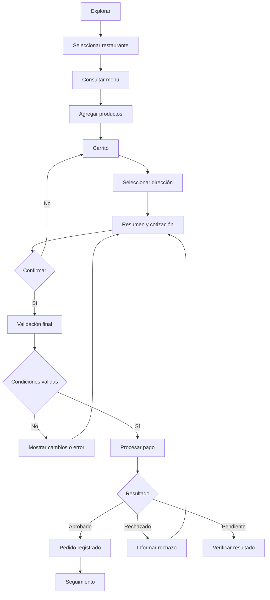

## 4.5. Creación de programación recurrente

**Casos relacionados:** CU-USR-06, CU-USR-07

DietDelivery ofrecerá dos modalidades de programación.

### Modalidad A: programación fija

El usuario seleccionará previamente el restaurante y los productos que desea recibir.

**Recorrido:**

1. Accede a Programaciones.
2. Selecciona Nueva programación.
3. Elige Programación fija.
4. Selecciona restaurante.
5. Selecciona productos y cantidades.
6. Configura días de repetición.
7. Configura horario.
8. Selecciona dirección.
9. Revisa la programación.
10. Guarda los cambios.

**Ejemplo:**

- Lunes, miércoles y viernes.
- 2:00 p. m.
- Restaurante seleccionado.
- Pechuga de pollo con verduras.

La programación no genera una compra inmediatamente. Cada ocurrencia producirá una propuesta que deberá confirmarse.

### Modalidad B: programación mediante recomendaciones

El usuario configura criterios alimenticios sin seleccionar obligatoriamente un restaurante o producto específico.

**Recorrido:**

1. Accede a Programaciones.
2. Selecciona Nueva programación.
3. Elige Programación por recomendaciones.
4. Selecciona categorías alimenticias.
5. Configura restricciones aplicables.
6. Selecciona días y horarios.
7. Selecciona dirección.
8. Revisa los criterios.
9. Guarda la programación.

**Ejemplo:**

- Martes y jueves.
- 3:00 p. m.
- Categoría: pescado.
- Restricción: sin ingredientes especificados por el usuario.
- Restaurante: seleccionado posteriormente por el sistema.

### Diagrama conjunto

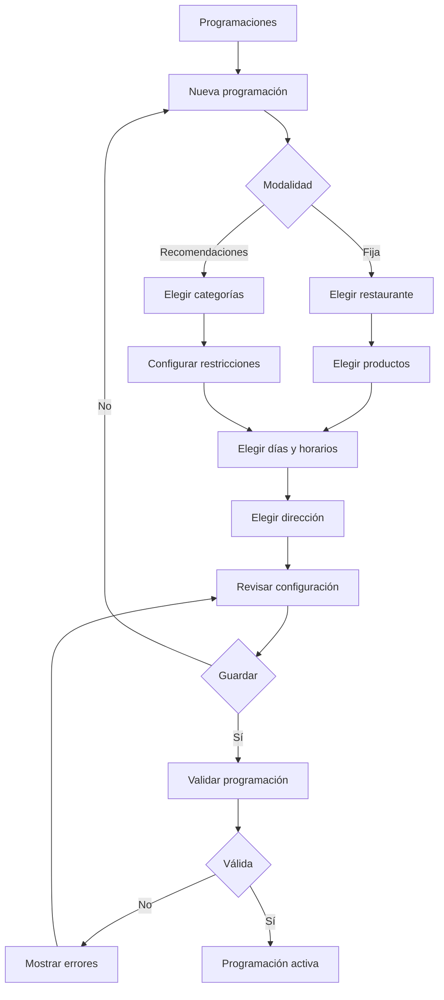

## 4.6. Administración de programaciones

**Caso relacionado:** CU-USR-08

### Acciones disponibles

| Acción | Resultado |
|---|---|
| Consultar | Muestra modalidad, días, horarios y estado. |
| Editar | Actualiza las ocurrencias futuras. |
| Pausar | Detiene la generación de nuevas propuestas. |
| Reactivar | Reanuda las ocurrencias futuras. |
| Omitir | Excluye una ocurrencia específica. |
| Eliminar | Desactiva definitivamente la programación. |

### Diagrama

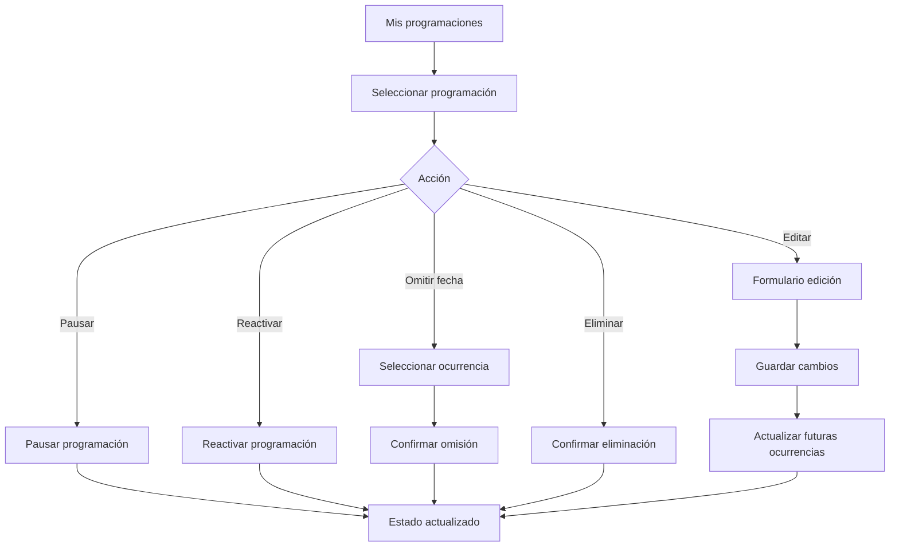

Los cambios no alterarán pedidos previamente confirmados.

## 4.7. Confirmación de propuestas recurrentes

**Caso relacionado:** CU-USR-09

El sistema deberá admitir dos métodos de confirmación.

### Método A: dentro de la aplicación

1. El usuario recibe un aviso.
2. Abre la propuesta.
3. Consulta el restaurante, productos y precio.
4. Selecciona Confirmar pedido.
5. El sistema verifica la operación.
6. Se procesa el pedido.

### Método B: desde una notificación interactiva

1. El usuario recibe una notificación compatible.
2. Visualiza la información esencial de la propuesta.
3. Selecciona Confirmar.
4. El sistema valida identidad, autorización y vigencia.
5. Si no se requieren pasos adicionales, procesa el pedido.
6. Si se requiere autenticación o revisión adicional, abre el flujo seguro correspondiente.

En ambos métodos debe existir autorización válida y conocimiento de las condiciones de compra.

### Diagrama

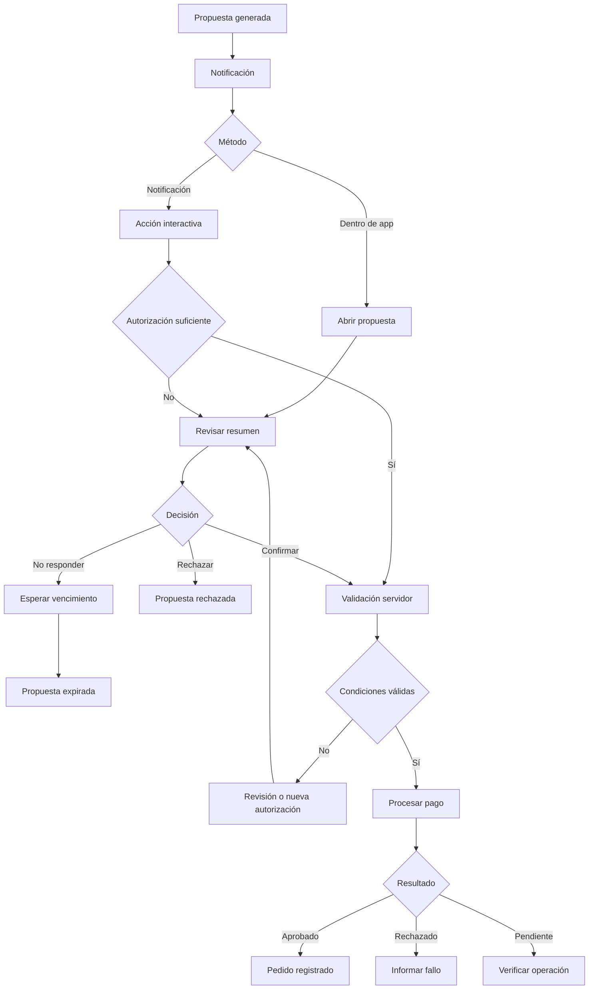

## 4.8. Consulta y seguimiento de pedidos

**Caso relacionado:** CU-USR-10

### Recorrido

1. El usuario abre Pedidos.
2. Selecciona un pedido activo.
3. Consulta su estado.
4. Visualiza actualizaciones de preparación y entrega.
5. Al finalizar, el pedido aparece en el historial.

### Estados visibles sugeridos

- Pendiente de aceptación.
- Aceptado.
- En preparación.
- Listo para recoger.
- Asignado a repartidor.
- Recogido.
- En camino.
- Entregado.
- Cancelado.

El seguimiento GPS en tiempo real queda fuera del MVP.

---

# 5. Flujos del restaurante

## 5.1. Navegación principal

**Casos relacionados:** CU-RES-01 a CU-RES-08

El panel del restaurante incluirá:

- Inicio o resumen operativo.
- Pedidos pendientes.
- Pedidos en preparación.
- Catálogo.
- Horarios y disponibilidad.
- Historial.
- Configuración del establecimiento.

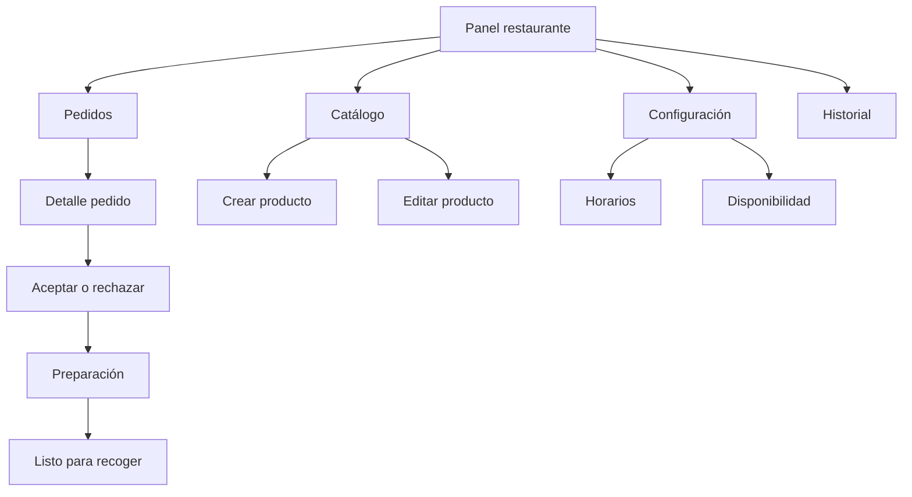

## 5.2. Gestión del catálogo

**Casos relacionados:** CU-RES-03, CU-RES-04

### Recorrido

1. El restaurante abre Catálogo.
2. Selecciona crear o editar un producto.
3. Registra nombre, descripción, categoría y precio.
4. Añade ingredientes y alérgenos conocidos.
5. Establece disponibilidad.
6. Guarda el producto.
7. El sistema valida y actualiza el catálogo.

### Estados alternativos

- Producto agotado.
- Producto desactivado.
- Información alimenticia incompleta.
- Error de validación.
- Error al guardar.

## 5.3. Preparación de pedidos

**Casos relacionados:** CU-RES-05, CU-RES-06, CU-RES-07, CU-RES-08

### Recorrido

1. El restaurante recibe un pedido.
2. Consulta los productos y las instrucciones.
3. Acepta o rechaza.
4. Si acepta, inicia la preparación.
5. Actualiza el estado del pedido.
6. Cuando termina, lo marca como listo para recoger.
7. El sistema continúa con el proceso de entrega.

### Diagrama

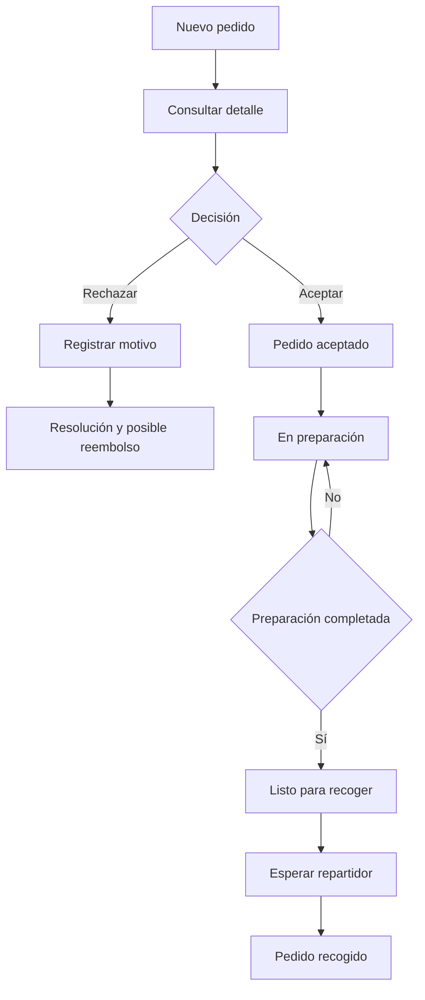

---

# 6. Flujos del repartidor

## 6.1. Navegación principal

**Casos relacionados:** CU-DEL-01 a CU-DEL-08

La interfaz del repartidor incluirá:

- Inicio.
- Entregas asignadas.
- Detalle de entrega.
- Información de recolección.
- Estado de entrega.
- Reportar incidencia.
- Historial.
- Perfil.

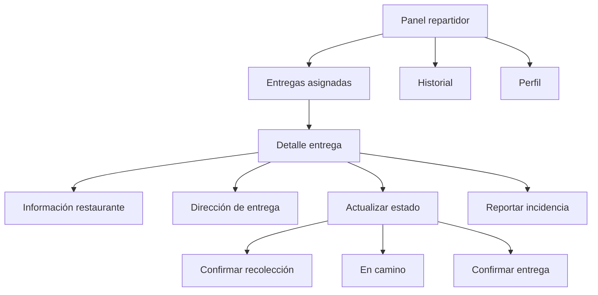

## 6.2. Recolección y entrega

**Casos relacionados:** CU-DEL-02 a CU-DEL-06

### Recorrido

1. El repartidor inicia sesión.
2. Consulta las entregas asignadas.
3. Selecciona una entrega.
4. Consulta la ubicación del restaurante.
5. Se dirige al establecimiento.
6. Recoge los alimentos.
7. Confirma la recolección.
8. Consulta la dirección de destino.
9. Traslada el pedido.
10. Entrega los alimentos.
11. Confirma la entrega.
12. El sistema registra la finalización.

### Diagrama

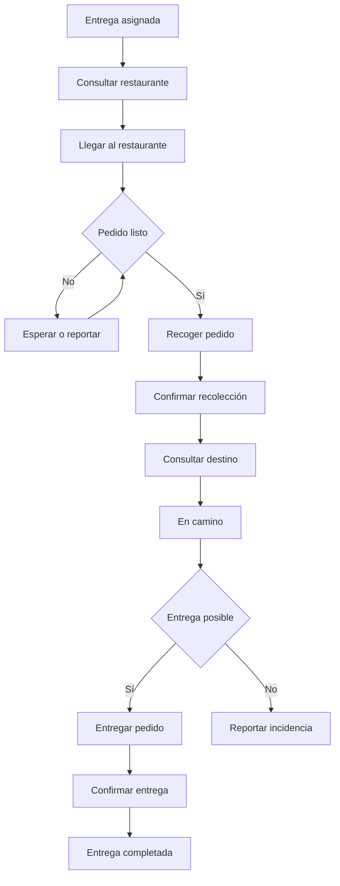

## 6.3. Reporte de incidencias

**Caso relacionado:** CU-DEL-07

El repartidor podrá reportar situaciones como:

- Restaurante no disponible.
- Pedido no preparado.
- Dirección incorrecta.
- Destinatario ausente.
- Problemas durante la entrega.

La incidencia quedará vinculada a la entrega y podrá ser consultada por el administrador.

---

# 7. Flujos del administrador

## 7.1. Navegación principal

**Casos relacionados:** CU-ADM-01 a CU-ADM-09

El panel administrativo contará con:

- Dashboard.
- Usuarios.
- Restaurantes.
- Repartidores.
- Pedidos.
- Entregas.
- Incidencias.
- Métricas.
- Auditoría.

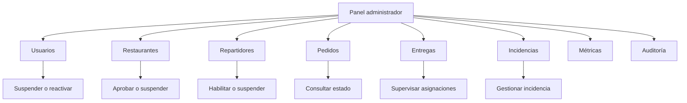

## 7.2. Gestión de cuentas

**Casos relacionados:** CU-ADM-02, CU-ADM-03, CU-ADM-04

### Recorrido

1. El administrador selecciona un módulo de cuentas.
2. Consulta los registros.
3. Selecciona una cuenta o establecimiento.
4. Revisa su información autorizada.
5. Selecciona una acción administrativa.
6. Confirma la operación cuando corresponda.
7. El sistema verifica permisos.
8. Ejecuta el cambio.
9. Registra la operación en auditoría.

### Diagrama

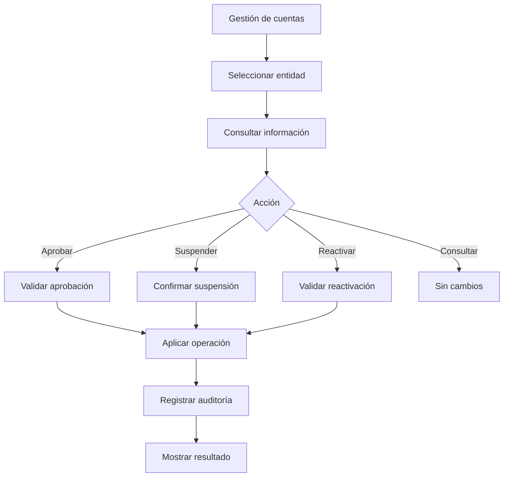

## 7.3. Supervisión de pedidos e incidencias

**Casos relacionados:** CU-ADM-05, CU-ADM-06, CU-ADM-07

### Recorrido

1. El administrador accede al panel de supervisión.
2. Consulta pedidos o entregas.
3. Selecciona un registro.
4. Revisa el historial de estados.
5. Identifica incidencias relacionadas.
6. Si es necesario, registra una acción administrativa.
7. El sistema guarda la intervención.
8. Se actualiza el estado correspondiente.

Las acciones administrativas no podrán utilizarse para autorizar compras en nombre del usuario sin una autorización válida.

---

# 8. Flujos automáticos del sistema

## 8.1. Procesamiento de programaciones

**Casos relacionados:** CU-SYS-01, CU-SYS-02, CU-SYS-03

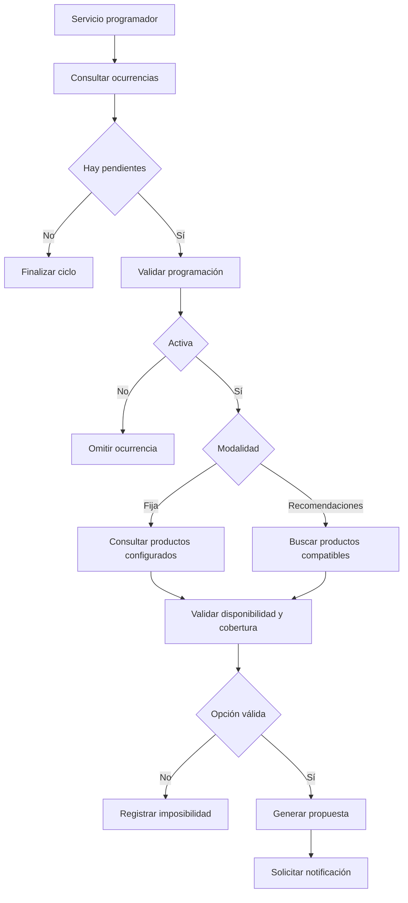

## 8.2. Procesamiento de confirmaciones

**Caso relacionado:** CU-SYS-06

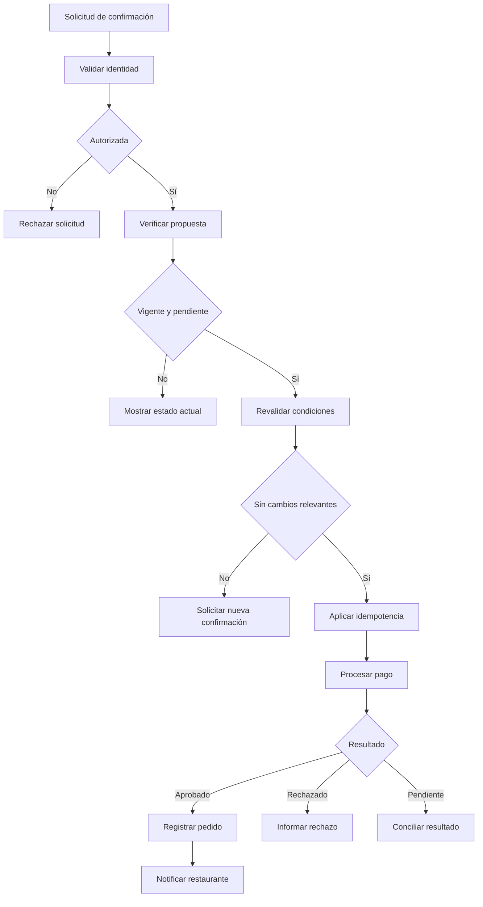

## 8.3. Expiración de propuestas

**Caso relacionado:** CU-SYS-05

1. El sistema identifica propuestas pendientes cuyo plazo terminó.
2. Verifica su estado actual.
3. Si continúan pendientes, las marca como expiradas.
4. Registra el evento.
5. Impide confirmaciones posteriores.
6. Conserva las siguientes ocurrencias de la programación.

---

# 9. Manejo de errores y estados alternativos

## 9.1. Matriz de errores

| Situación | Comportamiento esperado | Acción disponible |
|---|---|---|
| Sin conexión | Informar falta de conectividad. | Reintentar o consultar datos disponibles. |
| Sesión expirada | Solicitar autenticación. | Iniciar sesión. |
| Restaurante cerrado | Impedir una compra inválida. | Seleccionar alternativa. |
| Producto agotado | Informar indisponibilidad. | Modificar selección. |
| Precio modificado | Mostrar cotización actualizada. | Revisar y confirmar nuevamente. |
| Propuesta expirada | Impedir confirmación. | Esperar otra ocurrencia. |
| Pago rechazado | Informar resultado. | Revisar método de pago. |
| Pago pendiente | Mostrar estado de verificación. | Consultar resultado sin duplicar operación. |
| Notificación fallida | Mantener propuesta consultable. | Abrir aplicación. |
| Sin recomendaciones | Informar ausencia de opciones. | Modificar criterios. |
| Sin repartidores | Mantener asignación pendiente. | Esperar o intervención administrativa. |
| Pedido cancelado | Mostrar estado y resolución. | Consultar detalles. |
| Acceso no autorizado | Bloquear operación. | Volver a sección permitida. |

## 9.2. Flujo genérico de recuperación

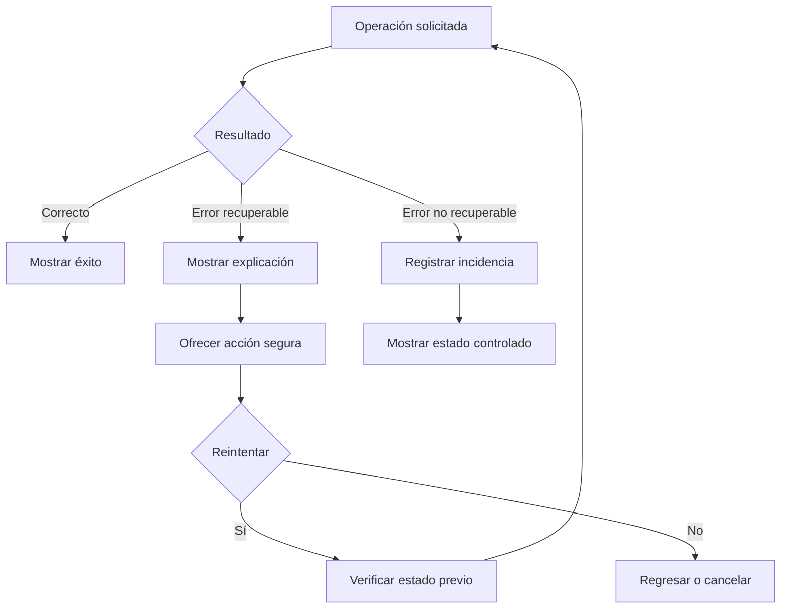

## 10. Estados de programaciones y propuestas

### 10.1. Programaciones

| Estado | Descripción |
|---|---|
| Activa | Genera futuras ocurrencias. |
| Pausada | No genera nuevas propuestas. |
| Eliminada | No admite nuevas ocurrencias. |

### 10.2. Propuestas

| Estado | Descripción |
|---|---|
| Pendiente | Espera respuesta del usuario. |
| En procesamiento | Confirmación recibida y operación en curso. |
| Confirmada | Compra autorizada y procesada correctamente. |
| Rechazada | El usuario rechazó la propuesta. |
| Expirada | Terminó su periodo de validez. |
| Fallida | No pudo completarse por una condición o error definitivo. |

### Diagrama de estados de propuesta

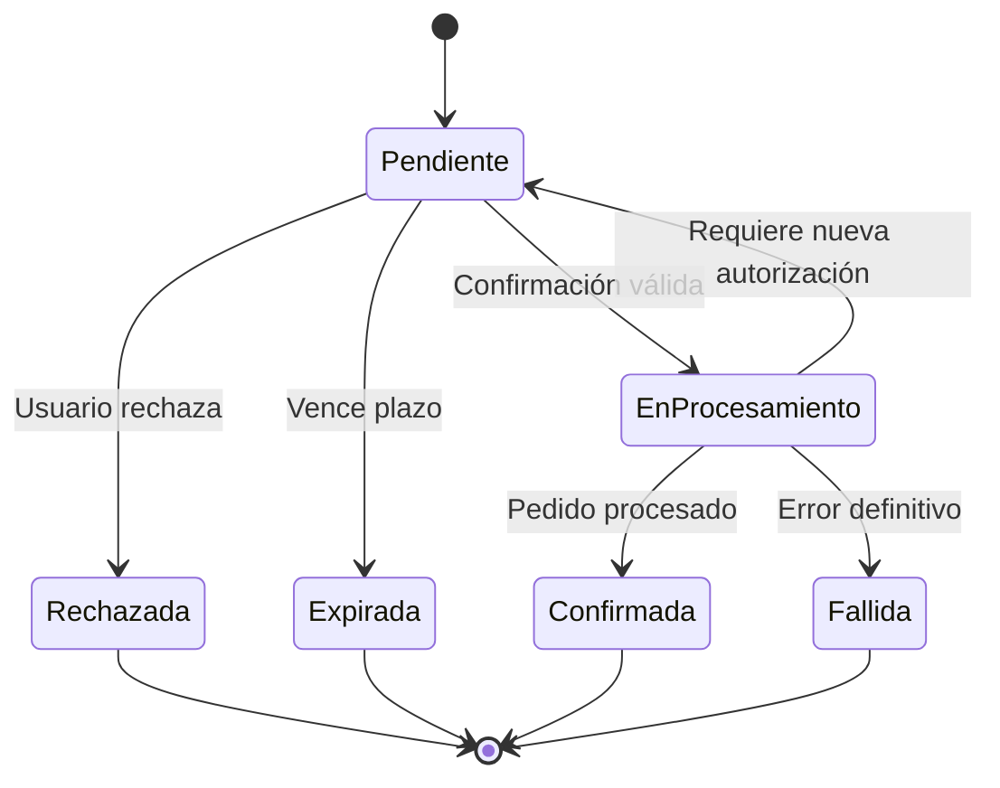

Las transiciones deberán implementarse con controles de concurrencia e idempotencia.

---

# 11. Matriz de trazabilidad

| Flujo | Casos de uso relacionados |
|---|---|
| Registro e inicio de sesión | CU-USR-01, CU-USR-02 |
| Configuración alimenticia | CU-USR-03 |
| Recomendaciones | CU-USR-04 |
| Pedido convencional | CU-USR-05 |
| Programación fija | CU-USR-06 |
| Programación por recomendaciones | CU-USR-07 |
| Administración de programaciones | CU-USR-08 |
| Confirmación de propuestas | CU-USR-09 |
| Seguimiento de pedidos | CU-USR-10 |
| Acceso de restaurante | CU-RES-01 |
| Gestión de establecimiento | CU-RES-02 |
| Catálogo y disponibilidad | CU-RES-03, CU-RES-04 |
| Recepción y preparación | CU-RES-05 a CU-RES-08 |
| Acceso de repartidor | CU-DEL-01 |
| Gestión de entregas | CU-DEL-02 a CU-DEL-06 |
| Incidencias e historial de entregas | CU-DEL-07, CU-DEL-08 |
| Acceso administrativo | CU-ADM-01 |
| Gestión de cuentas | CU-ADM-02 a CU-ADM-04 |
| Supervisión e incidencias | CU-ADM-05 a CU-ADM-07 |
| Auditoría y métricas | CU-ADM-08, CU-ADM-09 |
| Detección de ocurrencias | CU-SYS-01 |
| Generación de propuestas | CU-SYS-02, CU-SYS-03 |
| Notificaciones | CU-SYS-04 |
| Expiración | CU-SYS-05 |
| Procesamiento de confirmaciones | CU-SYS-06 |
| Asignación de repartidores | CU-SYS-07 |
| Cambios de estado | CU-SYS-08 |

## 12. Criterios de validación de flujos

Los flujos se considerarán listos para el MVP cuando:

1. Los cuatro roles puedan navegar por sus funciones autorizadas.
2. Las pantallas críticas tengan estados de carga, error y contenido vacío.
3. Los usuarios puedan completar pedidos convencionales.
4. Se puedan configurar ambas modalidades de programación.
5. Las propuestas se generen sin compras automáticas.
6. Se puedan confirmar propuestas desde la aplicación.
7. La confirmación desde notificaciones funcione en plataformas compatibles.
8. Las propuestas puedan rechazarse o expirar.
9. Los cambios de precio y disponibilidad se revaliden.
10. Los pagos y pedidos no se dupliquen por reintentos.
11. Los restaurantes puedan aceptar y preparar pedidos.
12. Los repartidores puedan completar entregas.
13. Los administradores puedan supervisar operaciones.
14. Las incidencias puedan registrarse.
15. Las transiciones de estado respeten las reglas del sistema.

## 13. Consideraciones para el diseño de interfaces

Durante la fase de diseño UX/UI se deberán definir:

- Wireframes de las pantallas principales.
- Componentes de navegación.
- Formularios de preferencias alimenticias.
- Selectores de días y horarios.
- Pantallas de propuestas y confirmación.
- Estados de error y recuperación.
- Componentes de seguimiento.
- Interfaces específicas para restaurante, repartidor y administrador.

Las decisiones visuales definitivas se establecerán durante el diseño de interfaces.

## 14. Conclusión

Los flujos de usuario definidos permiten visualizar el funcionamiento integral de DietDelivery y la relación entre sus cuatro actores.

La característica principal del sistema será la posibilidad de programar comidas recurrentes y recibir propuestas listas para confirmar, reduciendo la necesidad de repetir el proceso tradicional de búsqueda y selección.

La documentación también establece rutas alternativas y mecanismos de recuperación para garantizar que los pedidos se procesen de forma segura y consistente.

Estos flujos servirán como base para el diseño de interfaces, la arquitectura del sistema y las pruebas de aceptación.

---

**DietDelivery — Planifica tu alimentación, confirma y recibe.**