# Modelo de Datos de Coconea

**Proyecto:** Coconea  
**Versión:** 1.0  
**Estado:** Diseño conceptual y lógico  
**Alcance:** Producto Mínimo Viable (MVP)  
**Arquitectura del repositorio:** Monorepo  
**Motor de base de datos:** Pendiente de selección

---

## 1. Introducción

Este documento define el modelo de datos conceptual y lógico de Coconea, una plataforma de reparto de alimentos que permite realizar pedidos convencionales y programar pedidos recurrentes según las preferencias y restricciones alimenticias de los usuarios.

El modelo describe las entidades, atributos, identificadores, relaciones, cardinalidades, restricciones y estados necesarios para implementar el MVP.

Su propósito es proporcionar una estructura de información consistente que pueda utilizarse posteriormente para diseñar la base de datos física, los contratos de la API y los componentes del sistema.

El diseño se mantiene independiente del motor de persistencia y del lenguaje de programación.

## 2. Objetivos

1. Identificar las entidades principales del negocio.
2. Definir los atributos necesarios para cada entidad.
3. Establecer relaciones y cardinalidades.
4. Garantizar la trazabilidad de programaciones, propuestas y pedidos.
5. Evitar duplicaciones de compras y cobros.
6. Preservar la información histórica de operaciones económicas.
7. Aplicar separación de acceso por rol y propiedad.
8. Facilitar auditoría, recuperación y evolución del sistema.

## 3. Alcance del modelo

### 3.1. Incluido en el MVP

El modelo contempla:

- Identidad, roles y sesiones.
- Perfiles alimenticios.
- Preferencias y restricciones.
- Direcciones.
- Restaurantes, horarios y cobertura.
- Catálogo, ingredientes y alérgenos.
- Carritos y pedidos.
- Programaciones recurrentes.
- Ocurrencias y propuestas.
- Confirmaciones.
- Pagos y reembolsos.
- Repartidores y asignaciones.
- Entregas e incidencias.
- Notificaciones.
- Auditoría e idempotencia.

### 3.2. Fuera del MVP

No se modelarán en detalle:

- Inteligencia artificial avanzada.
- Cálculo nutricional médico.
- Suscripciones.
- Cuentas familiares.
- Programas de recompensas.
- Seguimiento GPS continuo.
- Optimización avanzada de rutas.
- Múltiples empleados por restaurante.
- Reseñas y calificaciones.
- Integraciones empresariales avanzadas.

Estas capacidades podrán incorporarse en versiones posteriores.

---

# 4. Convenciones del modelo

## 4.1. Identificadores

Cada entidad persistente tendrá un identificador lógico único.

Se utilizará la notación `id` para su clave primaria.

Las relaciones utilizarán atributos con el sufijo `_id`.

El tipo físico del identificador, como UUID u otro formato, se determinará al seleccionar el stack.

## 4.2. Tipos de datos lógicos

| Tipo | Descripción |
|---|---|
| Identifier | Identificador único. |
| String | Cadena de texto. |
| Text | Texto de longitud variable. |
| Integer | Número entero. |
| Decimal | Número decimal exacto. |
| Boolean | Valor verdadero o falso. |
| Date | Fecha sin hora. |
| Time | Hora local. |
| DateTime | Fecha y hora con referencia temporal inequívoca. |
| Enum | Valor de un catálogo controlado. |
| JSON | Estructura de datos cuando esté justificada. |

Los importes monetarios deberán representarse mediante tipos exactos, nunca mediante aritmética binaria de punto flotante.

## 4.3. Campos comunes

Cuando corresponda, las entidades incluirán:

| Campo | Tipo | Descripción |
|---|---|---|
| id | Identifier | Clave primaria. |
| created_at | DateTime | Fecha de creación. |
| updated_at | DateTime | Última modificación. |
| version | Integer | Versión para control de concurrencia. |

No todas las entidades necesitan los cuatro campos. Los eventos inmutables pueden conservar únicamente su fecha de creación.

## 4.4. Reglas generales

- Los identificadores no deberán reutilizarse.
- Las relaciones obligatorias deberán validarse.
- Los estados utilizarán valores controlados.
- Los registros económicos conservarán datos históricos.
- Las operaciones críticas deberán ser idempotentes.
- Los datos sensibles tendrán acceso restringido.
- Las eliminaciones no deberán destruir referencias históricas necesarias.

---

# 5. Modelo conceptual

## 5.1. Dominios principales

El modelo se divide conceptualmente en ocho dominios.

| Dominio | Responsabilidad |
|---|---|
| Identidad | Cuentas, roles, sesiones y direcciones. |
| Alimentación | Preferencias, restricciones e ingredientes. |
| Restaurantes | Establecimientos, menús, disponibilidad y cobertura. |
| Programación | Programaciones, ocurrencias y propuestas. |
| Comercio | Carritos, pedidos, pagos y reembolsos. |
| Entregas | Repartidores, asignaciones y seguimiento. |
| Comunicación | Notificaciones y sus intentos de envío. |
| Operación | Incidencias, auditoría e idempotencia. |

Estos dominios representan límites lógicos, no necesariamente microservicios ni bases de datos separadas.

## 5.2. Diagrama conceptual general

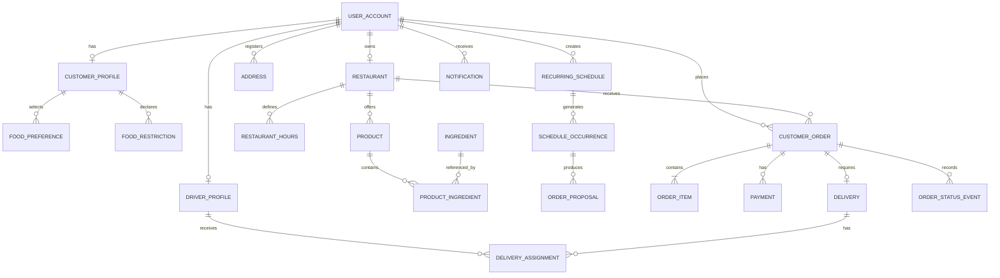

El diagrama representa las relaciones principales. Las siguientes secciones detallan las entidades y las restricciones que no pueden expresarse completamente mediante cardinalidades.

---

# 6. Identidad y cuentas

## 6.1. USER_ACCOUNT

Representa una identidad autenticable del sistema.

| Atributo | Tipo | Restricción |
|---|---|---|
| id | Identifier | PK |
| email | String | Único, obligatorio |
| password_hash | String | Obligatorio para autenticación local |
| role | Enum | USER, RESTAURANT, DELIVERY, ADMIN |
| display_name | String | Obligatorio |
| phone | String | Opcional |
| status | Enum | ACTIVE, SUSPENDED, DISABLED |
| email_verified_at | DateTime | Opcional |
| created_at | DateTime | Obligatorio |
| updated_at | DateTime | Obligatorio |
| version | Integer | Obligatorio |

**Reglas:**

- El correo se normalizará para comprobar unicidad.
- Las contraseñas no se almacenarán en texto plano.
- El rol determina los permisos generales.
- La propiedad de los recursos se validará adicionalmente.
- Una cuenta suspendida no podrá iniciar nuevas operaciones protegidas.

**Trazabilidad:** RF-001 a RF-006; RN-001 a RN-005.

## 6.2. CUSTOMER_PROFILE

Almacena la información propia de un usuario consumidor.

| Atributo | Tipo | Restricción |
|---|---|---|
| id | Identifier | PK |
| account_id | Identifier | FK, único |
| preferred_name | String | Opcional |
| created_at | DateTime | Obligatorio |
| updated_at | DateTime | Obligatorio |

Cada cuenta con rol USER podrá tener un perfil de consumidor.

## 6.3. DRIVER_PROFILE

Representa a un repartidor habilitable.

| Atributo | Tipo | Restricción |
|---|---|---|
| id | Identifier | PK |
| account_id | Identifier | FK, único |
| availability_status | Enum | AVAILABLE, UNAVAILABLE |
| approval_status | Enum | PENDING, APPROVED, SUSPENDED |
| created_at | DateTime | Obligatorio |
| updated_at | DateTime | Obligatorio |

La disponibilidad operativa y la aprobación administrativa son conceptos distintos.

## 6.4. ADDRESS

Representa una dirección registrada.

| Atributo | Tipo | Restricción |
|---|---|---|
| id | Identifier | PK |
| account_id | Identifier | FK |
| label | String | Opcional |
| recipient_name | String | Obligatorio |
| recipient_phone | String | Obligatorio |
| street | String | Obligatorio |
| exterior_number | String | Opcional según región |
| interior_number | String | Opcional |
| neighborhood | String | Opcional |
| city | String | Obligatorio |
| region | String | Obligatorio |
| postal_code | String | Según región |
| country_code | String | Obligatorio |
| reference_notes | Text | Opcional |
| latitude | Decimal | Opcional |
| longitude | Decimal | Opcional |
| is_default | Boolean | Obligatorio |
| created_at | DateTime | Obligatorio |
| updated_at | DateTime | Obligatorio |

**Restricciones:**

- Una dirección pertenece a una cuenta.
- El usuario solo podrá modificar sus direcciones.
- Una cuenta tendrá como máximo una dirección predeterminada.
- La dirección usada en un pedido deberá conservarse como una copia histórica.

## 6.5. AUTH_SESSION

Representa una sesión autenticada.

| Atributo | Tipo | Restricción |
|---|---|---|
| id | Identifier | PK |
| account_id | Identifier | FK |
| token_reference | String | Único, no almacenar token secreto sin protección |
| created_at | DateTime | Obligatorio |
| expires_at | DateTime | Obligatorio |
| revoked_at | DateTime | Opcional |

El mecanismo físico de sesiones se definirá al seleccionar la arquitectura de autenticación.

---

# 7. Preferencias y restricciones alimenticias

## 7.1. FOOD_CATEGORY

Catálogo de categorías alimenticias.

| Atributo | Tipo | Restricción |
|---|---|---|
| id | Identifier | PK |
| name | String | Único |
| description | Text | Opcional |
| is_active | Boolean | Obligatorio |

Ejemplos: pollo, carnes, pescados, ensaladas, vegetariano y vegano.

## 7.2. FOOD_PREFERENCE

Relaciona un perfil con sus categorías preferidas.

| Atributo | Tipo | Restricción |
|---|---|---|
| id | Identifier | PK |
| customer_profile_id | Identifier | FK |
| food_category_id | Identifier | FK |
| created_at | DateTime | Obligatorio |

**Unicidad:** `(customer_profile_id, food_category_id)`.

## 7.3. INGREDIENT

Catálogo de ingredientes y sustancias alimenticias declarables.

| Atributo | Tipo | Restricción |
|---|---|---|
| id | Identifier | PK |
| name | String | Obligatorio |
| normalized_name | String | Único |
| allergen_flag | Boolean | Obligatorio |
| is_active | Boolean | Obligatorio |

El catálogo deberá evitar duplicaciones semánticas mediante normalización y revisión administrativa.

## 7.4. FOOD_RESTRICTION

Representa un ingrediente o sustancia que el usuario desea evitar.

| Atributo | Tipo | Restricción |
|---|---|---|
| id | Identifier | PK |
| customer_profile_id | Identifier | FK |
| ingredient_id | Identifier | FK |
| restriction_type | Enum | ALLERGEN, AVOID |
| created_at | DateTime | Obligatorio |

**Unicidad:** `(customer_profile_id, ingredient_id, restriction_type)`.

Las restricciones constituyen datos potencialmente sensibles y requieren protección especial.

## 7.5. Diagrama alimenticio

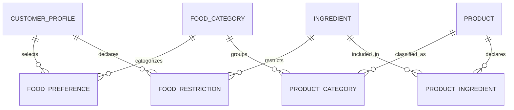

---

# 8. Restaurantes y catálogo

## 8.1. RESTAURANT

Representa un establecimiento registrado.

| Atributo | Tipo | Restricción |
|---|---|---|
| id | Identifier | PK |
| owner_account_id | Identifier | FK |
| name | String | Obligatorio |
| description | Text | Opcional |
| phone | String | Obligatorio |
| address_text | Text | Obligatorio |
| latitude | Decimal | Opcional |
| longitude | Decimal | Opcional |
| timezone | String | Obligatorio |
| approval_status | Enum | PENDING, APPROVED, SUSPENDED |
| operational_status | Enum | OPEN, TEMPORARILY_UNAVAILABLE |
| created_at | DateTime | Obligatorio |
| updated_at | DateTime | Obligatorio |
| version | Integer | Obligatorio |

**Reglas:**

- En el MVP cada restaurante tendrá una cuenta responsable.
- La cuenta deberá tener rol RESTAURANT.
- Un establecimiento suspendido no recibirá nuevos pedidos.
- Los horarios determinarán su disponibilidad temporal.

## 8.2. RESTAURANT_HOURS

Define horarios semanales.

| Atributo | Tipo | Restricción |
|---|---|---|
| id | Identifier | PK |
| restaurant_id | Identifier | FK |
| weekday | Integer | 1 a 7 |
| opens_at | Time | Obligatorio |
| closes_at | Time | Obligatorio |
| is_closed | Boolean | Obligatorio |

Se permitirán múltiples intervalos para un mismo día, cuando el restaurante opere en horarios separados.

Los intervalos que atraviesen la medianoche deberán normalizarse o representarse explícitamente.

## 8.3. RESTAURANT_SPECIAL_HOURS

Registra excepciones de calendario.

| Atributo | Tipo | Restricción |
|---|---|---|
| id | Identifier | PK |
| restaurant_id | Identifier | FK |
| date | Date | Obligatorio |
| opens_at | Time | Opcional |
| closes_at | Time | Opcional |
| is_closed | Boolean | Obligatorio |
| reason | String | Opcional |

Los horarios especiales prevalecen sobre los horarios semanales.

## 8.4. SERVICE_ZONE

Representa una zona de cobertura.

| Atributo | Tipo | Restricción |
|---|---|---|
| id | Identifier | PK |
| name | String | Obligatorio |
| description | Text | Opcional |
| boundary_definition | JSON | Representación lógica de cobertura |
| is_active | Boolean | Obligatorio |

La representación geográfica definitiva dependerá del motor y las herramientas seleccionadas.

## 8.5. RESTAURANT_SERVICE_ZONE

Relaciona restaurantes y zonas.

| Atributo | Tipo | Restricción |
|---|---|---|
| restaurant_id | Identifier | FK |
| service_zone_id | Identifier | FK |
| is_active | Boolean | Obligatorio |

**Clave compuesta:** `(restaurant_id, service_zone_id)`.

## 8.6. PRODUCT

Representa un platillo o artículo del menú.

| Atributo | Tipo | Restricción |
|---|---|---|
| id | Identifier | PK |
| restaurant_id | Identifier | FK |
| name | String | Obligatorio |
| description | Text | Opcional |
| price | Decimal | Mayor o igual a cero |
| currency | String | Código monetario |
| availability_status | Enum | AVAILABLE, UNAVAILABLE |
| ingredient_disclosure_status | Enum | COMPLETE, PARTIAL, UNKNOWN |
| is_active | Boolean | Obligatorio |
| created_at | DateTime | Obligatorio |
| updated_at | DateTime | Obligatorio |
| version | Integer | Obligatorio |

**Reglas:**

- El precio deberá ser exacto y estar expresado en una moneda.
- El restaurante será responsable de la información alimenticia declarada.
- Un producto con información incompleta no se considerará automáticamente seguro.
- La disponibilidad deberá verificarse nuevamente antes de confirmar una compra.

## 8.7. PRODUCT_CATEGORY

Relaciona productos con categorías.

| Atributo | Tipo | Restricción |
|---|---|---|
| product_id | Identifier | FK |
| food_category_id | Identifier | FK |

**Clave compuesta:** `(product_id, food_category_id)`.

## 8.8. PRODUCT_INGREDIENT

Relaciona productos con ingredientes.

| Atributo | Tipo | Restricción |
|---|---|---|
| product_id | Identifier | FK |
| ingredient_id | Identifier | FK |
| declaration_type | Enum | CONTAINS, MAY_CONTAIN |
| notes | String | Opcional |

**Clave compuesta:** `(product_id, ingredient_id, declaration_type)`.

La ausencia de un ingrediente en esta relación no significa que el producto esté libre de él cuando la declaración sea incompleta.

## 8.9. Diagrama de restaurantes

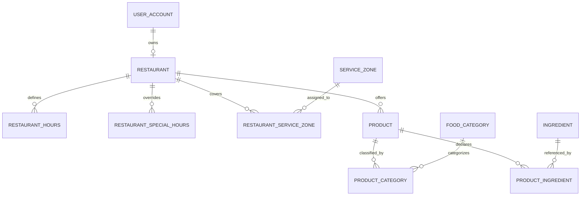

---

# 9. Carrito y pedidos convencionales

## 9.1. SHOPPING_CART

Representa un carrito de compra activo.

| Atributo | Tipo | Restricción |
|---|---|---|
| id | Identifier | PK |
| customer_account_id | Identifier | FK |
| restaurant_id | Identifier | FK |
| status | Enum | ACTIVE, CHECKED_OUT, ABANDONED |
| created_at | DateTime | Obligatorio |
| updated_at | DateTime | Obligatorio |
| version | Integer | Obligatorio |

Cada carrito contendrá productos de un solo restaurante.

## 9.2. CART_ITEM

Representa una línea del carrito.

| Atributo | Tipo | Restricción |
|---|---|---|
| id | Identifier | PK |
| cart_id | Identifier | FK |
| product_id | Identifier | FK |
| quantity | Integer | Mayor que cero |
| created_at | DateTime | Obligatorio |

Los precios se consultarán nuevamente durante la cotización.

## 9.3. CUSTOMER_ORDER

Representa una compra registrada.

| Atributo | Tipo | Restricción |
|---|---|---|
| id | Identifier | PK |
| customer_account_id | Identifier | FK |
| restaurant_id | Identifier | FK |
| source_type | Enum | DIRECT, RECURRING |
| proposal_id | Identifier | FK opcional, único |
| status | Enum | Estado controlado |
| currency | String | Obligatorio |
| subtotal | Decimal | Mayor o igual a cero |
| delivery_fee | Decimal | Mayor o igual a cero |
| additional_charges | Decimal | Mayor o igual a cero |
| discount_total | Decimal | Mayor o igual a cero |
| total | Decimal | Mayor o igual a cero |
| delivery_address_snapshot | JSON | Obligatorio |
| confirmed_at | DateTime | Obligatorio |
| created_at | DateTime | Obligatorio |
| updated_at | DateTime | Obligatorio |
| version | Integer | Obligatorio |

**Reglas:**

- Un pedido recurrente debe vincularse con una propuesta confirmada.
- Un pedido directo no necesita propuesta recurrente.
- Una propuesta no podrá originar más de un pedido.
- Los importes históricos no se recalcularán utilizando precios actuales.
- La dirección histórica no dependerá de futuras modificaciones del usuario.

## 9.4. ORDER_ITEM

Representa una línea de pedido.

| Atributo | Tipo | Restricción |
|---|---|---|
| id | Identifier | PK |
| order_id | Identifier | FK |
| product_id | Identifier | FK |
| product_name_snapshot | String | Obligatorio |
| quantity | Integer | Mayor que cero |
| unit_price | Decimal | Mayor o igual a cero |
| line_total | Decimal | Mayor o igual a cero |
| ingredient_snapshot | JSON | Información declarada al confirmar |

El nombre, precio e información alimenticia se conservarán como evidencia histórica.

## 9.5. ORDER_STATUS_EVENT

Registra cambios de estado.

| Atributo | Tipo | Restricción |
|---|---|---|
| id | Identifier | PK |
| order_id | Identifier | FK |
| previous_status | Enum | Opcional para creación |
| new_status | Enum | Obligatorio |
| actor_account_id | Identifier | FK opcional |
| reason | String | Opcional |
| occurred_at | DateTime | Obligatorio |

Los eventos deberán ser inmutables.

## 9.6. Diagrama de pedidos

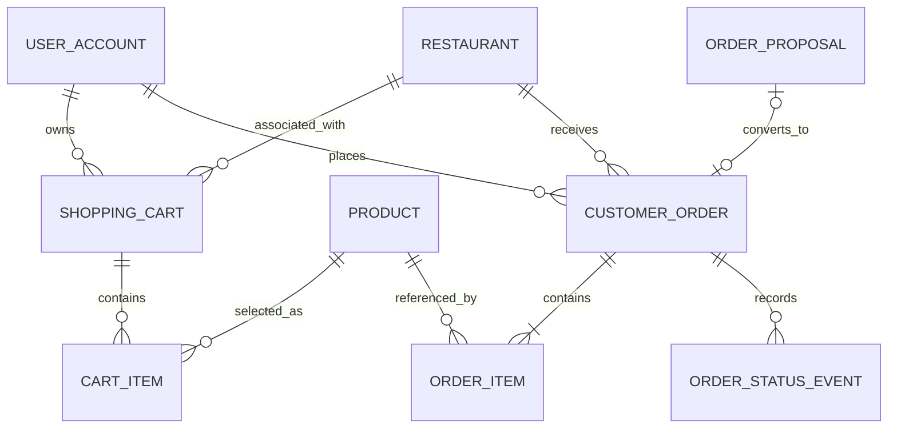

---

# 10. Programaciones recurrentes

Este dominio constituye una de las principales características diferenciadoras de Coconea.

Se separan cuatro conceptos:

1. **Programación:** configuración recurrente creada por el usuario.
2. **Ocurrencia:** instancia correspondiente a una fecha y horario concretos.
3. **Propuesta:** oferta específica presentada para confirmación.
4. **Pedido:** compra que solo existe después de una autorización válida y su procesamiento correspondiente.

## 10.1. RECURRING_SCHEDULE

Representa una programación recurrente.

| Atributo | Tipo | Restricción |
|---|---|---|
| id | Identifier | PK |
| customer_account_id | Identifier | FK |
| mode | Enum | FIXED, RECOMMENDATION |
| status | Enum | ACTIVE, PAUSED, DELETED |
| timezone | String | Obligatorio |
| local_time | Time | Obligatorio |
| address_id | Identifier | FK |
| fixed_restaurant_id | Identifier | FK opcional |
| effective_from | Date | Obligatorio |
| effective_until | Date | Opcional |
| created_at | DateTime | Obligatorio |
| updated_at | DateTime | Obligatorio |
| version | Integer | Obligatorio |

**Restricciones:**

- FIXED requiere un restaurante y al menos un producto configurado.
- RECOMMENDATION utiliza criterios alimenticios.
- Una programación no representa una autorización de pago.
- Las modificaciones afectarán únicamente las ocurrencias futuras elegibles.

## 10.2. SCHEDULE_WEEKDAY

Define los días de ejecución.

| Atributo | Tipo | Restricción |
|---|---|---|
| schedule_id | Identifier | FK |
| weekday | Integer | 1 a 7 |

**Clave compuesta:** `(schedule_id, weekday)`.

Cada programación activa deberá tener al menos un día configurado.

## 10.3. SCHEDULE_FIXED_ITEM

Define productos para programaciones fijas.

| Atributo | Tipo | Restricción |
|---|---|---|
| id | Identifier | PK |
| schedule_id | Identifier | FK |
| product_id | Identifier | FK |
| quantity | Integer | Mayor que cero |

Los productos deberán pertenecer al restaurante seleccionado.

## 10.4. SCHEDULE_CATEGORY

Define categorías permitidas para recomendaciones.

| Atributo | Tipo | Restricción |
|---|---|---|
| schedule_id | Identifier | FK |
| food_category_id | Identifier | FK |

**Clave compuesta:** `(schedule_id, food_category_id)`.

## 10.5. SCHEDULE_RESTRICTION

Define restricciones específicas de una programación.

| Atributo | Tipo | Restricción |
|---|---|---|
| schedule_id | Identifier | FK |
| ingredient_id | Identifier | FK |
| restriction_type | Enum | ALLERGEN, AVOID |

**Clave compuesta:** `(schedule_id, ingredient_id, restriction_type)`.

Estas restricciones complementan las restricciones aplicables del perfil alimenticio.

## 10.6. SCHEDULE_OCCURRENCE

Representa una ejecución prevista.

| Atributo | Tipo | Restricción |
|---|---|---|
| id | Identifier | PK |
| schedule_id | Identifier | FK |
| scheduled_local_date | Date | Obligatorio |
| scheduled_local_time | Time | Obligatorio |
| scheduled_at | DateTime | Instante resuelto |
| timezone | String | Obligatorio |
| status | Enum | PENDING, SKIPPED, PROCESSING, PROPOSED, UNAVAILABLE, COMPLETED |
| processed_at | DateTime | Opcional |
| created_at | DateTime | Obligatorio |
| version | Integer | Obligatorio |

**Unicidad lógica:** `(schedule_id, scheduled_local_date, scheduled_local_time)`.

**Reglas:**

- Una ocurrencia omitida no generará propuestas.
- Las ejecuciones repetidas no deberán duplicarla.
- Las ambigüedades de horario de verano deberán resolverse mediante una política documentada.

## 10.7. ORDER_PROPOSAL

Representa una propuesta de compra.

| Atributo | Tipo | Restricción |
|---|---|---|
| id | Identifier | PK |
| occurrence_id | Identifier | FK |
| customer_account_id | Identifier | FK |
| restaurant_id | Identifier | FK |
| status | Enum | PENDING, PROCESSING, CONFIRMED, REJECTED, EXPIRED, FAILED |
| quote_version | Integer | Obligatorio |
| currency | String | Obligatorio |
| subtotal | Decimal | Obligatorio |
| delivery_fee | Decimal | Obligatorio |
| additional_charges | Decimal | Obligatorio |
| discount_total | Decimal | Obligatorio |
| total | Decimal | Obligatorio |
| address_snapshot | JSON | Obligatorio |
| generated_at | DateTime | Obligatorio |
| expires_at | DateTime | Obligatorio |
| confirmed_at | DateTime | Opcional |
| version | Integer | Obligatorio |

**Restricciones:**

- La propuesta debe pertenecer al propietario de la programación.
- El vencimiento debe ser posterior a su generación.
- Una propuesta expirada o rechazada no podrá convertirse en pedido.
- La confirmación debe validar la versión de cotización.
- No podrán existir dos propuestas activas para una misma ocurrencia.

## 10.8. PROPOSAL_ITEM

Representa los productos propuestos.

| Atributo | Tipo | Restricción |
|---|---|---|
| id | Identifier | PK |
| proposal_id | Identifier | FK |
| product_id | Identifier | FK |
| product_name_snapshot | String | Obligatorio |
| quantity | Integer | Mayor que cero |
| unit_price | Decimal | Obligatorio |
| line_total | Decimal | Obligatorio |
| ingredient_snapshot | JSON | Información declarada |

Las propuestas deberán conservar los detalles mostrados al usuario.

## 10.9. PROPOSAL_CONFIRMATION

Registra una decisión de confirmación.

| Atributo | Tipo | Restricción |
|---|---|---|
| id | Identifier | PK |
| proposal_id | Identifier | FK |
| customer_account_id | Identifier | FK |
| action | Enum | CONFIRM, REJECT |
| channel | Enum | IN_APP, PUSH |
| quote_version | Integer | Obligatorio |
| authorization_reference | String | Opcional |
| idempotency_key | String | Obligatorio |
| decision_at | DateTime | Obligatorio |
| result_status | Enum | ACCEPTED, REJECTED, PENDING, FAILED |

**Reglas:**

- Una confirmación debe corresponder a una propuesta vigente.
- El canal PUSH no elimina las validaciones de seguridad.
- La clave idempotente debe evitar decisiones económicas duplicadas.
- Los intentos fallidos pueden registrarse sin producir una compra.

## 10.10. Diagrama de recurrencias

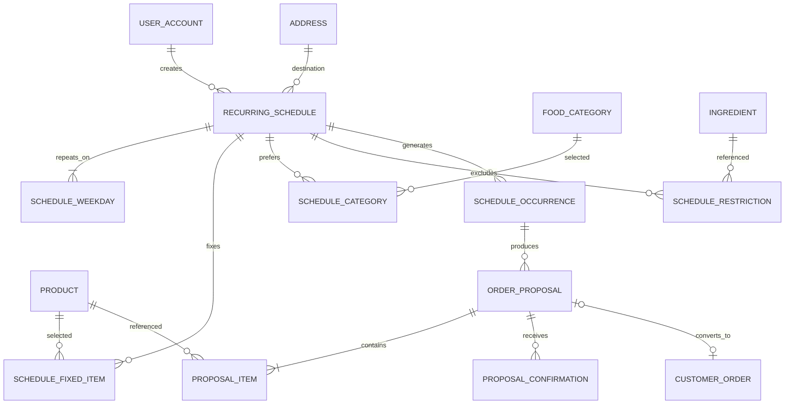

---

# 11. Pagos y reembolsos

## 11.1. PAYMENT

Representa una operación de pago.

| Atributo | Tipo | Restricción |
|---|---|---|
| id | Identifier | PK |
| order_id | Identifier | FK |
| provider | String | Obligatorio |
| provider_payment_reference | String | Único por proveedor, si existe |
| idempotency_key | String | Único en su ámbito |
| amount | Decimal | Mayor que cero |
| currency | String | Obligatorio |
| status | Enum | PENDING, AUTHORIZED, CAPTURED, FAILED, CANCELED, REFUNDED, PARTIALLY_REFUNDED |
| created_at | DateTime | Obligatorio |
| updated_at | DateTime | Obligatorio |

No se almacenarán números completos de tarjetas ni códigos de seguridad.

La asociación de un pago con un pedido deberá diseñarse de modo que los fallos intermedios puedan conciliarse sin duplicar operaciones.

## 11.2. PAYMENT_EVENT

Registra eventos provenientes del proveedor o del procesamiento interno.

| Atributo | Tipo | Restricción |
|---|---|---|
| id | Identifier | PK |
| payment_id | Identifier | FK |
| provider_event_id | String | Único cuando exista |
| event_type | String | Obligatorio |
| event_at | DateTime | Obligatorio |
| received_at | DateTime | Obligatorio |
| sanitized_payload | JSON | Opcional |

Los eventos repetidos del proveedor deberán detectarse.

## 11.3. REFUND

Representa un reembolso.

| Atributo | Tipo | Restricción |
|---|---|---|
| id | Identifier | PK |
| payment_id | Identifier | FK |
| amount | Decimal | Mayor que cero |
| currency | String | Obligatorio |
| reason | String | Obligatorio |
| status | Enum | PENDING, COMPLETED, FAILED |
| provider_refund_reference | String | Opcional |
| idempotency_key | String | Único en su ámbito |
| created_at | DateTime | Obligatorio |
| updated_at | DateTime | Obligatorio |

La suma de reembolsos completados no podrá superar el importe efectivamente capturado.

## 11.4. Diagrama de pagos

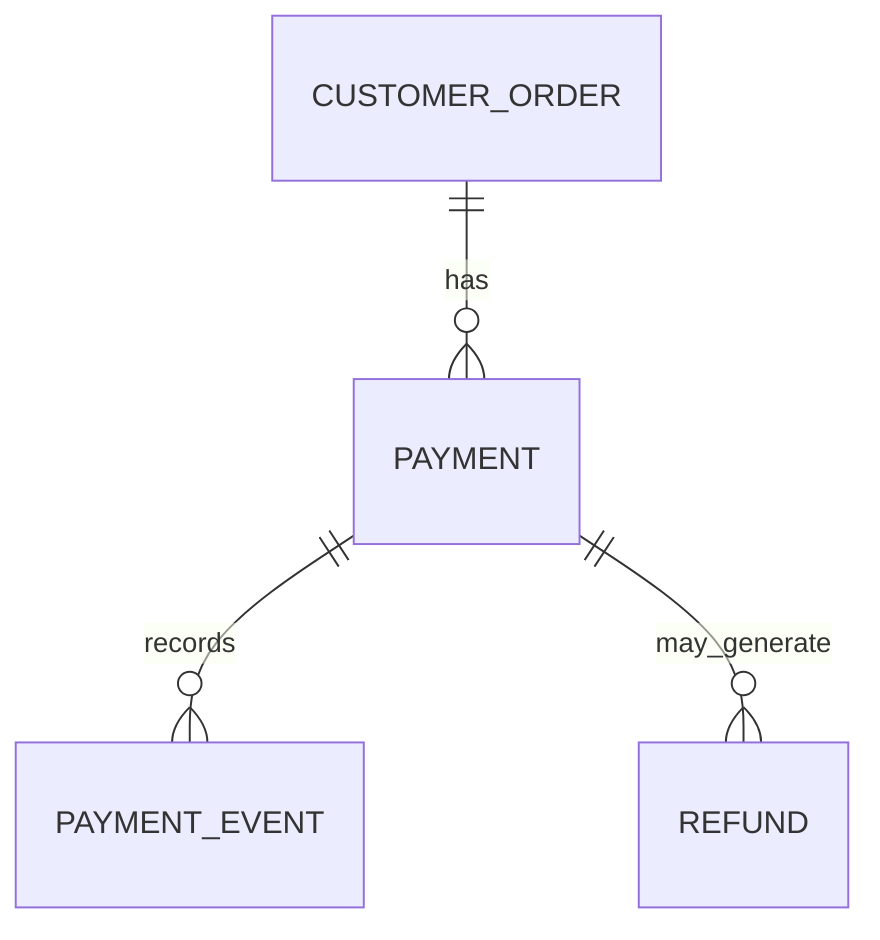

---

# 12. Entregas y repartidores

## 12.1. DELIVERY

Representa el proceso de entrega de un pedido.

| Atributo | Tipo | Restricción |
|---|---|---|
| id | Identifier | PK |
| order_id | Identifier | FK, único |
| status | Enum | PENDING_ASSIGNMENT, ASSIGNED, PICKED_UP, IN_TRANSIT, DELIVERED, FAILED, CANCELED |
| pickup_address_snapshot | JSON | Obligatorio |
| destination_address_snapshot | JSON | Obligatorio |
| assigned_at | DateTime | Opcional |
| picked_up_at | DateTime | Opcional |
| delivered_at | DateTime | Opcional |
| created_at | DateTime | Obligatorio |
| updated_at | DateTime | Obligatorio |
| version | Integer | Obligatorio |

Cada pedido del MVP tendrá como máximo una entrega activa asociada.

## 12.2. DELIVERY_ASSIGNMENT

Representa una asignación a un repartidor.

| Atributo | Tipo | Restricción |
|---|---|---|
| id | Identifier | PK |
| delivery_id | Identifier | FK |
| driver_profile_id | Identifier | FK |
| status | Enum | ACTIVE, REVOKED, COMPLETED |
| assigned_at | DateTime | Obligatorio |
| ended_at | DateTime | Opcional |
| assigned_by_account_id | Identifier | FK opcional |

**Restricción:** Una entrega tendrá como máximo una asignación ACTIVE.

Las asignaciones históricas deberán conservarse.

## 12.3. DELIVERY_STATUS_EVENT

Registra cambios de estado de entrega.

| Atributo | Tipo | Restricción |
|---|---|---|
| id | Identifier | PK |
| delivery_id | Identifier | FK |
| previous_status | Enum | Opcional |
| new_status | Enum | Obligatorio |
| actor_account_id | Identifier | FK opcional |
| occurred_at | DateTime | Obligatorio |
| notes | String | Opcional |

## 12.4. INCIDENT

Representa una incidencia operativa.

| Atributo | Tipo | Restricción |
|---|---|---|
| id | Identifier | PK |
| order_id | Identifier | FK opcional |
| delivery_id | Identifier | FK opcional |
| reported_by_account_id | Identifier | FK |
| assigned_admin_account_id | Identifier | FK opcional |
| category | Enum | Catálogo controlado |
| description | Text | Obligatorio |
| status | Enum | OPEN, IN_REVIEW, RESOLVED, CLOSED |
| resolution_notes | Text | Opcional |
| created_at | DateTime | Obligatorio |
| updated_at | DateTime | Obligatorio |

Una incidencia deberá vincularse al menos con un pedido o una entrega.

## 12.5. Diagrama de entregas

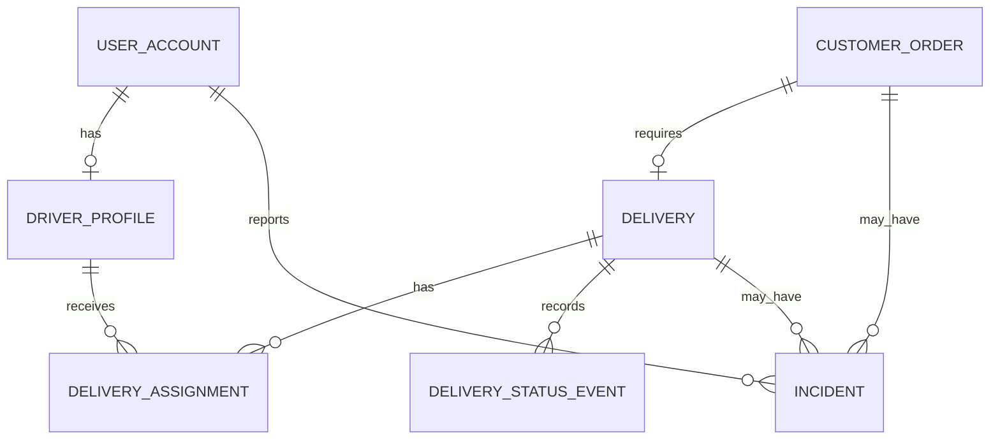

---

# 13. Notificaciones

## 13.1. DEVICE_REGISTRATION

Registra dispositivos habilitados para notificaciones.

| Atributo | Tipo | Restricción |
|---|---|---|
| id | Identifier | PK |
| account_id | Identifier | FK |
| platform | Enum | WEB, ANDROID, IOS |
| token_reference | String | Identificador protegido |
| notifications_enabled | Boolean | Obligatorio |
| last_seen_at | DateTime | Opcional |
| created_at | DateTime | Obligatorio |

El soporte efectivo para acciones interactivas dependerá de la plataforma y de los permisos del dispositivo.

## 13.2. NOTIFICATION

Representa una notificación lógica.

| Atributo | Tipo | Restricción |
|---|---|---|
| id | Identifier | PK |
| account_id | Identifier | FK |
| proposal_id | Identifier | FK opcional |
| order_id | Identifier | FK opcional |
| notification_type | Enum | PROPOSAL, ORDER_STATUS, DELIVERY_STATUS, SYSTEM |
| title | String | Obligatorio |
| message | Text | Obligatorio |
| status | Enum | PENDING, SENT, FAILED, CANCELED |
| created_at | DateTime | Obligatorio |
| read_at | DateTime | Opcional |

## 13.3. NOTIFICATION_ATTEMPT

Registra intentos de envío.

| Atributo | Tipo | Restricción |
|---|---|---|
| id | Identifier | PK |
| notification_id | Identifier | FK |
| device_registration_id | Identifier | FK opcional |
| attempt_number | Integer | Mayor que cero |
| provider | String | Opcional |
| status | Enum | PENDING, SENT, FAILED |
| error_code | String | Opcional |
| attempted_at | DateTime | Obligatorio |

La entrega de una notificación no equivale a la confirmación de una propuesta.

## 13.4. Diagrama de notificaciones

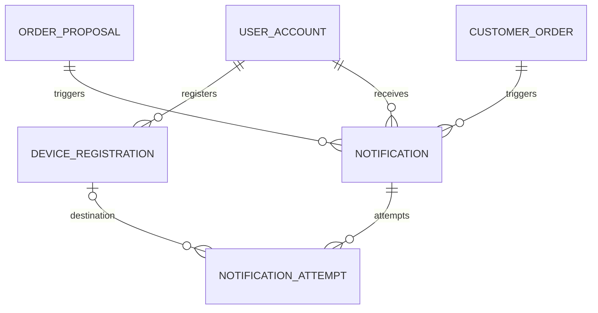

---

# 14. Auditoría e idempotencia

## 14.1. AUDIT_EVENT

Representa un evento de auditoría.

| Atributo | Tipo | Restricción |
|---|---|---|
| id | Identifier | PK |
| actor_account_id | Identifier | FK opcional |
| action | String | Obligatorio |
| resource_type | String | Obligatorio |
| resource_id | Identifier | Obligatorio |
| result | Enum | SUCCESS, FAILURE |
| correlation_id | String | Obligatorio |
| metadata | JSON | Datos no sensibles |
| occurred_at | DateTime | Obligatorio |

Los registros deberán evitar contraseñas, tokens, información completa de tarjetas y datos personales innecesarios.

## 14.2. IDEMPOTENCY_RECORD

Controla operaciones críticas repetidas.

| Atributo | Tipo | Restricción |
|---|---|---|
| id | Identifier | PK |
| operation_scope | String | Obligatorio |
| idempotency_key | String | Obligatorio |
| request_fingerprint | String | Obligatorio |
| status | Enum | PROCESSING, COMPLETED, FAILED |
| resource_type | String | Opcional |
| resource_id | Identifier | Opcional |
| result_reference | String | Opcional |
| created_at | DateTime | Obligatorio |
| expires_at | DateTime | Según operación |

**Unicidad:** `(operation_scope, idempotency_key)`.

Si se reutiliza una clave con parámetros distintos, la operación deberá rechazarse.

El periodo de retención deberá cubrir los reintentos legítimos y las necesidades de conciliación.

---

# 15. Relaciones y cardinalidades principales

| Entidad origen | Entidad destino | Cardinalidad | Descripción |
|---|---|---|---|
| USER_ACCOUNT | CUSTOMER_PROFILE | 1 a 0..1 | Perfil consumidor. |
| USER_ACCOUNT | RESTAURANT | 1 a 0..1 | Establecimiento responsable en el MVP. |
| USER_ACCOUNT | DRIVER_PROFILE | 1 a 0..1 | Perfil de repartidor. |
| USER_ACCOUNT | ADDRESS | 1 a 0..N | Direcciones registradas. |
| CUSTOMER_PROFILE | FOOD_PREFERENCE | 1 a 0..N | Preferencias. |
| CUSTOMER_PROFILE | FOOD_RESTRICTION | 1 a 0..N | Restricciones. |
| RESTAURANT | PRODUCT | 1 a 0..N | Catálogo. |
| PRODUCT | PRODUCT_INGREDIENT | 1 a 0..N | Declaraciones alimenticias. |
| USER_ACCOUNT | RECURRING_SCHEDULE | 1 a 0..N | Programaciones. |
| RECURRING_SCHEDULE | SCHEDULE_OCCURRENCE | 1 a 0..N | Ocurrencias. |
| SCHEDULE_OCCURRENCE | ORDER_PROPOSAL | 1 a 0..N | Propuestas históricas. |
| ORDER_PROPOSAL | CUSTOMER_ORDER | 1 a 0..1 | Pedido originado. |
| USER_ACCOUNT | CUSTOMER_ORDER | 1 a 0..N | Compras. |
| RESTAURANT | CUSTOMER_ORDER | 1 a 0..N | Pedidos recibidos. |
| CUSTOMER_ORDER | ORDER_ITEM | 1 a 1..N | Productos comprados. |
| CUSTOMER_ORDER | PAYMENT | 1 a 0..N | Intentos y operaciones de pago. |
| CUSTOMER_ORDER | DELIVERY | 1 a 0..1 | Entrega. |
| DELIVERY | DELIVERY_ASSIGNMENT | 1 a 0..N | Asignaciones históricas. |
| DRIVER_PROFILE | DELIVERY_ASSIGNMENT | 1 a 0..N | Entregas asignadas. |
| USER_ACCOUNT | NOTIFICATION | 1 a 0..N | Notificaciones. |
| NOTIFICATION | NOTIFICATION_ATTEMPT | 1 a 0..N | Intentos de envío. |

---

# 16. Estados y transiciones

## 16.1. Programación

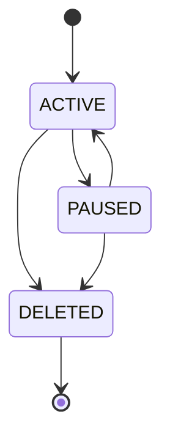

## 16.2. Propuesta

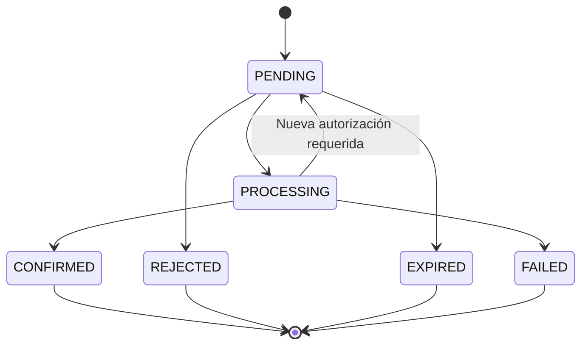

## 16.3. Pedido

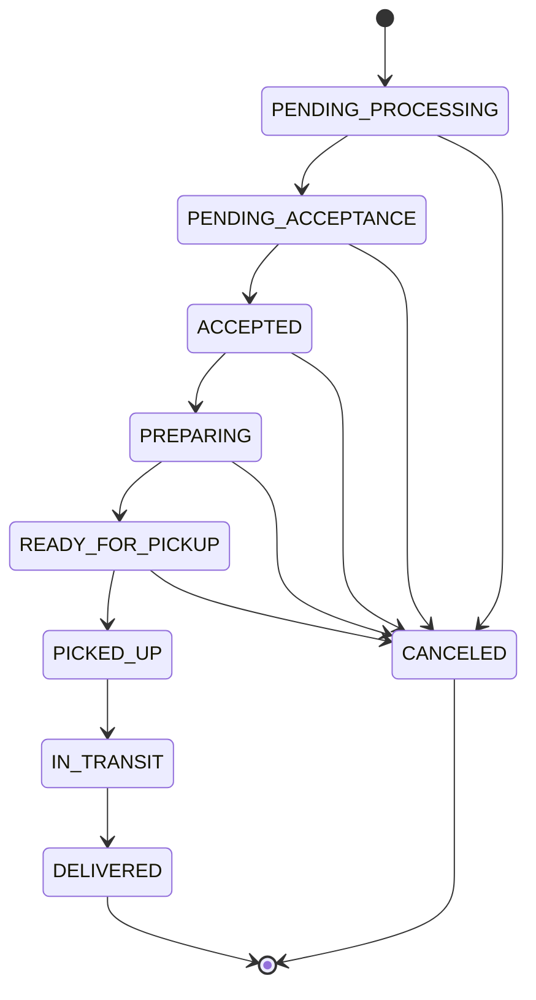

Las cancelaciones después de la recolección requerirán un procedimiento de excepción, no una transición ordinaria automática.

---

# 17. Restricciones de integridad

## 17.1. Identidad

- Correo único normalizado.
- Rol válido.
- Sesiones revocables.
- Propiedad verificable.

## 17.2. Catálogo

- Productos vinculados a un restaurante.
- Cantidades mayores que cero.
- Importes no negativos.
- Moneda consistente.
- Declaraciones alimenticias diferenciadas entre completas e incompletas.

## 17.3. Programaciones

- Modalidad válida.
- Al menos un día de repetición.
- Zona horaria definida.
- Configuración fija con productos propios del restaurante.
- Restricciones de recomendación aplicables.
- Ocurrencias únicas.
- Propuestas sin duplicación activa.

## 17.4. Pedidos

- Una propuesta produce como máximo un pedido.
- Los pedidos recurrentes requieren confirmación válida.
- Los productos del pedido pertenecen a un solo restaurante.
- Los importes deben reconciliar con el detalle.
- Los estados deben seguir transiciones permitidas.

## 17.5. Pagos

- Claves idempotentes.
- Referencias externas únicas en su ámbito.
- Reembolsos no superiores a importes capturados.
- Estados de pago consistentes con los resultados del proveedor.

## 17.6. Entregas

- Una entrega por pedido en el MVP.
- Una asignación activa como máximo por entrega.
- Repartidor habilitado.
- Recolección posterior al estado listo.
- Finalización por el repartidor asignado.

---

# 18. Consistencia y concurrencia

Coconea deberá proteger las operaciones críticas ante solicitudes simultáneas.

### 18.1. Confirmaciones concurrentes

Dos confirmaciones simultáneas de una propuesta no podrán generar dos pedidos.

### 18.2. Expiración y confirmación

Si una propuesta expira mientras se procesa una confirmación, solo una transición válida deberá prevalecer.

### 18.3. Pagos y persistencia

Los pagos externos y los cambios internos deberán coordinarse mediante mecanismos de idempotencia y conciliación.

### 18.4. Asignación de repartidores

Dos procesos de asignación no podrán crear dos asignaciones activas para la misma entrega.

### 18.5. Modificaciones de catálogo

Los cambios de precio o disponibilidad deberán verificarse antes de completar una compra.

Las técnicas concretas de bloqueo, transacciones y procesamiento asíncrono se seleccionarán durante el diseño técnico.

---

# 19. Privacidad y conservación de datos

El modelo deberá respetar los siguientes principios:

1. Recolectar únicamente información necesaria.
2. Restringir el acceso a preferencias y restricciones alimenticias.
3. No almacenar credenciales en texto plano.
4. No almacenar información completa de tarjetas.
5. Evitar datos personales innecesarios en auditoría.
6. Definir periodos de retención por categoría.
7. Conservar información histórica necesaria para operaciones y obligaciones aplicables.
8. Permitir solicitudes de acceso, corrección y eliminación según la normativa correspondiente.

La implementación de estos controles se detallará en `12-seguridad.md`.

---

# 20. Organización del modelo dentro del Monorepo

La arquitectura Monorepo permitirá mantener los contratos de datos y la lógica de dominio organizados sin duplicarlos entre aplicaciones.

La estructura prevista es:

```text
coconea/
├── apps/
│   ├── customer/
│   ├── restaurant/
│   ├── delivery/
│   ├── admin/
│   └── api/
│
├── packages/
│   ├── shared/
│   ├── types/
│   ├── validation/
│   └── config/
│
├── docs/
│   └── 09-modelo-de-datos.md
│
├── infrastructure/
└── scripts/
```

### Responsabilidades propuestas

| Ubicación | Responsabilidad |
|---|---|
| `apps/api/` | Aplicación de reglas de negocio y acceso a datos. |
| `packages/types/` | Contratos y tipos compartidos. |
| `packages/validation/` | Validaciones reutilizables, sin sustituir las del servidor. |
| `packages/shared/` | Utilidades comunes sin dependencias indebidas. |
| `infrastructure/` | Configuración de servicios y persistencia. |
| `docs/` | Documentación conceptual y técnica. |

La ubicación definitiva de esquemas, migraciones y herramientas de persistencia dependerá del stack seleccionado.

Las aplicaciones cliente no deberán acceder directamente a datos privados de otros actores.

---

# 21. Matriz de trazabilidad

| Dominio | Entidades principales | RF | RN |
|---|---|---|---|
| Identidad | USER_ACCOUNT, AUTH_SESSION | RF-001 a RF-006 | RN-001 a RN-005 |
| Perfil alimenticio | CUSTOMER_PROFILE, FOOD_PREFERENCE, FOOD_RESTRICTION | RF-007 a RF-010 | RN-006 a RN-011 |
| Restaurantes | RESTAURANT, RESTAURANT_HOURS, SERVICE_ZONE | RF-011, RF-043, RF-059, RF-060 | RN-012, RN-015, RN-016 |
| Catálogo | PRODUCT, PRODUCT_INGREDIENT, PRODUCT_CATEGORY | RF-012 a RF-017 | RN-008, RN-009, RN-013, RN-014 |
| Carrito | SHOPPING_CART, CART_ITEM | RF-018, RF-019 | RN-017 |
| Programaciones | RECURRING_SCHEDULE, SCHEDULE_WEEKDAY, SCHEDULE_OCCURRENCE | RF-021 a RF-029 | RN-018 a RN-026 |
| Recomendaciones | SCHEDULE_CATEGORY, SCHEDULE_RESTRICTION | RF-014, RF-022, RF-030 | RN-027 a RN-030 |
| Propuestas | ORDER_PROPOSAL, PROPOSAL_ITEM, PROPOSAL_CONFIRMATION | RF-029 a RF-036 | RN-025, RN-030 a RN-038 |
| Pedidos | CUSTOMER_ORDER, ORDER_ITEM, ORDER_STATUS_EVENT | RF-020, RF-038, RF-040 a RF-042 | RN-044 a RN-047, RN-058 |
| Pagos | PAYMENT, PAYMENT_EVENT, REFUND | RF-039, RF-061 | RN-039 a RN-043 |
| Entregas | DELIVERY, DELIVERY_ASSIGNMENT, DELIVERY_STATUS_EVENT | RF-047 a RF-050 | RN-051 a RN-054 |
| Incidencias | INCIDENT | RF-051, RF-056 | RN-055 |
| Notificaciones | DEVICE_REGISTRATION, NOTIFICATION, NOTIFICATION_ATTEMPT | RF-031, RF-033, RF-037 | RN-062 a RN-064 |
| Auditoría | AUDIT_EVENT, IDEMPOTENCY_RECORD | RF-061, RF-062, RF-063 | RN-059 a RN-061, RN-066 |

---

# 22. Criterios de aceptación del modelo

El modelo se considerará preparado para la fase de implementación cuando:

1. Todas las entidades principales del MVP estén identificadas.
2. Cada entidad tenga una clave primaria.
3. Las relaciones obligatorias estén definidas.
4. Las cardinalidades sean consistentes.
5. Los datos alimenticios permitan evaluar compatibilidad.
6. Las programaciones fijas y variables puedan representarse.
7. Las ocurrencias puedan procesarse sin duplicaciones.
8. Las propuestas conserven sus condiciones económicas.
9. Las confirmaciones puedan auditarse.
10. Los pedidos conserven información histórica.
11. Los pagos permitan conciliación.
12. Los reembolsos sean rastreables.
13. Las entregas admitan reasignación controlada.
14. Los estados sean verificables.
15. La autorización pueda aplicarse por rol y propiedad.
16. El modelo pueda implementarse sin depender de una tecnología específica.

## 23. Decisiones pendientes

Antes de convertir este diseño lógico en un esquema físico deberán resolverse:

- Motor de base de datos.
- Formato definitivo de identificadores.
- Estrategia de migraciones.
- Manejo físico de tipos enumerados.
- Representación geográfica de cobertura.
- Estrategia de transacciones y concurrencia.
- Procesamiento de tareas programadas.
- Proveedor de pagos.
- Proveedor de notificaciones.
- Periodos de retención.
- Políticas definitivas de cancelación.
- Índices y optimización de consultas.

Estas decisiones se documentarán durante el diseño de arquitectura y la selección del stack.

## 24. Conclusión

El modelo de datos propuesto establece una base conceptual y lógica para Coconea, cubriendo los principales procesos de usuarios, restaurantes, repartidores y administradores.

Su característica central es la separación entre programaciones, ocurrencias, propuestas y pedidos, lo que permite implementar pedidos recurrentes sin realizar compras automáticas no autorizadas.

También se han contemplado mecanismos de integridad, idempotencia, auditoría, conservación histórica y control de acceso.

Este documento servirá como referencia para la arquitectura del sistema, el diseño de la API y la implementación posterior de la persistencia.

---

**Coconea — Planifica tu alimentación, confirma y recibe.**