# Arquitectura de Software de Coconea

**Proyecto:** Coconea  
**Versión:** 1.0  
**Estado:** Diseño arquitectónico  
**Alcance:** Producto Mínimo Viable (MVP)  
**Organización del código:** Monorepo  
**Stack tecnológico:** Pendiente de selección

---

## 1. Introducción

Este documento define la arquitectura de software propuesta para Coconea, una plataforma de entrega de alimentos que permite realizar pedidos convencionales y programar pedidos recurrentes según las preferencias y restricciones alimenticias de sus usuarios.

La arquitectura debe soportar cuatro actores principales:

- **USER:** consumidor que explora restaurantes, configura preferencias y realiza pedidos.
- **RESTAURANT:** establecimiento que administra su catálogo y prepara pedidos.
- **DELIVERY:** repartidor que recibe asignaciones y realiza entregas.
- **ADMIN:** administrador que supervisa la operación.

La plataforma contará con aplicaciones diferenciadas para cada actor y un backend central responsable de las reglas de negocio, la persistencia y las integraciones.

Su característica más importante será el procesamiento de pedidos recurrentes mediante dos modalidades:

1. **Programación fija:** restaurante y productos definidos por el usuario.
2. **Programación por recomendaciones:** selección de productos mediante reglas de compatibilidad y disponibilidad.

En ambas modalidades, cada propuesta requerirá autorización explícita antes de convertirse en una compra.

## 2. Objetivos arquitectónicos

La arquitectura debe:

1. Permitir el desarrollo organizado dentro de un Monorepo.
2. Separar responsabilidades entre aplicaciones y dominios.
3. Reutilizar contratos y validaciones sin duplicar lógica crítica.
4. Centralizar la aplicación de reglas de negocio.
5. Soportar pedidos convencionales y recurrentes.
6. Procesar tareas programadas sin bloquear las solicitudes normales.
7. Evitar compras y cargos duplicados.
8. Mantener consistencia entre pedidos, pagos y entregas.
9. Proteger información personal y alimenticia.
10. Permitir auditoría y diagnóstico de operaciones.
11. Facilitar pruebas automatizadas.
12. Mantener la posibilidad de evolución sin introducir complejidad innecesaria en el MVP.

---

# 3. Decisiones arquitectónicas principales

| ID | Decisión | Justificación |
|---|---|---|
| DA-001 | Utilizar un Monorepo. | Mantener aplicaciones, contratos y documentación en un solo repositorio. |
| DA-002 | Separar las cuatro interfaces por actor. | Simplificar navegación, permisos y responsabilidades. |
| DA-003 | Utilizar una API central. | Centralizar autorización, operaciones y reglas de negocio. |
| DA-004 | Adoptar un monolito modular como punto de partida. | Reducir complejidad operativa durante el MVP. |
| DA-005 | Separar lógicamente los módulos de dominio. | Evitar acoplamiento y facilitar crecimiento. |
| DA-006 | Ejecutar tareas recurrentes fuera del ciclo de solicitudes interactivas. | Proteger el rendimiento y permitir reintentos. |
| DA-007 | Tratar los pagos como operaciones externas no atómicas. | Permitir conciliación y recuperación segura. |
| DA-008 | Exigir autorización explícita para cada propuesta recurrente. | Evitar compras automáticas no autorizadas. |
| DA-009 | Utilizar contratos compartidos versionados. | Mantener compatibilidad entre clientes y API. |
| DA-010 | Diseñar observabilidad desde el MVP. | Facilitar diagnóstico, auditoría y mantenimiento. |

Estas decisiones son lógicas y no obligan a utilizar herramientas específicas.

## 3.1. ¿Por qué un monolito modular?

Para el MVP se propone un backend central organizado en módulos con responsabilidades delimitadas.

Esto permite:

- Desarrollar y probar una sola aplicación de backend.
- Evitar la complejidad inicial de múltiples microservicios.
- Mantener transacciones internas más sencillas.
- Compartir infraestructura de autenticación y observabilidad.
- Extraer módulos a servicios independientes en el futuro, si existe una necesidad comprobada.

**Monorepo y monolito modular no son lo mismo.**

El Monorepo describe cómo se organiza el código fuente; el monolito modular describe cómo se organiza y despliega inicialmente el backend.

---

# 4. Arquitectura general

## 4.1. Vista de contexto

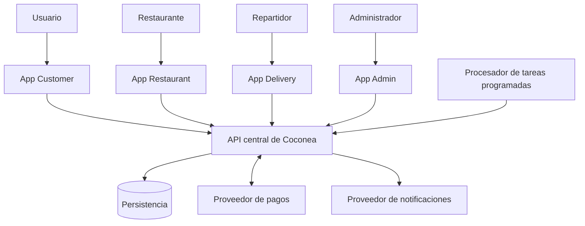

El procesador de tareas deberá utilizar interfaces internas controladas. La flecha hacia la API representa una integración lógica, no necesariamente una solicitud HTTP pública.

## 4.2. Principios de comunicación

Las aplicaciones cliente se comunicarán con el backend mediante interfaces autenticadas y contratos definidos.

Ninguna aplicación cliente tendrá acceso directo a la base de datos principal.

El backend será responsable de:

- Autenticación y autorización.
- Validación de operaciones.
- Ejecución de reglas de negocio.
- Coordinación de pagos.
- Gestión de estados.
- Persistencia.
- Publicación de eventos y notificaciones.

Las aplicaciones mostrarán información, capturarán acciones y gestionarán la experiencia del usuario.

---

# 5. Estructura del Monorepo

La estructura base será:

```text
coconea/
├── apps/
│   ├── customer/
│   ├── restaurant/
│   ├── delivery/
│   ├── admin/
│   └── api/
│
├── packages/
│   ├── shared/
│   ├── types/
│   ├── validation/
│   └── config/
│
├── docs/
│   ├── 01-descripcion-general.md
│   ├── 02-objetivos-y-alcance.md
│   ├── 03-actores-y-roles.md
│   ├── 04-requerimientos-funcionales.md
│   ├── 05-requerimientos-no-funcionales.md
│   ├── 06-casos-de-uso.md
│   ├── 07-flujos-de-usuario.md
│   ├── 08-reglas-de-negocio.md
│   ├── 09-modelo-de-datos.md
│   ├── 10-arquitectura.md
│   ├── 11-api.md
│   ├── 12-seguridad.md
│   └── 13-stack-tecnologico.md
│
├── infrastructure/
├── scripts/
├── .github/
├── .gitignore
├── .editorconfig
├── README.md
├── CONTRIBUTING.md
├── CHANGELOG.md
└── LICENSE
```

## 5.1. Responsabilidades por directorio

| Directorio | Responsabilidad |
|---|---|
| `apps/customer/` | Experiencia del consumidor. |
| `apps/restaurant/` | Operaciones del restaurante. |
| `apps/delivery/` | Operaciones del repartidor. |
| `apps/admin/` | Supervisión administrativa. |
| `apps/api/` | Backend central y lógica de dominio. |
| `packages/shared/` | Utilidades comunes independientes del negocio crítico. |
| `packages/types/` | Contratos y estructuras compartidas. |
| `packages/validation/` | Esquemas y validaciones reutilizables. |
| `packages/config/` | Configuración compartida no sensible. |
| `infrastructure/` | Definiciones de despliegue e infraestructura. |
| `scripts/` | Automatizaciones de desarrollo y mantenimiento. |
| `docs/` | Documentación funcional y técnica. |

## 5.2. Dependencias permitidas

Las aplicaciones podrán depender de los paquetes compartidos.

El backend podrá utilizar esos mismos paquetes cuando sus contratos sean compatibles.

Los paquetes compartidos no deberán depender de las aplicaciones.

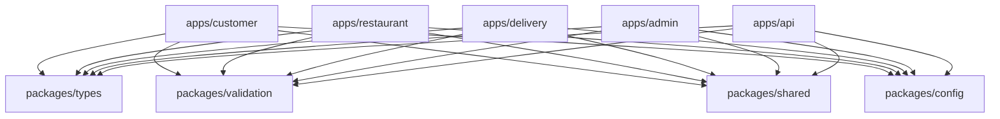

El gráfico muestra dependencias de código, no llamadas de red.

Los paquetes no deben importar lógica interna de `apps/api/`.

---

# 6. Arquitectura de las aplicaciones

## 6.1. Aplicación Customer

**Ubicación:** `apps/customer/`

### Responsabilidades

- Registro e inicio de sesión.
- Gestión de perfil y direcciones.
- Preferencias y restricciones alimenticias.
- Exploración de restaurantes y productos.
- Carrito y pedidos convencionales.
- Creación de programaciones fijas.
- Creación de programaciones por recomendaciones.
- Edición, pausa y omisión de ocurrencias.
- Visualización y confirmación de propuestas.
- Consulta de historial y estados.
- Recepción de notificaciones.

### Módulos de interfaz sugeridos

```text
customer/
├── auth/
├── profile/
├── food-preferences/
├── restaurants/
├── cart/
├── checkout/
├── schedules/
├── proposals/
├── orders/
└── notifications/
```

La estructura interna es conceptual y podrá adaptarse al framework seleccionado.

## 6.2. Aplicación Restaurant

**Ubicación:** `apps/restaurant/`

### Responsabilidades

- Autenticación del responsable.
- Configuración del establecimiento.
- Gestión de horarios.
- Administración de productos.
- Declaración de ingredientes y alérgenos.
- Gestión de disponibilidad y precios.
- Recepción de pedidos.
- Aceptación o rechazo.
- Actualización de preparación.
- Marcado de pedidos listos.

### Módulos sugeridos

```text
restaurant/
├── auth/
├── establishment/
├── hours/
├── catalog/
├── ingredients/
├── orders/
└── notifications/
```

El restaurante únicamente podrá operar sobre sus propios recursos.

## 6.3. Aplicación Delivery

**Ubicación:** `apps/delivery/`

### Responsabilidades

- Autenticación.
- Consulta de disponibilidad.
- Visualización de entregas asignadas.
- Consulta de origen y destino.
- Confirmación de recolección.
- Actualización de estado.
- Confirmación de entrega.
- Reporte de incidencias.
- Consulta de historial.

### Módulos sugeridos

```text
delivery/
├── auth/
├── availability/
├── assignments/
├── pickup/
├── deliveries/
├── incidents/
└── history/
```

El MVP no requiere seguimiento GPS continuo.

## 6.4. Aplicación Admin

**Ubicación:** `apps/admin/`

### Responsabilidades

- Autenticación administrativa.
- Gestión de cuentas.
- Supervisión de restaurantes.
- Gestión de repartidores.
- Consulta de pedidos.
- Supervisión de incidencias.
- Consulta de métricas básicas.
- Revisión de auditoría autorizada.

### Módulos sugeridos

```text
admin/
├── auth/
├── users/
├── restaurants/
├── drivers/
├── orders/
├── incidents/
├── metrics/
└── audit/
```

La administración no podrá realizar compras en nombre de un usuario sin una autorización válida.

---

# 7. Arquitectura interna del backend

**Ubicación:** `apps/api/`

Se propone organizar el backend por dominios de negocio, con una separación interna de responsabilidades.

## 7.1. Capas lógicas

### Capa de presentación

Expone los contratos de comunicación hacia las aplicaciones.

Responsabilidades:

- Recibir solicitudes.
- Validar formato.
- Autenticar.
- Aplicar autorización de entrada.
- Transformar datos de entrada y salida.
- Devolver errores consistentes.

### Capa de aplicación

Coordina casos de uso.

Responsabilidades:

- Ejecutar flujos de negocio.
- Coordinar módulos.
- Gestionar límites transaccionales.
- Aplicar idempotencia.
- Solicitar operaciones externas.
- Emitir eventos internos.

### Capa de dominio

Contiene reglas y conceptos de negocio.

Responsabilidades:

- Validar transiciones.
- Evaluar compatibilidad alimenticia.
- Calcular condiciones de propuestas.
- Aplicar políticas de cancelación.
- Mantener invariantes de programación y pedidos.

### Capa de infraestructura

Implementa capacidades técnicas.

Responsabilidades:

- Acceso a persistencia.
- Integraciones externas.
- Envío de notificaciones.
- Procesamiento de tareas.
- Registro de eventos.
- Adaptadores de pago.

## 7.2. Diagrama de capas

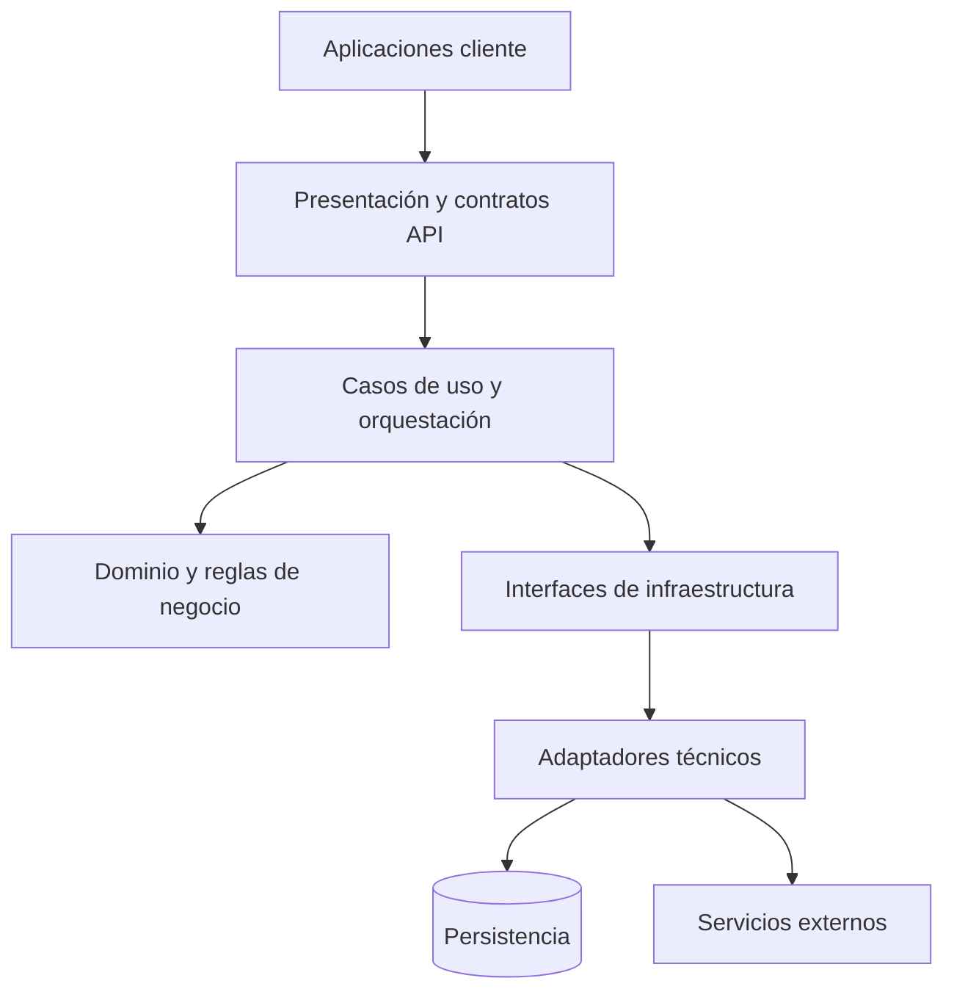

El dominio no deberá depender directamente de un proveedor de pagos, una biblioteca de persistencia ni un framework de interfaz.

---

# 8. Módulos de dominio del backend

Se proponen los siguientes módulos:

| Módulo | Responsabilidad |
|---|---|
| Identity | Cuentas, autenticación y sesiones. |
| Authorization | Roles, permisos y propiedad. |
| Customer | Perfiles y direcciones. |
| FoodProfile | Preferencias y restricciones. |
| Restaurant | Establecimientos y horarios. |
| Catalog | Productos, categorías e ingredientes. |
| Coverage | Zonas y elegibilidad de entrega. |
| Cart | Carritos y cotizaciones. |
| Scheduling | Programaciones y ocurrencias. |
| Recommendation | Selección de productos compatibles. |
| Proposal | Propuestas y confirmaciones. |
| Order | Pedidos y estados. |
| Payment | Cobros, conciliación y reembolsos. |
| Delivery | Asignaciones y entregas. |
| Notification | Mensajes y dispositivos. |
| Incident | Incidencias operativas. |
| Administration | Operaciones administrativas. |
| Audit | Evidencia de acciones críticas. |
| Idempotency | Prevención de efectos duplicados. |

## 8.1. Organización conceptual

```text
apps/api/
├── presentation/
│   ├── routes/
│   ├── middleware/
│   └── contracts/
│
├── application/
│   ├── use-cases/
│   └── orchestration/
│
├── domain/
│   ├── identity/
│   ├── authorization/
│   ├── customer/
│   ├── food-profile/
│   ├── restaurant/
│   ├── catalog/
│   ├── coverage/
│   ├── cart/
│   ├── scheduling/
│   ├── recommendation/
│   ├── proposal/
│   ├── order/
│   ├── payment/
│   ├── delivery/
│   ├── notification/
│   ├── incident/
│   ├── administration/
│   ├── audit/
│   └── idempotency/
│
├── infrastructure/
│   ├── persistence/
│   ├── payments/
│   ├── notifications/
│   ├── scheduling/
│   └── observability/
│
└── bootstrap/
```

La organización definitiva podrá adoptar una estructura por módulos con capas internas. Lo importante es conservar los límites de responsabilidad, no imponer carpetas innecesarias.

---

# 9. Comunicación entre módulos

## 9.1. Comunicación síncrona

Se utilizará cuando una operación requiera una respuesta inmediata.

Ejemplos:

- Consultar restaurantes.
- Validar una dirección.
- Obtener una cotización.
- Confirmar una propuesta.
- Consultar el estado de un pedido.

## 9.2. Comunicación asíncrona

Se utilizará cuando la operación pueda ejecutarse fuera de la solicitud principal.

Ejemplos:

- Generar ocurrencias.
- Enviar notificaciones.
- Reintentar operaciones temporales.
- Procesar eventos de estado.
- Conciliar pagos.

## 9.3. Eventos de dominio

Eventos conceptuales propuestos:

| Evento | Origen | Consumidores |
|---|---|---|
| ScheduleCreated | Scheduling | Audit |
| OccurrenceDue | Scheduling | Proposal |
| ProposalCreated | Proposal | Notification, Audit |
| ProposalConfirmed | Proposal | Order, Audit |
| ProposalExpired | Proposal | Audit |
| OrderCreated | Order | Payment, Audit |
| PaymentCaptured | Payment | Order, Notification |
| OrderAccepted | Order | Delivery, Notification |
| OrderReady | Order | Delivery, Notification |
| DeliveryAssigned | Delivery | Notification |
| OrderDelivered | Delivery | Order, Notification |
| OrderCanceled | Order | Payment, Notification |

Estos eventos no requieren inicialmente un sistema de mensajería distribuido.

Podrán implementarse mediante mecanismos internos o persistentes según las necesidades de confiabilidad.

**Importante:** publicar un evento no debe equivaler a confirmar que todas sus consecuencias se ejecutaron. Los consumidores deben ser idempotentes.

---

# 10. Arquitectura de pedidos convencionales

## 10.1. Flujo principal

1. El usuario selecciona un restaurante.
2. Consulta productos disponibles.
3. Agrega productos al carrito.
4. Selecciona dirección.
5. Solicita una cotización.
6. El backend verifica cobertura, horario, precios y disponibilidad.
7. El usuario confirma las condiciones.
8. Se registra una operación de compra identificable.
9. Se procesa el pago de forma segura.
10. Se establece el pedido en el estado correspondiente.
11. El restaurante recibe el pedido cuando el procesamiento económico lo permite.

## 10.2. Diagrama de secuencia

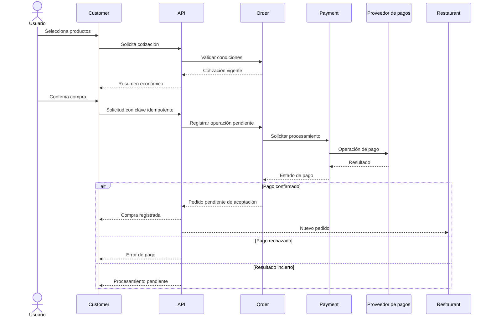

Las respuestas del proveedor pueden ser asíncronas. La aplicación no deberá asumir que un tiempo de espera equivale a un pago fallido.

---

# 11. Arquitectura de pedidos recurrentes

## 11.1. Componentes involucrados

- Scheduling.
- Recommendation.
- Proposal.
- Catalog.
- FoodProfile.
- Coverage.
- Notification.
- Payment.
- Order.
- Idempotency.
- Audit.

## 11.2. Programación fija

El usuario selecciona:

- Restaurante.
- Productos.
- Cantidades.
- Días.
- Horario.
- Dirección.

Cuando llega una ocurrencia, el sistema verifica si los productos y el restaurante continúan disponibles.

Si las condiciones son válidas, genera una propuesta.

El usuario deberá confirmarla antes de realizar una compra.

## 11.3. Programación por recomendaciones

El usuario selecciona:

- Categorías alimenticias.
- Restricciones aplicables.
- Días.
- Horario.
- Dirección.

Cuando llega una ocurrencia, el sistema:

1. Identifica restaurantes elegibles.
2. Comprueba cobertura y horario.
3. Consulta productos disponibles.
4. Excluye incompatibilidades conocidas.
5. Descarta productos sin información suficiente para afirmar compatibilidad.
6. Aplica reglas de selección.
7. Genera una propuesta concreta.
8. Solicita confirmación.

Las recomendaciones del MVP estarán basadas en reglas, no en inteligencia artificial avanzada.

## 11.4. Diagrama de generación

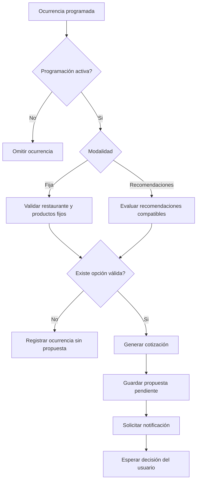

## 11.5. Garantías necesarias

- Una ocurrencia debe tener identidad estable.
- Los reintentos no deben duplicar propuestas activas.
- La propuesta debe tener vencimiento.
- La programación no autoriza cobros.
- Una propuesta rechazada no genera pedido.
- Una propuesta expirada no genera pedido.
- Las condiciones deben revalidarse al confirmar.

---

# 12. Procesador de tareas programadas

## 12.1. Responsabilidad

El procesador identificará las ocurrencias pendientes y coordinará su ejecución.

Deberá funcionar independientemente del ciclo normal de solicitudes interactivas.

## 12.2. Diseño lógico

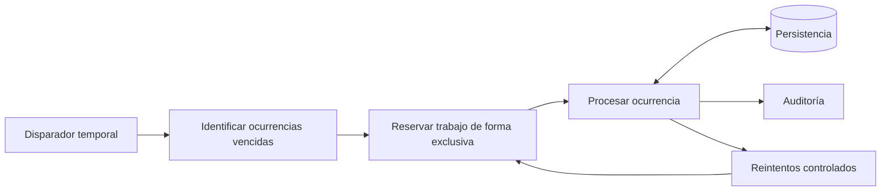

## 12.3. Requisitos operativos

- Evitar que dos ejecutores procesen simultáneamente la misma ocurrencia.
- Registrar intentos.
- Recuperar trabajos interrumpidos.
- Respetar zonas horarias.
- Gestionar horarios ambiguos o inexistentes por cambios de horario.
- No generar propuestas para programaciones pausadas.
- No repetir efectos ya completados.
- Registrar errores y resultados.

## 12.4. Recuperación

Ante una interrupción:

1. Identificar trabajos incompletos.
2. Verificar el estado persistido.
3. Recuperar operaciones seguras.
4. Reintentar únicamente acciones idempotentes.
5. Registrar el resultado.

El mecanismo concreto de planificación y ejecución se seleccionará más adelante.

---

# 13. Arquitectura de confirmaciones

## 13.1. Confirmación dentro de la aplicación

1. El usuario abre la propuesta.
2. El sistema muestra productos, precios, cargos, dirección y vigencia.
3. El usuario confirma.
4. El backend verifica identidad y propiedad.
5. Comprueba vigencia y estado.
6. Revalida condiciones.
7. Registra la autorización.
8. Coordina la compra y el pago.
9. Devuelve el resultado o un estado pendiente de procesamiento.

## 13.2. Confirmación desde notificación

Cuando el dispositivo lo permita:

1. Se presenta una notificación interactiva.
2. El usuario selecciona confirmar.
3. La acción se transmite a un punto de entrada seguro.
4. El backend autentica y autoriza la solicitud.
5. Se comprueba la propuesta y la versión de cotización.
6. Si las condiciones son válidas, continúa el procesamiento.
7. Si falta autenticación o cambian las condiciones, se abre la aplicación para revisión.

**Una notificación nunca representa autorización por el simple hecho de haber sido entregada o abierta.**

## 13.3. Diagrama de confirmación

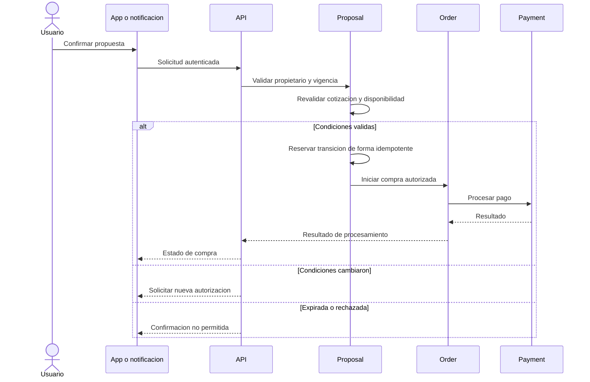

## 13.4. Estados de propuesta

- PENDING.
- PROCESSING.
- CONFIRMED.
- REJECTED.
- EXPIRED.
- FAILED.

El estado CONFIRMED se utilizará cuando la compra autorizada haya alcanzado el resultado definido como exitoso por la política de procesamiento.

Una propuesta en PROCESSING no podrá generar una segunda compra por una solicitud repetida.

---

# 14. Arquitectura de pagos

## 14.1. Principios

- Ningún cargo sin autorización.
- Uso de un proveedor especializado.
- No almacenar información completa de tarjetas.
- Operaciones identificables.
- Claves idempotentes.
- Conciliación de resultados inciertos.
- Reembolsos rastreables.
- Separación entre estado de pedido y estado de pago.

## 14.2. Adaptador de pagos

El módulo Payment expondrá operaciones lógicas como:

- Crear intención de pago.
- Consultar estado.
- Confirmar resultado.
- Solicitar reembolso.
- Consultar reembolso.
- Procesar eventos del proveedor.

El resto del dominio no deberá depender directamente del formato particular de un proveedor.

## 14.3. Manejo de resultados

| Resultado | Comportamiento |
|---|---|
| Confirmado | Actualizar estado económico y continuar el flujo. |
| Rechazado | No marcar como pagado ni liberar a preparación. |
| Pendiente | Mantener estado intermedio controlado. |
| Desconocido | Conciliar antes de reintentar. |
| Duplicado | Recuperar resultado previo. |
| Reembolsado | Registrar referencia, importe y estado. |

## 14.4. Consistencia entre sistemas

La base de datos de Coconea y el proveedor de pagos no comparten necesariamente una transacción atómica.

Por ello, se requerirán mecanismos de:

- Persistencia de operaciones pendientes.
- Idempotencia.
- Recepción segura de eventos.
- Conciliación.
- Recuperación.
- Compensación o reembolso cuando corresponda.

No deberá repetirse un cargo independiente simplemente porque una respuesta no llegó.

---

# 15. Arquitectura de notificaciones

## 15.1. Tipos

- Propuesta disponible.
- Propuesta próxima a expirar, si se habilita.
- Pedido confirmado.
- Pedido aceptado o rechazado.
- Pedido en preparación.
- Pedido listo.
- Pedido en camino.
- Pedido entregado.
- Incidencia relevante.

## 15.2. Flujo

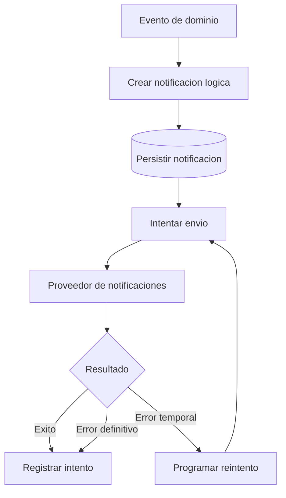

## 15.3. Reglas

- Registrar intentos.
- No duplicar operaciones económicas por notificaciones repetidas.
- Respetar vigencia de propuestas.
- Permitir consulta dentro de la aplicación.
- Evitar información sensible innecesaria en pantallas bloqueadas.
- Proteger las acciones interactivas mediante autenticación y autorización.

---

# 16. Arquitectura de restaurantes

El módulo Restaurant gestionará el establecimiento y sus condiciones operativas.

El módulo Catalog gestionará los productos y su información alimenticia.

El módulo Order coordinará la aceptación y preparación.

## 16.1. Flujo operativo

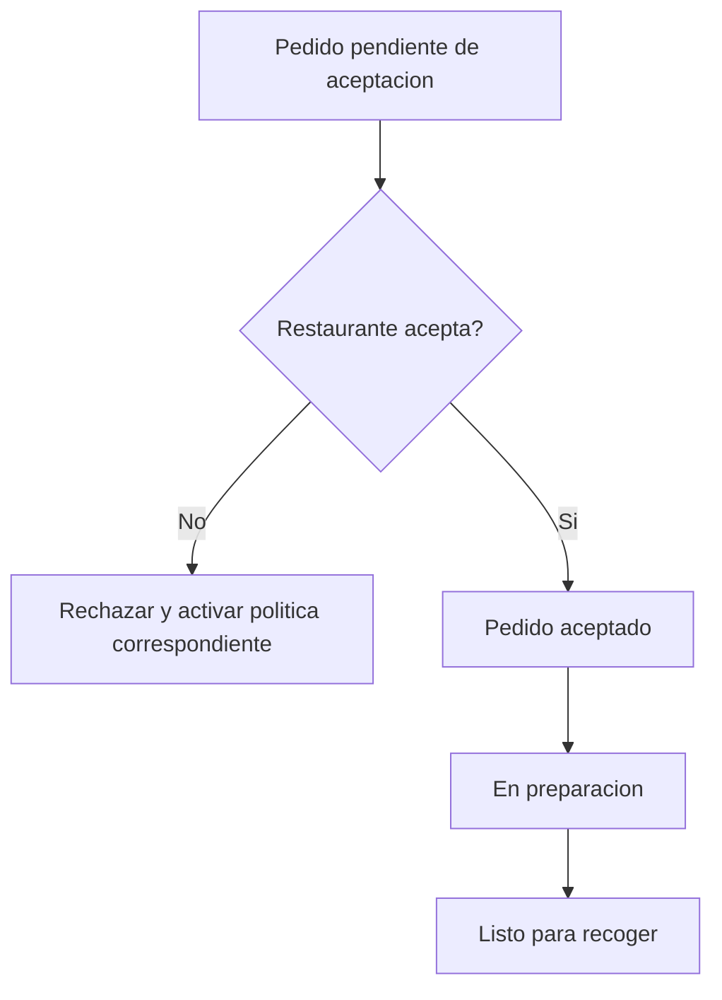

Las acciones deberán verificar que el restaurante sea propietario del pedido.

Los rechazos posteriores al pago deberán activar la política de cancelación y reembolso aplicable.

---

# 17. Arquitectura de entregas

## 17.1. Asignación

El MVP utilizará un mecanismo básico de asignación de repartidores.

Se comprobarán:

- Cuenta habilitada.
- Disponibilidad operativa.
- Elegibilidad para la entrega.
- Ausencia de asignación activa incompatible.

No se requiere optimización avanzada de rutas.

## 17.2. Flujo de entrega

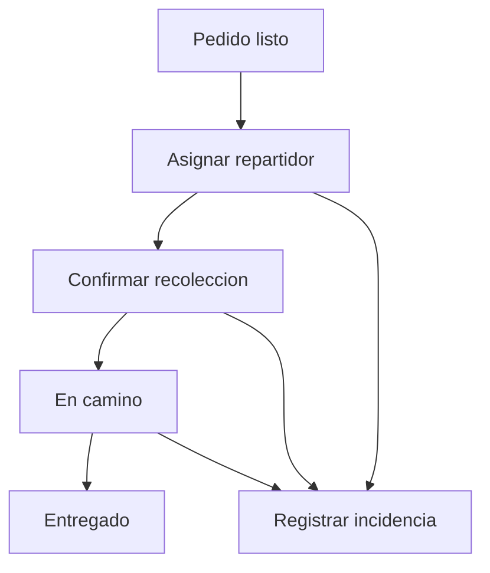

Una incidencia no implica automáticamente que el pedido esté cancelado.

## 17.3. Reasignación

Cuando sea necesario:

1. Registrar el motivo.
2. Revocar la asignación anterior.
3. Verificar la elegibilidad del nuevo repartidor.
4. Crear una nueva asignación activa.
5. Conservar el historial.

Nunca deberán existir dos asignaciones activas para una misma entrega.

---

# 18. Seguridad arquitectónica

## 18.1. Autenticación

Toda operación protegida deberá identificar al actor.

Las sesiones deberán tener mecanismos de expiración y revocación.

## 18.2. Autorización

Se aplicarán dos niveles:

1. **Autorización por rol:** determinar si un actor puede realizar una categoría de operación.
2. **Autorización por recurso:** comprobar si puede actuar sobre ese objeto específico.

Ejemplos:

- Un usuario solo consulta sus pedidos.
- Un restaurante solo administra sus productos.
- Un repartidor solo modifica entregas asignadas.
- Un administrador solo realiza operaciones incluidas en sus permisos.

## 18.3. Protección de datos

- Comunicación cifrada.
- Contraseñas protegidas.
- Secretos fuera del código fuente.
- Validación de entradas.
- Acceso mínimo necesario.
- Protección de restricciones alimenticias.
- Auditoría sin secretos.
- Integraciones externas autenticadas.

## 18.4. Seguridad de confirmaciones

Las acciones desde notificaciones deberán verificarse en el servidor.

No se confiará únicamente en identificadores recibidos del dispositivo.

Si una acción requiere revisar información modificada, deberá solicitarse una nueva autorización.

---

# 19. Persistencia

## 19.1. Modelo lógico

La persistencia seguirá las entidades definidas en `09-modelo-de-datos.md`.

Los principales grupos serán:

- Cuentas y perfiles.
- Restaurantes y productos.
- Programaciones y ocurrencias.
- Propuestas y confirmaciones.
- Pedidos y pagos.
- Entregas.
- Notificaciones.
- Auditoría.

## 19.2. Acceso a datos

Cada módulo accederá a sus entidades mediante interfaces controladas.

Se evitará que otros módulos modifiquen directamente sus datos internos sin pasar por las reglas correspondientes.

## 19.3. Integridad

Deberán garantizarse:

- Identificadores únicos.
- Relaciones válidas.
- Estados controlados.
- Operaciones idempotentes.
- Historial económico.
- Restricciones de concurrencia.

## 19.4. Transacciones

Las operaciones que afecten múltiples entidades deberán utilizar límites transaccionales definidos.

Cuando intervengan servicios externos, se utilizarán mecanismos de conciliación o compensación.

---

# 20. Observabilidad

La plataforma deberá permitir identificar qué ocurrió durante una operación, cuándo ocurrió y cuál fue su resultado.

## 20.1. Registros

Se registrarán:

- Errores de aplicación.
- Fallos de autorización.
- Procesamiento de ocurrencias.
- Generación de propuestas.
- Confirmaciones.
- Pagos.
- Cambios de estado.
- Entregas.
- Incidencias.

## 20.2. Correlación

Las operaciones importantes deberán contar con identificadores de correlación.

Esto permitirá relacionar una solicitud de confirmación con su propuesta, pedido, pago y notificaciones.

## 20.3. Métricas

Métricas iniciales:

| Métrica | Objetivo |
|---|---|
| Duración de solicitudes | Medir rendimiento. |
| Tasa de errores | Detectar fallos. |
| Ocurrencias procesadas | Verificar ejecución. |
| Propuestas generadas | Supervisar programación. |
| Confirmaciones exitosas | Evaluar flujo crítico. |
| Pagos pendientes | Detectar conciliaciones necesarias. |
| Pedidos por estado | Supervisar operación. |
| Entregas completadas | Medir actividad. |
| Notificaciones fallidas | Detectar problemas de comunicación. |

## 20.4. Alertas

Deberán considerarse alertas para:

- Fallos repetidos de tareas programadas.
- Pagos con estado incierto prolongado.
- Errores elevados de API.
- Incapacidad de procesar propuestas.
- Problemas de persistencia.
- Acumulación anormal de trabajos pendientes.

---

# 21. Disponibilidad y recuperación

La arquitectura deberá contemplar:

- Comprobaciones de salud.
- Reinicio seguro de procesos.
- Reintentos controlados.
- Copias de seguridad.
- Restauración probada.
- Recuperación de trabajos interrumpidos.
- Conciliación de operaciones económicas.

Los objetivos iniciales documentados en los requerimientos no funcionales incluyen:

| Indicador | Objetivo inicial |
|---|---|
| Disponibilidad mensual | 99.5 % |
| RPO | 15 minutos |
| RTO | 4 horas |
| Solicitudes API comunes, p95 | 800 ms |
| Generación oportuna de propuestas | 99 % dentro de 60 segundos |

Estos valores son metas de diseño y deberán comprobarse mediante pruebas y decisiones de infraestructura.

---

# 22. Despliegue lógico

El MVP podrá desplegarse con un conjunto reducido de componentes.

## 22.1. Componentes

1. Aplicaciones cliente.
2. API central.
3. Ejecutor de tareas.
4. Persistencia.
5. Proveedor de pagos.
6. Proveedor de notificaciones.
7. Sistema de registros y métricas.

## 22.2. Diagrama de despliegue

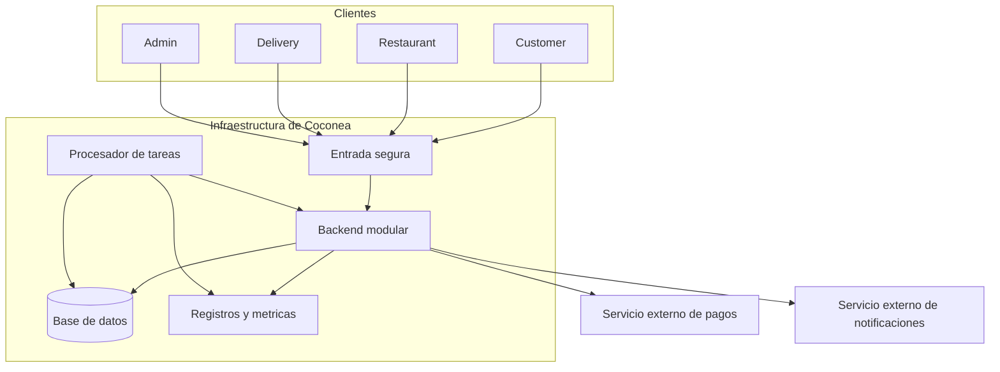

El procesador podrá compartir código con el backend y ejecutarse como un proceso independiente.

No se exige que cada aplicación cliente tenga un servidor dedicado.

## 22.3. Entornos

Se contemplan:

- Desarrollo local.
- Pruebas.
- Producción piloto.

Los entornos deberán utilizar configuraciones y credenciales separadas.

Las operaciones de pago durante desarrollo y pruebas utilizarán un entorno seguro de simulación.

---

# 23. Integración continua y calidad

La estructura Monorepo facilitará ejecutar validaciones comunes.

## 23.1. Flujo de integración


## 23.2. Pruebas necesarias

### Unitarias

- Reglas de negocio.
- Compatibilidad alimenticia.
- Cálculos económicos.
- Transiciones de estado.
- Políticas de vigencia.

### Integración

- Persistencia.
- Autenticación.
- Pagos simulados.
- Notificaciones.
- Procesamiento de ocurrencias.

### Extremo a extremo

- Pedido convencional.
- Programación fija.
- Programación por recomendaciones.
- Confirmación dentro de la aplicación.
- Confirmación mediante notificación compatible.
- Rechazo y expiración.
- Preparación del restaurante.
- Entrega del repartidor.
- Supervisión administrativa.

### Concurrencia

- Confirmaciones simultáneas.
- Reintentos de pago.
- Generación duplicada de ocurrencias.
- Asignaciones simultáneas.

---

# 24. Escalabilidad y evolución

El MVP debe permitir crecimiento sin implementar anticipadamente una infraestructura excesivamente compleja.

## 24.1. Evolución prevista

**Etapa 1 — MVP**

- Monorepo.
- Backend modular.
- Persistencia central.
- Procesador de tareas.
- Integraciones externas básicas.

**Etapa 2 — Crecimiento**

- Mayor capacidad de procesamiento.
- Optimización de consultas.
- Escalado independiente del ejecutor.
- Mejoras en distribución de notificaciones.
- Mecanismos adicionales de caché cuando se justifiquen.

**Etapa 3 — Expansión**

- Separación de servicios si es necesaria.
- Recomendaciones avanzadas.
- Optimización de entregas.
- Analítica ampliada.
- Integraciones adicionales.

No se adoptarán microservicios únicamente por una expectativa hipotética de crecimiento.

---

# 25. Riesgos arquitectónicos

| Riesgo | Impacto | Mitigación |
|---|---|---|
| Duplicación de compras | Crítico | Idempotencia y restricciones de unicidad. |
| Cobros con resultado incierto | Crítico | Conciliación y estados intermedios. |
| Confirmaciones de propuestas vencidas | Alto | Validación de vigencia en servidor. |
| Recomendaciones incompatibles | Alto | Filtrado estricto de ingredientes conocidos. |
| Fallos del programador | Alto | Persistencia y recuperación de trabajos. |
| Notificaciones no entregadas | Medio | Consulta y confirmación dentro de la aplicación. |
| Dependencias circulares | Medio | Límites claros entre módulos. |
| Acceso entre cuentas | Crítico | Autorización por rol y recurso. |
| Cambios de precios durante confirmación | Alto | Revalidación y nueva autorización. |
| Dificultad para depurar errores | Medio | Correlación, métricas y auditoría. |
| Complejidad operativa excesiva | Alto | Monolito modular y despliegue inicial sencillo. |

---

# 26. Matriz de trazabilidad

| Componente | RF principales | RN principales | Entidades relacionadas |
|---|---|---|---|
| Identity y Authorization | RF-001 a RF-006 | RN-001 a RN-005 | USER_ACCOUNT, AUTH_SESSION |
| FoodProfile | RF-007 a RF-010 | RN-006 a RN-011 | CUSTOMER_PROFILE, FOOD_PREFERENCE, FOOD_RESTRICTION |
| Restaurant | RF-043 a RF-046 | RN-012, RN-015, RN-048 a RN-050 | RESTAURANT, RESTAURANT_HOURS |
| Catalog | RF-011 a RF-017 | RN-008, RN-009, RN-013, RN-014 | PRODUCT, PRODUCT_INGREDIENT |
| Coverage | RF-058 a RF-060 | RN-015, RN-016 | ADDRESS, SERVICE_ZONE |
| Cart | RF-018 a RF-020 | RN-014, RN-017, RN-039 | SHOPPING_CART, CART_ITEM |
| Scheduling | RF-021 a RF-029 | RN-018 a RN-026 | RECURRING_SCHEDULE, SCHEDULE_OCCURRENCE |
| Recommendation | RF-014, RF-022, RF-030 | RN-027 a RN-030 | SCHEDULE_CATEGORY, SCHEDULE_RESTRICTION |
| Proposal | RF-029 a RF-036 | RN-025, RN-030 a RN-038 | ORDER_PROPOSAL, PROPOSAL_CONFIRMATION |
| Order | RF-038, RF-040 a RF-042 | RN-044 a RN-047, RN-058 | CUSTOMER_ORDER, ORDER_ITEM |
| Payment | RF-039, RF-061 | RN-039 a RN-043 | PAYMENT, PAYMENT_EVENT, REFUND |
| Delivery | RF-047 a RF-051 | RN-051 a RN-055 | DELIVERY, DELIVERY_ASSIGNMENT |
| Notification | RF-031, RF-033, RF-037 | RN-062 a RN-064 | NOTIFICATION, NOTIFICATION_ATTEMPT |
| Administration | RF-052 a RF-057 | RN-065 a RN-067 | USER_ACCOUNT, RESTAURANT, INCIDENT |
| Audit e Idempotency | RF-061 a RF-063 | RN-059 a RN-061, RN-066 | AUDIT_EVENT, IDEMPOTENCY_RECORD |

---

# 27. Criterios de aceptación arquitectónica

La arquitectura estará preparada para comenzar la implementación cuando:

1. Las cinco aplicaciones del Monorepo tengan responsabilidades definidas.
2. Los paquetes compartidos tengan límites claros.
3. El backend esté organizado en módulos independientes a nivel lógico.
4. Exista un contrato de comunicación entre clientes y API.
5. Los pedidos convencionales tengan un flujo completo.
6. Las dos modalidades de programación estén soportadas.
7. Las tareas programadas puedan recuperarse después de fallos.
8. Las propuestas tengan vencimiento y estados controlados.
9. Las dos modalidades de confirmación estén contempladas.
10. Los pagos tengan mecanismos de idempotencia y conciliación.
11. Las notificaciones no sustituyan autorizaciones.
12. Los restaurantes solo operen sus pedidos.
13. Los repartidores solo operen entregas asignadas.
14. Los administradores actúen con permisos controlados.
15. Las operaciones críticas generen registros de auditoría.
16. Existan estrategias de pruebas, observabilidad y recuperación.
17. El diseño pueda implementarse sin depender todavía de un stack específico.

---

# 28. Decisiones técnicas pendientes

Se resolverán durante la selección del stack tecnológico:

- Lenguajes de programación.
- Frameworks de interfaz.
- Framework del backend.
- Motor de base de datos.
- Herramientas de acceso a datos.
- Gestión de paquetes del Monorepo.
- Herramientas de construcción.
- Sistema de tareas programadas.
- Mecanismo de mensajería.
- Proveedor de autenticación, si corresponde.
- Proveedor de pagos.
- Proveedor de notificaciones.
- Plataforma de alojamiento.
- Herramientas de monitoreo.
- Estrategia de despliegue automatizado.

Estas decisiones deberán justificar su compatibilidad con los requerimientos funcionales, no funcionales y las reglas de negocio.

## 29. Conclusión

La arquitectura propuesta para Coconea combina un Monorepo con un backend modular, aplicaciones especializadas por actor y mecanismos controlados para tareas programadas, pagos y notificaciones.

Este diseño busca equilibrar claridad, seguridad, mantenibilidad y viabilidad de implementación.

La separación entre programación, ocurrencia, propuesta, autorización y pedido constituye el eje central de la arquitectura y permite ofrecer pedidos recurrentes sin realizar compras no autorizadas.

La propuesta también establece una base para evolucionar hacia una plataforma de mayor escala cuando existan necesidades reales que lo justifiquen.

---

**Coconea — Planifica tu alimentación, confirma y recibe.**