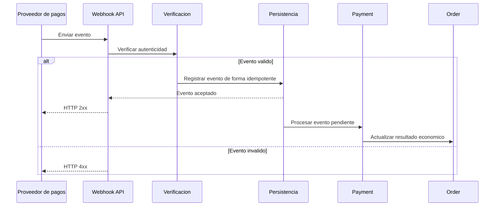
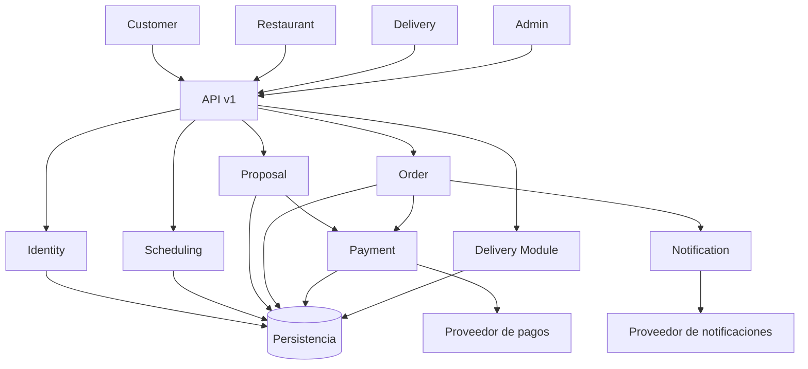
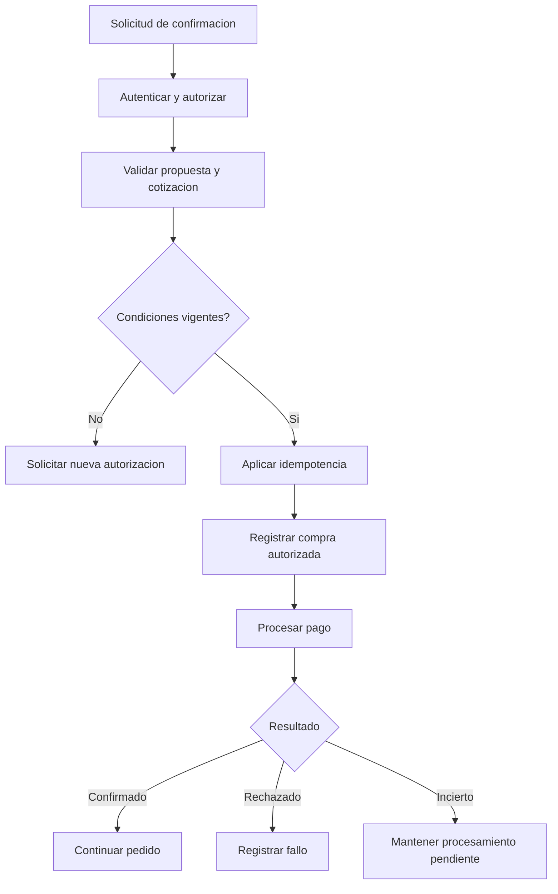

# Especificación de API — Coconea

**Proyecto:** Coconea  
**Versión del documento:** 1.0  
**Versión de API:** v1  
**Estado:** Diseño de contrato  
**Alcance:** Producto Mínimo Viable (MVP)  
**Arquitectura:** Monorepo con backend monolítico modular  
**Stack tecnológico:** Pendiente de selección

---

## 1. Introducción

Este documento define la especificación de la API de Coconea, plataforma de entrega de alimentos con pedidos convencionales y programaciones recurrentes basadas en preferencias y restricciones alimenticias.

La API constituye el contrato de comunicación entre las aplicaciones:

- `apps/customer/`
- `apps/restaurant/`
- `apps/delivery/`
- `apps/admin/`

Y el backend:

- `apps/api/`

La API centraliza autenticación, autorización, validación, reglas de negocio, persistencia, pagos, notificaciones y seguimiento de operaciones.

La especificación es independiente del framework y del motor de base de datos.

## 2. Objetivos

1. Definir una interfaz coherente y versionada.
2. Identificar los endpoints necesarios para los cuatro actores.
3. Establecer formatos uniformes de solicitudes y respuestas.
4. Documentar autenticación, autorización y propiedad de recursos.
5. Soportar pedidos convencionales y recurrentes.
6. Cubrir programaciones fijas y por recomendaciones.
7. Permitir confirmaciones dentro de la aplicación y desde notificaciones compatibles.
8. Prevenir operaciones económicas duplicadas.
9. Establecer reglas de paginación, filtrado y errores.
10. Documentar integraciones externas y webhooks.
11. Mantener trazabilidad con RF, RN, CU y el modelo de datos.

---

# 3. Principios de diseño

| ID | Principio | Descripción |
|---|---|---|
| API-PR-01 | Recursos | Los endpoints representan recursos y operaciones de dominio. |
| API-PR-02 | Versionado | Los cambios incompatibles requieren una nueva versión. |
| API-PR-03 | Seguridad | Las operaciones protegidas requieren autenticación y autorización. |
| API-PR-04 | Propiedad | Cada actor accede únicamente a los recursos permitidos. |
| API-PR-05 | Validación | Toda entrada se valida en el servidor. |
| API-PR-06 | Idempotencia | Las operaciones críticas toleran reintentos. |
| API-PR-07 | Consistencia | Los estados respetan transiciones válidas. |
| API-PR-08 | Trazabilidad | Las operaciones críticas generan identificadores y eventos. |
| API-PR-09 | Privacidad | Las respuestas incluyen únicamente información necesaria. |
| API-PR-10 | Evolución | Los contratos pueden ampliarse sin romper clientes existentes. |

## 3.1. Estilo de comunicación

Se adopta una API HTTP orientada a recursos, con intercambio de representaciones JSON.

Los métodos principales serán:

| Método | Uso |
|---|---|
| GET | Consultar recursos sin efectos de negocio. |
| POST | Crear recursos o ejecutar acciones explícitas. |
| PATCH | Modificar parcialmente recursos. |
| PUT | Reemplazar representaciones completas cuando corresponda. |
| DELETE | Solicitar eliminación o desactivación permitida. |

No se utilizará GET para confirmar compras, ejecutar pagos o cambiar estados.

## 3.2. URL base

Ejemplo conceptual:

```text
https://api.coconea.example/v1
```

El dominio es ilustrativo y no representa un servicio desplegado.

## 3.3. Versionado

La versión mayor se incluirá en la ruta:

```http
GET /v1/restaurants
```

Las modificaciones compatibles podrán incorporarse a `v1`, siempre que no cambien el significado de los campos existentes.

Se considerarán incompatibles, entre otros cambios:

- Eliminar campos obligatorios.
- Cambiar el significado de un estado.
- Modificar estructuras de respuesta sin compatibilidad.
- Introducir nuevas obligaciones de entrada para operaciones existentes.

---

# 4. Convenciones generales

## 4.1. Nombres

Se utilizarán:

- Rutas en minúsculas.
- Sustantivos plurales para colecciones.
- Identificadores en rutas para recursos concretos.
- `snake_case` para propiedades JSON.
- Valores de enumeración en mayúsculas.
- Identificadores opacos, sin significado de negocio.

Ejemplos:

```http
GET /v1/restaurants
GET /v1/restaurants/{restaurant_id}
GET /v1/me/orders
POST /v1/me/schedules
```

## 4.2. Encabezados

| Encabezado | Uso |
|---|---|
| Authorization | Credencial de acceso cuando corresponda. |
| Content-Type | Tipo de contenido de la solicitud. |
| Accept | Tipo de respuesta esperado. |
| Idempotency-Key | Identificación de operaciones críticas. |
| X-Request-ID | Correlación de solicitudes, cuando se proporcione. |
| If-Match | Control de concurrencia mediante versión, cuando aplique. |

Ejemplo:

```http
POST /v1/me/proposals/prop_123/confirm
Authorization: Bearer <access_token>
Content-Type: application/json
Idempotency-Key: 2c5e7f11-unique-request
```

Los ejemplos de credenciales son marcadores ilustrativos.

## 4.3. Fechas y horas

Los instantes absolutos utilizarán una representación ISO 8601 con zona u offset explícito, preferentemente UTC.

Ejemplo:

```json
{
  "created_at": "2026-10-14T18:30:00Z"
}
```

Las programaciones recurrentes utilizarán por separado:

- Días de la semana.
- Hora local.
- Identificador de zona horaria.
- Fecha de inicio.
- Fecha opcional de finalización.

Ejemplo:

```json
{
  "weekdays": [1, 3, 5],
  "local_time": "14:00",
  "timezone": "America/Mexico_City"
}
```

Los días se representan de 1 (lunes) a 7 (domingo).

## 4.4. Importes monetarios

Los importes se intercambiarán como cadenas decimales exactas.

Ejemplo:

```json
{
  "currency": "MXN",
  "subtotal": "180.00",
  "delivery_fee": "35.00",
  "additional_charges": "0.00",
  "discount_total": "0.00",
  "total": "215.00"
}
```

El servidor validará la moneda, precisión y operaciones aritméticas.

Los clientes no deberán determinar el importe final a cobrar.

## 4.5. Respuesta exitosa

Para recursos individuales se utilizará:

```json
{
  "data": {
    "id": "resource_123"
  },
  "meta": {
    "request_id": "req_123"
  }
}
```

Para colecciones se añadirá información de paginación.

Las respuestas sin contenido podrán utilizar HTTP 204.

## 4.6. Respuesta de error

```json
{
  "error": {
    "code": "VALIDATION_ERROR",
    "message": "Los datos proporcionados no son válidos.",
    "details": [
      {
        "field": "quantity",
        "reason": "Debe ser mayor que cero."
      }
    ],
    "request_id": "req_123"
  }
}
```

Los mensajes públicos no expondrán detalles internos de infraestructura.

---

# 5. Autenticación y autorización

## 5.1. Roles

| Rol | Identificador |
|---|---|
| Consumidor | USER |
| Restaurante | RESTAURANT |
| Repartidor | DELIVERY |
| Administrador | ADMIN |

`SYSTEM` representa procesos internos y no constituye un quinto rol de usuario.

## 5.2. Autenticación

Se define un contrato basado en credenciales de acceso.

El mecanismo exacto de emisión, almacenamiento y renovación se establecerá en el documento de seguridad y durante la selección tecnológica.

El servidor deberá:

- Validar credenciales.
- Comprobar expiración.
- Verificar revocación cuando aplique.
- Asociar cada solicitud con una identidad.
- Rechazar credenciales inválidas.

## 5.3. Autorización

Toda operación protegida comprobará:

1. Identidad autenticada.
2. Estado de cuenta.
3. Rol permitido.
4. Propiedad o asignación del recurso.
5. Condiciones específicas de la operación.

El identificador de usuario no se aceptará como fuente de autoridad cuando pueda obtenerse de la sesión.

Por ello, se utilizarán rutas como:

```http
GET /v1/me/orders
```

En lugar de permitir consultar libremente pedidos de cualquier usuario mediante un identificador suministrado por el cliente.

## 5.4. Matriz de acceso general

| Recurso | USER | RESTAURANT | DELIVERY | ADMIN |
|---|---|---|---|---|
| Perfil propio | Sí | Sí | Sí | Sí |
| Perfil alimenticio propio | Sí | No | No | Acceso restringido según función |
| Restaurantes públicos | Sí | Sí | Según necesidad | Sí |
| Catálogo propio | No | Sí | No | Supervisión |
| Programaciones propias | Sí | No | No | Supervisión limitada |
| Propuestas propias | Sí | No | No | Supervisión limitada |
| Pedidos propios | Sí | No | No | Supervisión |
| Pedidos del restaurante | No | Sí | No | Supervisión |
| Entregas asignadas | No | No | Sí | Supervisión |
| Gestión de cuentas | No | No | No | Sí |
| Auditoría | No | No | No | Según permisos |

La administración no implica acceso irrestricto a todos los datos sensibles.

---

# 6. Identidad y sesiones

## 6.1. Endpoints

| Método | Endpoint | Acceso | Descripción |
|---|---|---|---|
| POST | `/auth/register` | Público | Registrar consumidor. |
| POST | `/auth/login` | Público | Iniciar sesión. |
| POST | `/auth/logout` | Autenticado | Cerrar sesión. |
| POST | `/auth/refresh` | Sesión válida según mecanismo | Renovar credenciales. |
| POST | `/auth/password-recovery` | Público | Solicitar recuperación. |
| POST | `/auth/password-reset` | Token de recuperación válido | Restablecer contraseña. |
| GET | `/me` | Autenticado | Consultar perfil propio. |
| PATCH | `/me` | Autenticado | Actualizar datos permitidos. |

El registro público solo creará cuentas USER. Las cuentas RESTAURANT, DELIVERY y ADMIN se habilitarán mediante procedimientos controlados.

## 6.2. Registro

**Solicitud**

```http
POST /v1/auth/register
```

```json
{
  "display_name": "María López",
  "email": "maria@example.com",
  "password": "<secure_password>",
  "phone": "+520000000000"
}
```

**Respuesta: HTTP 201**

```json
{
  "data": {
    "id": "usr_101",
    "display_name": "María López",
    "email": "maria@example.com",
    "role": "USER",
    "status": "ACTIVE"
  }
}
```

La política de verificación de correo y activación podrá establecer estados intermedios adicionales sin permitir operaciones protegidas antes de cumplir los controles requeridos.

## 6.3. Inicio de sesión

**Solicitud**

```http
POST /v1/auth/login
```

```json
{
  "email": "maria@example.com",
  "password": "<secure_password>"
}
```

**Respuesta ilustrativa**

```json
{
  "data": {
    "access_token": "<access_token>",
    "token_type": "Bearer",
    "expires_in": 3600,
    "account": {
      "id": "usr_101",
      "role": "USER",
      "display_name": "María López"
    }
  }
}
```

La respuesta es un contrato conceptual. La utilización de cookies protegidas u otro mecanismo podrá modificar cómo se transportan las credenciales.

**Trazabilidad:** RF-001 a RF-006; CU-USR-01, CU-USR-02, CU-RES-01, CU-DEL-01, CU-ADM-01.

---

# 7. Perfil alimenticio y direcciones

## 7.1. Endpoints

| Método | Endpoint | Descripción |
|---|---|---|
| GET | `/me/food-profile` | Consultar perfil alimenticio. |
| PUT | `/me/food-profile/preferences` | Reemplazar preferencias. |
| PUT | `/me/food-profile/restrictions` | Reemplazar restricciones. |
| GET | `/food-categories` | Consultar categorías disponibles. |
| GET | `/ingredients` | Consultar ingredientes declarables. |
| GET | `/me/addresses` | Listar direcciones. |
| POST | `/me/addresses` | Crear dirección. |
| PATCH | `/me/addresses/{address_id}` | Actualizar dirección propia. |
| DELETE | `/me/addresses/{address_id}` | Retirar dirección del uso activo. |

**Rol:** USER para el perfil alimenticio y sus direcciones de entrega.

## 7.2. Preferencias

```http
PUT /v1/me/food-profile/preferences
```

```json
{
  "category_ids": [
    "cat_chicken",
    "cat_salads",
    "cat_vegetarian"
  ]
}
```

## 7.3. Restricciones

```http
PUT /v1/me/food-profile/restrictions
```

```json
{
  "restrictions": [
    {
      "ingredient_id": "ing_peanut",
      "restriction_type": "ALLERGEN"
    },
    {
      "ingredient_id": "ing_mushroom",
      "restriction_type": "AVOID"
    }
  ]
}
```

El backend verificará que los ingredientes existan y evitará duplicaciones.

## 7.4. Dirección

```http
POST /v1/me/addresses
```

```json
{
  "label": "Casa",
  "recipient_name": "María López",
  "recipient_phone": "+520000000000",
  "street": "Calle Ejemplo",
  "exterior_number": "120",
  "neighborhood": "Centro",
  "city": "Puebla",
  "region": "Puebla",
  "postal_code": "72000",
  "country_code": "MX",
  "reference_notes": "Portón gris",
  "is_default": true
}
```

**Reglas:**

- Solo el propietario puede modificar la dirección.
- La cobertura se verifica antes de comprar.
- La dirección usada en un pedido se conserva como copia histórica.
- Eliminar una dirección no modifica pedidos anteriores.

**Trazabilidad:** RF-007 a RF-010, RF-058 y RF-059; CU-USR-03.

---

# 8. Restaurantes y catálogo público

## 8.1. Endpoints

| Método | Endpoint | Acceso |
|---|---|---|
| GET | `/restaurants` | Público o autenticado |
| GET | `/restaurants/{restaurant_id}` | Público o autenticado |
| GET | `/restaurants/{restaurant_id}/products` | Público o autenticado |
| GET | `/restaurants/{restaurant_id}/hours` | Público o autenticado |
| GET | `/products/{product_id}` | Público o autenticado |
| POST | `/recommendations/preview` | USER |

## 8.2. Búsqueda

```http
GET /v1/restaurants?search=ensaladas&category_id=cat_salads&limit=20
```

Parámetros posibles:

| Parámetro | Descripción |
|---|---|
| search | Búsqueda textual. |
| category_id | Categoría alimenticia. |
| service_zone_id | Zona de cobertura. |
| available_at | Fecha y hora de referencia. |
| cursor | Cursor de paginación. |
| limit | Número máximo de resultados. |

La disponibilidad definitiva se revalidará al cotizar.

## 8.3. Respuesta de producto

```json
{
  "data": {
    "id": "prod_201",
    "restaurant_id": "rest_301",
    "name": "Ensalada de pollo",
    "description": "Ensalada con vegetales y pollo.",
    "price": "145.00",
    "currency": "MXN",
    "availability_status": "AVAILABLE",
    "ingredient_disclosure_status": "COMPLETE",
    "ingredients": [
      {
        "ingredient_id": "ing_chicken",
        "name": "Pollo",
        "declaration_type": "CONTAINS"
      },
      {
        "ingredient_id": "ing_lettuce",
        "name": "Lechuga",
        "declaration_type": "CONTAINS"
      }
    ]
  }
}
```

## 8.4. Vista previa de recomendaciones

```http
POST /v1/recommendations/preview
```

```json
{
  "address_id": "addr_101",
  "category_ids": ["cat_salads"],
  "excluded_ingredient_ids": ["ing_peanut"],
  "requested_at": "2026-10-15T19:00:00Z"
}
```

**Respuesta**

```json
{
  "data": {
    "recommendations": [
      {
        "restaurant_id": "rest_301",
        "product_id": "prod_201",
        "compatibility_status": "NO_KNOWN_CONFLICT",
        "availability_status": "AVAILABLE"
      }
    ],
    "disclaimer": "La compatibilidad se basa en los ingredientes declarados por el restaurante. No garantiza ausencia de contaminación cruzada."
  }
}
```

El estado `NO_KNOWN_CONFLICT` no significa que el producto sea médicamente seguro.

Los productos con declaraciones insuficientes no deberán presentarse como compatibles.

**Trazabilidad:** RF-011 a RF-017, RF-030, RF-059 y RF-060; CU-USR-04.

---

# 9. Carrito y pedidos convencionales

## 9.1. Endpoints

| Método | Endpoint | Descripción |
|---|---|---|
| GET | `/me/cart` | Consultar carrito activo. |
| POST | `/me/cart/items` | Agregar producto. |
| PATCH | `/me/cart/items/{item_id}` | Modificar cantidad. |
| DELETE | `/me/cart/items/{item_id}` | Retirar producto. |
| POST | `/me/cart/quote` | Cotizar carrito. |
| POST | `/me/orders` | Confirmar compra convencional. |
| GET | `/me/orders` | Consultar historial. |
| GET | `/me/orders/{order_id}` | Consultar pedido propio. |
| POST | `/me/orders/{order_id}/cancel` | Solicitar cancelación. |

**Rol:** USER.

## 9.2. Agregar producto

```http
POST /v1/me/cart/items
```

```json
{
  "product_id": "prod_201",
  "quantity": 2
}
```

Un carrito activo contendrá productos de un solo restaurante.

Si el usuario selecciona otro restaurante, el sistema deberá solicitar una decisión explícita sobre el contenido existente.

## 9.3. Cotización

```http
POST /v1/me/cart/quote
```

```json
{
  "address_id": "addr_101"
}
```

**Respuesta**

```json
{
  "data": {
    "quote_id": "quote_101",
    "quote_version": 1,
    "restaurant_id": "rest_301",
    "items": [
      {
        "product_id": "prod_201",
        "quantity": 2,
        "unit_price": "145.00",
        "line_total": "290.00"
      }
    ],
    "currency": "MXN",
    "subtotal": "290.00",
    "delivery_fee": "35.00",
    "additional_charges": "0.00",
    "discount_total": "0.00",
    "total": "325.00",
    "expires_at": "2026-10-14T19:00:00Z",
    "estimated_delivery_minutes": 45
  }
}
```

`quote_id` identifica una cotización temporal de compra directa, distinta de `ORDER_PROPOSAL`, que corresponde a una ocurrencia recurrente.

Su almacenamiento y retención podrán implementarse como un recurso temporal o mediante una representación verificable en el servidor.

## 9.4. Confirmar pedido convencional

```http
POST /v1/me/orders
Idempotency-Key: purchase-20261014-001
```

```json
{
  "quote_id": "quote_101",
  "quote_version": 1,
  "address_id": "addr_101",
  "payment_method_reference": "pm_test_101"
}
```

**Respuesta: HTTP 201 o HTTP 202**

```json
{
  "data": {
    "id": "ord_101",
    "source_type": "DIRECT",
    "status": "PENDING_PROCESSING",
    "payment_status": "PENDING",
    "currency": "MXN",
    "total": "325.00",
    "created_at": "2026-10-14T18:50:00Z"
  }
}
```

Se utilizará HTTP 202 cuando el procesamiento no haya concluido.

La API no deberá devolver un estado de pago confirmado mientras el resultado sea incierto.

## 9.5. Cancelación

```http
POST /v1/me/orders/ord_101/cancel
Idempotency-Key: cancel-ord-101
```

```json
{
  "reason": "Ya no necesito el pedido."
}
```

La cancelación dependerá del estado del pedido y de las políticas aplicables.

Si existe un pago capturado, el sistema determinará si corresponde iniciar un reembolso.

**Trazabilidad:** RF-018 a RF-020, RF-038 a RF-042, RF-061 y RF-063; CU-USR-05, CU-USR-10.

---

# 10. Programaciones recurrentes

## 10.1. Endpoints

| Método | Endpoint | Descripción |
|---|---|---|
| GET | `/me/schedules` | Listar programaciones. |
| POST | `/me/schedules` | Crear programación. |
| GET | `/me/schedules/{schedule_id}` | Consultar programación. |
| PATCH | `/me/schedules/{schedule_id}` | Editar programación. |
| POST | `/me/schedules/{schedule_id}/pause` | Pausar. |
| POST | `/me/schedules/{schedule_id}/resume` | Reanudar. |
| DELETE | `/me/schedules/{schedule_id}` | Eliminar lógicamente. |
| GET | `/me/schedules/{schedule_id}/occurrences` | Consultar ocurrencias. |
| POST | `/me/schedules/{schedule_id}/occurrences/{occurrence_id}/skip` | Omitir ocurrencia. |

**Rol:** USER.

## 10.2. Crear programación fija

```http
POST /v1/me/schedules
Idempotency-Key: schedule-fixed-001
```

```json
{
  "mode": "FIXED",
  "timezone": "America/Mexico_City",
  "weekdays": [1, 3, 5],
  "local_time": "14:00",
  "effective_from": "2026-10-19",
  "address_id": "addr_101",
  "fixed_restaurant_id": "rest_301",
  "fixed_items": [
    {
      "product_id": "prod_201",
      "quantity": 1
    }
  ]
}
```

**Respuesta: HTTP 201**

```json
{
  "data": {
    "id": "sch_101",
    "mode": "FIXED",
    "status": "ACTIVE",
    "timezone": "America/Mexico_City",
    "weekdays": [1, 3, 5],
    "local_time": "14:00",
    "effective_from": "2026-10-19",
    "next_occurrence_at": "2026-10-19T20:00:00Z"
  }
}
```

El horario absoluto mostrado es ilustrativo y deberá calcularse utilizando las reglas vigentes de la zona horaria.

## 10.3. Crear programación por recomendaciones

```http
POST /v1/me/schedules
Idempotency-Key: schedule-recommendation-001
```

```json
{
  "mode": "RECOMMENDATION",
  "timezone": "America/Mexico_City",
  "weekdays": [2, 4],
  "local_time": "13:30",
  "effective_from": "2026-10-20",
  "address_id": "addr_101",
  "category_ids": [
    "cat_salads",
    "cat_vegetarian"
  ],
  "restrictions": [
    {
      "ingredient_id": "ing_peanut",
      "restriction_type": "ALLERGEN"
    }
  ]
}
```

El sistema combinará estas condiciones con las restricciones aplicables del perfil alimenticio.

No se utilizarán recomendaciones avanzadas basadas en inteligencia artificial durante el MVP.

## 10.4. Modificar programación

```http
PATCH /v1/me/schedules/sch_101
If-Match: "3"
```

```json
{
  "local_time": "15:00",
  "weekdays": [1, 5]
}
```

**Reglas:**

- Solo el propietario puede modificarla.
- Los cambios no alteran pedidos ya creados.
- Las ocurrencias futuras se actualizarán conforme a la política de planificación.
- Una modificación concurrente podrá generar HTTP 412.

## 10.5. Pausar

```http
POST /v1/me/schedules/sch_101/pause
```

La pausa impedirá generar nuevas propuestas a partir de ocurrencias futuras no procesadas.

No cancelará automáticamente pedidos ya confirmados.

## 10.6. Omitir ocurrencia

```http
POST /v1/me/schedules/sch_101/occurrences/occ_101/skip
Idempotency-Key: skip-occ-101
```

Una ocurrencia ya convertida en pedido no podrá omitirse mediante este endpoint. Deberá aplicarse el proceso de cancelación correspondiente.

**Trazabilidad:** RF-021 a RF-030, RF-061; CU-USR-06, CU-USR-07, CU-USR-08, CU-SYS-01.

---

# 11. Propuestas recurrentes

## 11.1. Endpoints

| Método | Endpoint | Descripción |
|---|---|---|
| GET | `/me/proposals` | Listar propuestas propias. |
| GET | `/me/proposals/{proposal_id}` | Consultar detalle. |
| POST | `/me/proposals/{proposal_id}/confirm` | Confirmar propuesta. |
| POST | `/me/proposals/{proposal_id}/reject` | Rechazar propuesta. |
| GET | `/me/proposals/{proposal_id}/decision-status` | Consultar procesamiento de decisión. |

## 11.2. Consultar propuesta

```http
GET /v1/me/proposals/prop_101
```

**Respuesta**

```json
{
  "data": {
    "id": "prop_101",
    "occurrence_id": "occ_101",
    "schedule_id": "sch_101",
    "mode": "FIXED",
    "status": "PENDING",
    "quote_version": 2,
    "restaurant": {
      "id": "rest_301",
      "name": "Restaurante Ejemplo"
    },
    "items": [
      {
        "product_id": "prod_201",
        "name": "Ensalada de pollo",
        "quantity": 1,
        "unit_price": "145.00",
        "line_total": "145.00"
      }
    ],
    "delivery_address": {
      "label": "Casa",
      "city": "Puebla",
      "region": "Puebla",
      "reference_notes": "Portón gris"
    },
    "currency": "MXN",
    "subtotal": "145.00",
    "delivery_fee": "35.00",
    "additional_charges": "0.00",
    "discount_total": "0.00",
    "total": "180.00",
    "estimated_delivery_minutes": 45,
    "expires_at": "2026-10-19T19:55:00Z",
    "confirmation_required": true
  }
}
```

La respuesta incluirá los detalles alimenticios necesarios para tomar una decisión informada.

## 11.3. Confirmación dentro de la aplicación

```http
POST /v1/me/proposals/prop_101/confirm
Authorization: Bearer <access_token>
Idempotency-Key: confirm-prop-101
```

```json
{
  "quote_version": 2,
  "confirmation_channel": "IN_APP",
  "payment_method_reference": "pm_test_101"
}
```

**Respuesta: HTTP 202**

```json
{
  "data": {
    "proposal_id": "prop_101",
    "status": "PROCESSING",
    "decision_id": "decision_101",
    "order_id": "ord_201",
    "payment_status": "PENDING"
  }
}
```

`order_id` podrá ser `null` si el procesamiento aún no ha creado el registro correspondiente.

## 11.4. Rechazo

```http
POST /v1/me/proposals/prop_101/reject
Idempotency-Key: reject-prop-101
```

```json
{
  "quote_version": 2
}
```

**Respuesta**

```json
{
  "data": {
    "proposal_id": "prop_101",
    "status": "REJECTED"
  }
}
```

El rechazo no crea pedido ni genera cargo.

## 11.5. Confirmación desde notificación

Las acciones interactivas utilizarán el mismo caso de uso de confirmación.

El canal no crea una segunda lógica de compra.

La notificación deberá conducir a una solicitud autenticada y autorizada.

Cuando la plataforma permita confirmar de forma segura y las condiciones finales ya hayan sido mostradas y aceptadas, podrá utilizarse:

```http
POST /v1/me/proposals/prop_101/confirm
Authorization: Bearer <access_token>
Idempotency-Key: push-confirm-prop-101
```

```json
{
  "quote_version": 2,
  "confirmation_channel": "PUSH",
  "payment_method_reference": "pm_test_101"
}
```

Si el dispositivo no puede garantizar autenticación, autorización y aceptación informada, deberá abrirse la aplicación.

La notificación no contendrá credenciales reutilizables ni secretos de pago.

## 11.6. Validaciones de confirmación

El servidor comprobará:

1. Usuario autenticado.
2. Cuenta activa.
3. Propiedad de propuesta.
4. Estado PENDING.
5. Vigencia temporal.
6. Versión de cotización.
7. Productos disponibles.
8. Restaurante operativo.
9. Cobertura válida.
10. Compatibilidad alimenticia según datos declarados.
11. Dirección aplicable.
12. Medio de pago permitido.
13. Ausencia de compra previa.
14. Clave idempotente válida.

Si cambian precios, cargos, productos, dirección u otras condiciones relevantes, se exigirá una nueva aprobación.

## 11.7. Errores específicos

| Código | HTTP | Descripción |
|---|---|---|
| PROPOSAL_EXPIRED | 409 | La propuesta venció. |
| PROPOSAL_REJECTED | 409 | La propuesta fue rechazada. |
| PROPOSAL_ALREADY_PROCESSED | 409 | Ya existe una decisión final. |
| QUOTE_VERSION_MISMATCH | 409 | La cotización cambió. |
| PRODUCT_UNAVAILABLE | 409 | Un producto dejó de estar disponible. |
| RESTAURANT_UNAVAILABLE | 409 | El restaurante no puede recibir el pedido. |
| DELIVERY_OUT_OF_COVERAGE | 422 | Dirección fuera de cobertura. |
| CONFIRMATION_REAUTH_REQUIRED | 401 | Se requiere autenticación válida. |
| PAYMENT_PROCESSING | 202 | El procesamiento continúa. |

**Trazabilidad:** RF-029 a RF-039, RF-061 y RF-063; CU-USR-09, CU-SYS-04, CU-SYS-05, CU-SYS-06.

---

# 12. API del restaurante

## 12.1. Endpoints

| Método | Endpoint | Descripción |
|---|---|---|
| GET | `/restaurant/me` | Consultar establecimiento propio. |
| PATCH | `/restaurant/me` | Actualizar establecimiento. |
| GET | `/restaurant/me/hours` | Consultar horarios. |
| PUT | `/restaurant/me/hours` | Reemplazar horarios. |
| GET | `/restaurant/me/products` | Listar productos propios. |
| POST | `/restaurant/me/products` | Crear producto. |
| PATCH | `/restaurant/me/products/{product_id}` | Actualizar producto. |
| PATCH | `/restaurant/me/products/{product_id}/availability` | Cambiar disponibilidad. |
| GET | `/restaurant/me/orders` | Consultar pedidos recibidos. |
| GET | `/restaurant/me/orders/{order_id}` | Consultar pedido. |
| POST | `/restaurant/me/orders/{order_id}/accept` | Aceptar pedido. |
| POST | `/restaurant/me/orders/{order_id}/reject` | Rechazar pedido. |
| POST | `/restaurant/me/orders/{order_id}/start-preparation` | Iniciar preparación. |
| POST | `/restaurant/me/orders/{order_id}/ready` | Marcar listo. |

**Rol:** RESTAURANT.

## 12.2. Crear producto

```http
POST /v1/restaurant/me/products
```

```json
{
  "name": "Ensalada de pollo",
  "description": "Pollo con vegetales.",
  "price": "145.00",
  "currency": "MXN",
  "category_ids": ["cat_salads"],
  "ingredient_disclosure_status": "COMPLETE",
  "ingredients": [
    {
      "ingredient_id": "ing_chicken",
      "declaration_type": "CONTAINS"
    },
    {
      "ingredient_id": "ing_lettuce",
      "declaration_type": "CONTAINS"
    }
  ],
  "availability_status": "AVAILABLE"
}
```

La declaración `COMPLETE` constituye una afirmación del restaurante sobre la información proporcionada.

La plataforma no garantiza ausencia de contaminación cruzada.

## 12.3. Aceptar pedido

```http
POST /v1/restaurant/me/orders/ord_101/accept
Idempotency-Key: accept-ord-101
```

**Respuesta**

```json
{
  "data": {
    "order_id": "ord_101",
    "status": "ACCEPTED"
  }
}
```

## 12.4. Marcar listo

```http
POST /v1/restaurant/me/orders/ord_101/ready
Idempotency-Key: ready-ord-101
```

**Respuesta**

```json
{
  "data": {
    "order_id": "ord_101",
    "status": "READY_FOR_PICKUP"
  }
}
```

Las transiciones inválidas serán rechazadas.

**Trazabilidad:** RF-015 a RF-017, RF-043 a RF-046, RF-063; CU-RES-02 a CU-RES-08.

---

# 13. API del repartidor

## 13.1. Endpoints

| Método | Endpoint | Descripción |
|---|---|---|
| GET | `/delivery/me` | Consultar perfil. |
| PATCH | `/delivery/me/availability` | Cambiar disponibilidad. |
| GET | `/delivery/me/assignments` | Consultar asignaciones. |
| GET | `/delivery/me/assignments/{assignment_id}` | Consultar detalle. |
| POST | `/delivery/me/assignments/{assignment_id}/pickup` | Confirmar recolección. |
| POST | `/delivery/me/assignments/{assignment_id}/in-transit` | Marcar en camino. |
| POST | `/delivery/me/assignments/{assignment_id}/complete` | Confirmar entrega. |
| POST | `/delivery/me/assignments/{assignment_id}/incidents` | Reportar incidencia. |
| GET | `/delivery/me/history` | Consultar historial. |

**Rol:** DELIVERY.

## 13.2. Confirmar recolección

```http
POST /v1/delivery/me/assignments/asg_101/pickup
Idempotency-Key: pickup-asg-101
```

```json
{
  "notes": "Pedido recogido correctamente."
}
```

**Respuesta**

```json
{
  "data": {
    "assignment_id": "asg_101",
    "delivery_status": "PICKED_UP",
    "picked_up_at": "2026-10-14T20:10:00Z"
  }
}
```

## 13.3. Confirmar entrega

```http
POST /v1/delivery/me/assignments/asg_101/complete
Idempotency-Key: complete-asg-101
```

```json
{
  "notes": "Entregado al destinatario."
}
```

**Respuesta**

```json
{
  "data": {
    "delivery_status": "DELIVERED",
    "order_status": "DELIVERED",
    "delivered_at": "2026-10-14T20:40:00Z"
  }
}
```

## 13.4. Reportar incidencia

```http
POST /v1/delivery/me/assignments/asg_101/incidents
```

```json
{
  "category": "ADDRESS_NOT_FOUND",
  "description": "No fue posible localizar la entrada."
}
```

El repartidor deberá estar asignado a la entrega.

**Trazabilidad:** RF-047 a RF-051, RF-063; CU-DEL-02 a CU-DEL-08.

---

# 14. API administrativa

## 14.1. Endpoints

| Método | Endpoint | Descripción |
|---|---|---|
| GET | `/admin/users` | Listar usuarios. |
| GET | `/admin/users/{user_id}` | Consultar cuenta. |
| PATCH | `/admin/users/{user_id}/status` | Cambiar estado. |
| GET | `/admin/restaurants` | Listar restaurantes. |
| PATCH | `/admin/restaurants/{restaurant_id}/approval` | Aprobar o suspender. |
| GET | `/admin/drivers` | Listar repartidores. |
| PATCH | `/admin/drivers/{driver_id}/approval` | Gestionar habilitación. |
| GET | `/admin/orders` | Supervisar pedidos. |
| GET | `/admin/deliveries` | Supervisar entregas. |
| POST | `/admin/deliveries/{delivery_id}/assign` | Asignar repartidor. |
| POST | `/admin/deliveries/{delivery_id}/reassign` | Reasignar repartidor. |
| GET | `/admin/incidents` | Listar incidencias. |
| PATCH | `/admin/incidents/{incident_id}` | Gestionar incidencia. |
| GET | `/admin/audit-events` | Consultar auditoría autorizada. |
| GET | `/admin/metrics/overview` | Consultar métricas básicas. |

**Rol:** ADMIN, con permisos específicos según la operación.

## 14.2. Asignar repartidor

```http
POST /v1/admin/deliveries/dlv_101/assign
Idempotency-Key: assign-dlv-101
```

```json
{
  "driver_profile_id": "drv_101"
}
```

**Respuesta**

```json
{
  "data": {
    "assignment_id": "asg_101",
    "delivery_id": "dlv_101",
    "driver_profile_id": "drv_101",
    "status": "ACTIVE"
  }
}
```

La API comprobará disponibilidad, habilitación y ausencia de asignaciones activas incompatibles.

## 14.3. Gestionar incidencia

```http
PATCH /v1/admin/incidents/inc_101
If-Match: "2"
```

```json
{
  "status": "RESOLVED",
  "resolution_notes": "Se contactó al usuario y se resolvió la dirección."
}
```

## 14.4. Métricas básicas

```http
GET /v1/admin/metrics/overview?from=2026-10-01&to=2026-10-14
```

**Respuesta**

```json
{
  "data": {
    "orders_created": 240,
    "orders_delivered": 211,
    "orders_canceled": 12,
    "active_restaurants": 18,
    "approved_drivers": 27,
    "open_incidents": 4
  }
}
```

Los valores son ilustrativos.

**Trazabilidad:** RF-052 a RF-057, RF-062; CU-ADM-02 a CU-ADM-09.

---

# 15. Notificaciones

## 15.1. Endpoints

| Método | Endpoint | Descripción |
|---|---|---|
| GET | `/me/notifications` | Consultar notificaciones. |
| GET | `/me/notifications/{notification_id}` | Consultar detalle. |
| POST | `/me/notifications/{notification_id}/read` | Marcar como leída. |
| POST | `/me/devices` | Registrar dispositivo. |
| DELETE | `/me/devices/{device_id}` | Revocar dispositivo. |

## 15.2. Registrar dispositivo

```http
POST /v1/me/devices
```

```json
{
  "platform": "ANDROID",
  "notification_token": "<device_token>",
  "notifications_enabled": true
}
```

El token deberá almacenarse y tratarse como información sensible.

## 15.3. Notificación de propuesta

```json
{
  "data": {
    "id": "ntf_101",
    "notification_type": "PROPOSAL",
    "title": "Tu propuesta está lista",
    "message": "Revisa tu pedido programado antes de confirmar.",
    "proposal_id": "prop_101",
    "created_at": "2026-10-19T19:40:00Z",
    "read_at": null
  }
}
```

La notificación deberá enlazar con la propuesta correspondiente.

No se deberá utilizar la lectura de una notificación como confirmación de compra.

**Trazabilidad:** RF-031, RF-033, RF-037; CU-SYS-04, CU-SYS-08.

---

# 16. Pagos

## 16.1. Endpoints para consumidores

| Método | Endpoint | Descripción |
|---|---|---|
| GET | `/me/orders/{order_id}/payments` | Consultar pagos del pedido. |
| GET | `/me/orders/{order_id}/refunds` | Consultar reembolsos. |

Las operaciones de creación de pagos se coordinan desde los casos de uso de compra y confirmación.

No se expondrá un endpoint público que permita cobrar arbitrariamente una cantidad enviada por el cliente.

## 16.2. Respuesta de pago

```json
{
  "data": {
    "id": "pay_101",
    "order_id": "ord_101",
    "provider": "sandbox_provider",
    "amount": "325.00",
    "currency": "MXN",
    "status": "CAPTURED",
    "created_at": "2026-10-14T18:50:00Z"
  }
}
```

## 16.3. Reembolsos

Los reembolsos se gestionarán mediante casos de uso autorizados y políticas de cancelación.

No se permitirá que un cliente determine libremente el importe a reembolsar.

**Trazabilidad:** RF-039, RF-042, RF-061; CU-SYS-06.

---

# 17. Webhooks externos

## 17.1. Objetivo

Los webhooks permiten recibir eventos emitidos por proveedores externos, especialmente el proveedor de pagos.

## 17.2. Endpoint conceptual

```http
POST /v1/webhooks/payments/{provider}
```

Este endpoint no utilizará autenticación de usuario convencional.

Deberá aplicar autenticación del proveedor mediante el mecanismo compatible, como firmas verificables.

## 17.3. Evento ilustrativo

```json
{
  "event_id": "evt_101",
  "event_type": "payment.captured",
  "occurred_at": "2026-10-14T18:50:20Z",
  "payment_reference": "external_pay_101",
  "amount": "325.00",
  "currency": "MXN"
}
```

El formato real dependerá del proveedor.

## 17.4. Validaciones obligatorias

- Verificar autenticidad.
- Comprobar integridad del mensaje.
- Identificar proveedor.
- Evitar procesar eventos repetidos.
- Validar referencia de pago.
- Verificar moneda e importe.
- Comprobar transición de estado.
- Registrar recepción.
- Conciliar eventos fuera de orden.

## 17.5. Respuesta

La API responderá con éxito cuando el evento haya sido aceptado de manera durable para procesamiento, aunque la actualización de negocio se realice después.

No deberá devolver éxito antes de garantizar que el evento no se perderá silenciosamente.

## 17.6. Diagrama



---

# 18. Idempotencia

## 18.1. Operaciones que la requieren

| Operación | Requisito |
|---|---|
| Crear pedido | Obligatorio |
| Confirmar propuesta | Obligatorio |
| Rechazar propuesta | Obligatorio |
| Crear programación | Obligatorio |
| Omitir ocurrencia | Obligatorio |
| Solicitar cancelación | Obligatorio |
| Procesar pago | Obligatorio |
| Procesar reembolso | Obligatorio |
| Asignar repartidor | Obligatorio |
| Confirmar recolección | Obligatorio |
| Confirmar entrega | Obligatorio |

## 18.2. Funcionamiento

El cliente proporcionará una clave única por intención de operación.

El servidor asociará esa clave con:

- Ámbito de operación.
- Actor autenticado.
- Huella de la solicitud.
- Estado de procesamiento.
- Resultado registrado.

Si la solicitud se repite con la misma clave y los mismos parámetros, se devolverá el resultado correspondiente sin repetir sus efectos.

Si se reutiliza la clave con parámetros distintos, se rechazará.

## 18.3. Error de clave reutilizada

**HTTP 409**

```json
{
  "error": {
    "code": "IDEMPOTENCY_KEY_CONFLICT",
    "message": "La clave ya fue utilizada con parámetros diferentes.",
    "request_id": "req_123"
  }
}
```

## 18.4. Retención

La duración de las claves dependerá de la operación.

Las referencias permanentes y las restricciones de unicidad deberán seguir impidiendo duplicaciones incluso después de expirar registros temporales de idempotencia.

---

# 19. Paginación, filtrado y ordenamiento

## 19.1. Paginación por cursor

Se utilizará preferentemente para colecciones que cambian con frecuencia.

Ejemplo:

```http
GET /v1/me/orders?limit=20&cursor=cursor_abc
```

**Respuesta**

```json
{
  "data": [
    {
      "id": "ord_101",
      "status": "DELIVERED"
    },
    {
      "id": "ord_102",
      "status": "PREPARING"
    }
  ],
  "pagination": {
    "limit": 20,
    "next_cursor": "cursor_def",
    "has_more": true
  },
  "meta": {
    "request_id": "req_123"
  }
}
```

Los cursores serán opacos.

## 19.2. Límites

Valores propuestos:

- Predeterminado: 20 registros.
- Máximo: 100 registros.

Estos límites podrán ajustarse según pruebas de rendimiento.

## 19.3. Filtros

Ejemplos:

```http
GET /v1/me/orders?status=DELIVERED
GET /v1/restaurant/me/orders?status=PENDING_ACCEPTANCE
GET /v1/admin/incidents?status=OPEN
```

## 19.4. Ordenamiento

Ejemplo:

```http
GET /v1/me/orders?sort=-created_at
```

El servidor definirá una lista permitida de campos de ordenamiento.

No se aceptarán expresiones arbitrarias de consulta.

---

# 20. Códigos HTTP

| Código | Significado |
|---|---|
| 200 | Consulta u operación exitosa. |
| 201 | Recurso creado. |
| 202 | Solicitud aceptada para procesamiento. |
| 204 | Operación exitosa sin cuerpo. |
| 400 | Solicitud mal formada. |
| 401 | Autenticación requerida o inválida. |
| 403 | Operación no autorizada. |
| 404 | Recurso inexistente o no visible. |
| 409 | Conflicto de estado o negocio. |
| 412 | Versión del recurso desactualizada. |
| 422 | Datos válidos sintácticamente, pero incompatibles con una regla. |
| 429 | Límite de solicitudes excedido. |
| 500 | Error interno. |
| 502 | Error de integración externa. |
| 503 | Servicio temporalmente no disponible. |

No se utilizará HTTP 200 para ocultar fallos de negocio.

---

# 21. Catálogo de errores

| Código | Descripción |
|---|---|
| VALIDATION_ERROR | Datos inválidos. |
| AUTHENTICATION_REQUIRED | Falta autenticación. |
| INVALID_CREDENTIALS | Credenciales inválidas. |
| ACCOUNT_SUSPENDED | Cuenta suspendida. |
| ACCESS_DENIED | Permisos insuficientes. |
| RESOURCE_NOT_FOUND | Recurso no disponible. |
| RESOURCE_VERSION_CONFLICT | Conflicto de concurrencia. |
| INVALID_STATE_TRANSITION | Transición no permitida. |
| PRODUCT_UNAVAILABLE | Producto no disponible. |
| RESTAURANT_UNAVAILABLE | Restaurante no disponible. |
| DELIVERY_OUT_OF_COVERAGE | Dirección fuera de cobertura. |
| FOOD_COMPATIBILITY_UNDETERMINED | Información alimenticia insuficiente. |
| SCHEDULE_INVALID | Configuración recurrente inválida. |
| OCCURRENCE_ALREADY_PROCESSED | Ocurrencia procesada. |
| PROPOSAL_EXPIRED | Propuesta vencida. |
| PROPOSAL_REJECTED | Propuesta rechazada. |
| QUOTE_VERSION_MISMATCH | Cotización modificada. |
| CONFIRMATION_REAUTH_REQUIRED | Se requiere autenticación válida. |
| PAYMENT_DECLINED | Pago rechazado. |
| PAYMENT_STATUS_UNKNOWN | Resultado de pago incierto. |
| REFUND_NOT_ALLOWED | Reembolso no permitido. |
| DRIVER_NOT_AVAILABLE | Repartidor no disponible. |
| DELIVERY_NOT_ASSIGNED | Entrega no asignada al actor. |
| IDEMPOTENCY_KEY_CONFLICT | Clave reutilizada incorrectamente. |
| RATE_LIMIT_EXCEEDED | Exceso de solicitudes. |
| INTERNAL_ERROR | Error interno. |

Los códigos deberán mantenerse estables dentro de la versión de API.

---

# 22. Concurrencia y versiones

Los recursos modificables podrán exponer una versión lógica.

Ejemplo:

```json
{
  "data": {
    "id": "sch_101",
    "status": "ACTIVE",
    "version": 3
  }
}
```

La modificación podrá requerir:

```http
If-Match: "3"
```

Si la versión ya cambió, se devolverá HTTP 412.

Las operaciones económicas deberán utilizar controles de concurrencia adicionales a este mecanismo.

Una confirmación y una expiración simultáneas no podrán producir resultados contradictorios.

---

# 23. Límites de solicitudes

La API aplicará políticas de protección contra abuso.

Se considerarán límites específicos para:

- Inicio de sesión.
- Recuperación de contraseñas.
- Registro.
- Búsquedas.
- Generación de cotizaciones.
- Confirmaciones.
- Webhooks.

Cuando corresponda, se devolverá HTTP 429.

Ejemplo:

```json
{
  "error": {
    "code": "RATE_LIMIT_EXCEEDED",
    "message": "Demasiadas solicitudes. Inténtalo más tarde.",
    "request_id": "req_123"
  }
}
```

Los valores definitivos dependerán de las pruebas y del entorno de despliegue.

---

# 24. Privacidad y exposición de datos

## 24.1. Principio de mínima información

Cada respuesta incluirá únicamente los datos necesarios para la operación.

Ejemplos:

- El restaurante no necesita conocer todas las restricciones históricas del usuario.
- El repartidor solo necesita información relevante para realizar la entrega.
- El administrador no necesita credenciales ni información completa de pagos.
- Los registros de auditoría no deberán exponer secretos.

## 24.2. Datos alimenticios

Las restricciones podrán revelar información sensible.

La API limitará su consulta y evitará divulgarlas innecesariamente a otros actores.

El motor de recomendaciones podrá utilizarlas internamente para filtrar productos.

## 24.3. Direcciones

Las direcciones completas de entrega solo se mostrarán a actores que las necesiten y durante el contexto operativo autorizado.

## 24.4. Credenciales

Nunca se devolverán:

- Hashes de contraseñas.
- Secretos de autenticación.
- Claves privadas.
- Tokens de proveedores.
- Datos completos de tarjetas.

---

# 25. Contratos compartidos en el Monorepo

La API utilizará contratos documentados y verificables.

Organización conceptual:

```text id="hyg64o"
coconea/
├── apps/
│   ├── customer/
│   ├── restaurant/
│   ├── delivery/
│   ├── admin/
│   └── api/
│
├── packages/
│   ├── types/
│   │   ├── auth/
│   │   ├── catalog/
│   │   ├── schedules/
│   │   ├── proposals/
│   │   ├── orders/
│   │   ├── payments/
│   │   └── deliveries/
│   │
│   ├── validation/
│   ├── shared/
│   └── config/
│
└── docs/
    └── 11-api.md
```

## 25.1. Reglas

- Los contratos compartidos no contendrán secretos.
- Las validaciones del cliente mejoran la experiencia, pero no sustituyen las del servidor.
- Las reglas de autorización permanecerán bajo control del backend.
- Las modificaciones incompatibles deberán gestionarse mediante versionado.
- Los tipos compartidos no deberán importar implementaciones de infraestructura.

---

# 26. Diagramas de integración

## 26.1. Comunicación general



## 26.2. Confirmación y pago



---

# 27. Trazabilidad funcional

| Dominio API | RF | CU principales |
|---|---|---|
| Autenticación | RF-001 a RF-006 | CU-USR-01, CU-USR-02, CU-RES-01, CU-DEL-01, CU-ADM-01 |
| Perfil alimenticio | RF-007 a RF-010 | CU-USR-03 |
| Catálogo y búsqueda | RF-011 a RF-017 | CU-USR-04, CU-RES-03, CU-RES-04 |
| Pedido convencional | RF-018 a RF-020 | CU-USR-05 |
| Programaciones | RF-021 a RF-028 | CU-USR-06, CU-USR-07, CU-USR-08 |
| Generación de propuestas | RF-029, RF-030 | CU-SYS-01 a CU-SYS-03 |
| Confirmaciones | RF-031 a RF-036 | CU-USR-09, CU-SYS-04 a CU-SYS-06 |
| Pedidos y pagos | RF-038 a RF-042 | CU-USR-05, CU-USR-09, CU-SYS-06 |
| Restaurante | RF-043 a RF-046 | CU-RES-02 a CU-RES-08 |
| Repartidor | RF-047 a RF-051 | CU-DEL-02 a CU-DEL-08 |
| Administración | RF-052 a RF-057 | CU-ADM-02 a CU-ADM-09 |
| Direcciones y cobertura | RF-058 a RF-060 | CU-USR-04, CU-USR-05 |
| Integridad y auditoría | RF-061 a RF-063 | CU-SYS-05, CU-SYS-06, CU-SYS-08 |

# 28. Trazabilidad con reglas de negocio y datos

| Área | RN relacionadas | Entidades principales |
|---|---|---|
| Identidad | RN-001 a RN-005 | USER_ACCOUNT, AUTH_SESSION |
| Alimentación | RN-006 a RN-011 | CUSTOMER_PROFILE, FOOD_PREFERENCE, FOOD_RESTRICTION |
| Catálogo | RN-012 a RN-017 | RESTAURANT, PRODUCT, PRODUCT_INGREDIENT |
| Programación | RN-018 a RN-030 | RECURRING_SCHEDULE, SCHEDULE_OCCURRENCE |
| Propuestas | RN-030 a RN-038 | ORDER_PROPOSAL, PROPOSAL_CONFIRMATION |
| Pagos | RN-039 a RN-043 | PAYMENT, PAYMENT_EVENT, REFUND |
| Pedidos | RN-044 a RN-047 | CUSTOMER_ORDER, ORDER_ITEM |
| Restaurantes | RN-048 a RN-050 | RESTAURANT, RESTAURANT_HOURS |
| Entregas | RN-051 a RN-055 | DELIVERY, DELIVERY_ASSIGNMENT, INCIDENT |
| Auditoría e integridad | RN-058 a RN-061, RN-066 | AUDIT_EVENT, IDEMPOTENCY_RECORD |
| Notificaciones | RN-062 a RN-064 | NOTIFICATION, NOTIFICATION_ATTEMPT |

---

# 29. Criterios de aceptación de la API

La especificación se considerará lista para iniciar la implementación cuando:

1. Los endpoints principales estén definidos.
2. Las rutas utilicen convenciones uniformes.
3. Los cuatro roles tengan operaciones identificadas.
4. Exista un mecanismo de autenticación documentado.
5. La autorización por propiedad sea obligatoria.
6. Los pedidos convencionales tengan un contrato completo.
7. Las programaciones fijas puedan crearse y administrarse.
8. Las programaciones por recomendaciones puedan crearse.
9. Las propuestas puedan consultarse y confirmarse.
10. La confirmación desde notificaciones utilice las mismas reglas seguras.
11. Las propuestas vencidas no puedan convertirse en pedidos.
12. Los cambios económicos exijan nueva autorización.
13. Las operaciones críticas sean idempotentes.
14. Los pagos puedan conciliarse.
15. Los webhooks puedan autenticarse y deduplicarse.
16. Los estados de pedido y entrega sean consistentes.
17. Los errores tengan códigos estables.
18. La paginación sea uniforme.
19. Los datos sensibles tengan exposición limitada.
20. Los contratos puedan compartirse dentro del Monorepo.

---

# 30. Decisiones pendientes

Durante el diseño técnico deberán concretarse:

- Formato final de especificación ejecutable de API.
- Tecnología de autenticación.
- Transporte de credenciales.
- Framework HTTP.
- Generación de clientes.
- Validación de esquemas.
- Estrategia de documentación interactiva.
- Proveedor de pagos.
- Proveedor de notificaciones.
- Política de expiración de cotizaciones.
- Política de expiración de propuestas.
- Límites de solicitudes.
- Retención de claves idempotentes.
- Gestión de eventos y tareas asíncronas.
- Implementación de webhooks.
- Política de compatibilidad entre versiones.

Las decisiones deberán conservar los contratos funcionales y las garantías de seguridad aquí establecidas.

## 31. Conclusión

La API de Coconea se diseña como una interfaz central, versionada y orientada a recursos, capaz de conectar las cuatro aplicaciones de usuario con los módulos de negocio del backend.

Su estructura contempla los procesos esenciales del MVP: autenticación, perfiles alimenticios, catálogo, pedidos convencionales, programaciones recurrentes, propuestas, confirmaciones, pagos, restaurantes, repartidores y administración.

Las garantías de autorización, idempotencia, vigencia de propuestas y conciliación de pagos son fundamentales para mantener una operación segura.

Esta especificación servirá como base para implementar contratos verificables, desarrollar las aplicaciones y realizar pruebas de integración sin depender todavía de un framework determinado.

---

**Coconea — Planifica tu alimentación, confirma y recibe.**