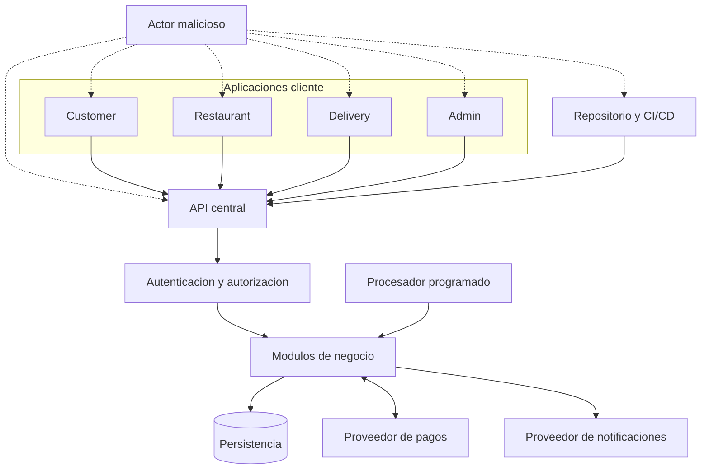
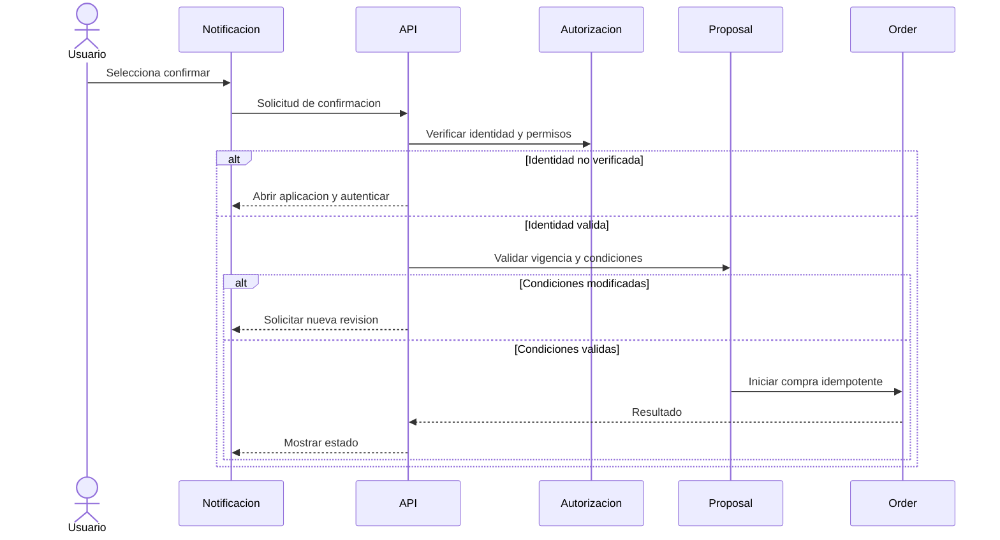
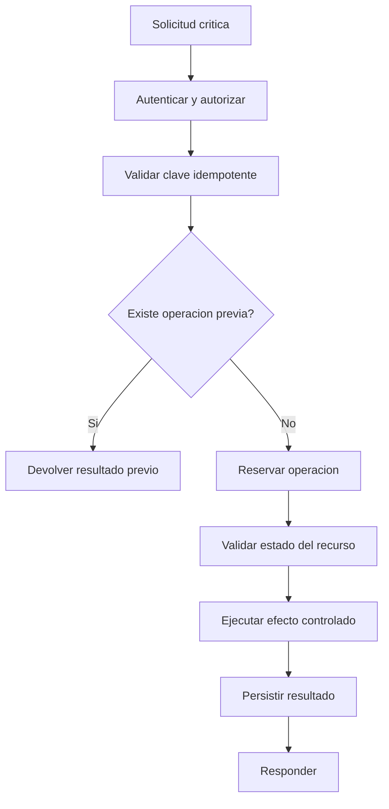
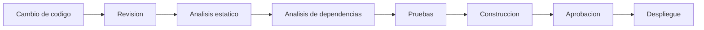
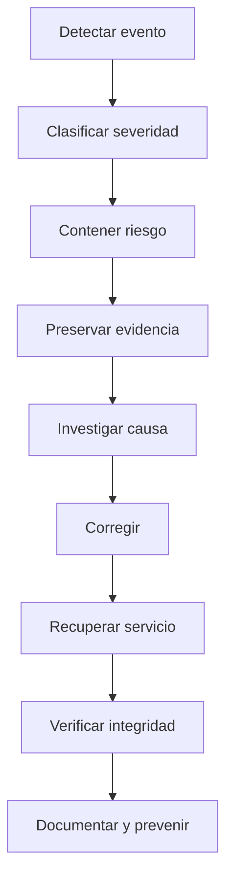

# Seguridad de Software — Coconea

**Proyecto:** Coconea  
**Versión:** 1.0  
**Estado:** Diseño de seguridad  
**Alcance:** Producto Mínimo Viable (MVP)  
**Arquitectura:** Monorepo con backend monolítico modular  
**Stack tecnológico:** Pendiente de selección

---

## 1. Introducción

Este documento define el modelo integral de seguridad de Coconea, una plataforma de entrega de alimentos que permite realizar pedidos convencionales y programar pedidos recurrentes de acuerdo con las preferencias y restricciones alimenticias de sus usuarios.

La seguridad debe contemplarse desde el diseño de la arquitectura, no únicamente durante las pruebas finales.

Coconea administrará información de cuentas, direcciones de entrega, preferencias alimenticias, restricciones relacionadas con ingredientes y alérgenos, pedidos, operaciones de pago y asignaciones de repartidores.

Además, su sistema de pedidos recurrentes requiere controles específicos, debido a que una programación puede generar propuestas automáticamente, pero **ninguna propuesta podrá convertirse en una compra sin autorización explícita del usuario**.

El modelo de seguridad cubrirá las aplicaciones:

- `apps/customer/`
- `apps/restaurant/`
- `apps/delivery/`
- `apps/admin/`
- `apps/api/`

También incluirá los paquetes compartidos, procesos programados, integraciones externas y mecanismos de despliegue del Monorepo.

## 2. Objetivos de seguridad

Los objetivos principales son:

1. Proteger la confidencialidad de los datos personales y alimenticios.
2. Garantizar la integridad de pedidos, propuestas y pagos.
3. Mantener la disponibilidad de los servicios esenciales.
4. Autenticar correctamente a los actores.
5. Autorizar operaciones según roles y propiedad de recursos.
6. Impedir compras sin consentimiento explícito.
7. Evitar pedidos y cargos duplicados.
8. Proteger las confirmaciones desde notificaciones.
9. Verificar la autenticidad de integraciones externas.
10. Detectar y registrar acciones críticas.
11. Proteger credenciales y secretos.
12. Reducir riesgos en dependencias y procesos de desarrollo.
13. Permitir recuperación ante fallos e incidentes.
14. Establecer controles verificables antes del despliegue.

---

# 3. Principios fundamentales

| ID | Principio | Aplicación |
|---|---|---|
| SEG-001 | Seguridad desde el diseño | Los controles se incorporan desde la arquitectura. |
| SEG-002 | Mínimo privilegio | Cada actor recibe únicamente los permisos necesarios. |
| SEG-003 | Denegación por defecto | Toda operación no autorizada explícitamente se rechaza. |
| SEG-004 | Defensa en profundidad | Se utilizan controles en varias capas. |
| SEG-005 | Validación del servidor | Ninguna validación del cliente sustituye la del backend. |
| SEG-006 | Separación de responsabilidades | Las aplicaciones y módulos mantienen límites definidos. |
| SEG-007 | Privacidad por diseño | Se recopilan y exponen únicamente los datos necesarios. |
| SEG-008 | Trazabilidad | Las operaciones sensibles generan evidencia auditable. |
| SEG-009 | Idempotencia | Los reintentos no duplican efectos económicos. |
| SEG-010 | Recuperación segura | Los fallos se gestionan sin omitir controles. |
| SEG-011 | Configuración segura | Los valores predeterminados deben reducir riesgos. |
| SEG-012 | Actualización continua | Las dependencias y controles se revisan periódicamente. |

---

# 4. Alcance y activos protegidos

## 4.1. Activos principales

| Activo | Sensibilidad | Riesgo principal |
|---|---|---|
| Credenciales y sesiones | Crítica | Suplantación de identidad. |
| Información personal | Alta | Divulgación no autorizada. |
| Direcciones de entrega | Alta | Exposición de ubicación y contacto. |
| Restricciones alimenticias | Alta | Exposición de información potencialmente sensible. |
| Preferencias alimenticias | Media-alta | Uso indebido o perfilado no autorizado. |
| Programaciones recurrentes | Alta | Modificación de futuras propuestas. |
| Propuestas de pedido | Alta | Confirmaciones fraudulentas. |
| Pedidos | Alta | Alteración de productos, importes o estados. |
| Pagos y reembolsos | Crítica | Pérdidas económicas y fraude. |
| Catálogo e ingredientes | Alta | Información incorrecta para decisiones alimenticias. |
| Asignaciones de entrega | Alta | Acceso indebido a pedidos y direcciones. |
| Secretos de integración | Crítica | Acceso a servicios externos. |
| Registros de auditoría | Alta | Pérdida o alteración de evidencia. |
| Copias de seguridad | Alta | Exposición o pérdida de información. |
| Código y pipelines | Alta | Introducción de código malicioso. |

## 4.2. Límites de confianza

Se establecen los siguientes límites:

1. Entre el usuario y su aplicación.
2. Entre las aplicaciones cliente y la API.
3. Entre los endpoints públicos y los módulos internos.
4. Entre los módulos de negocio y la persistencia.
5. Entre el backend y los proveedores externos.
6. Entre los procesos programados y los servicios internos.
7. Entre los desarrolladores y la infraestructura de despliegue.
8. Entre producción y los entornos de desarrollo y pruebas.

Cada límite requiere autenticación, autorización, validación o aislamiento según corresponda.

---

# 5. Modelo de amenazas

## 5.1. Metodología

Se utilizará una clasificación conceptual basada en amenazas como:

- Suplantación de identidad.
- Manipulación de información.
- Repudio de operaciones.
- Divulgación de datos.
- Denegación de servicio.
- Elevación de privilegios.

La evaluación deberá revisarse cuando cambien las funcionalidades o integraciones.

## 5.2. Matriz de amenazas

| ID | Amenaza | Impacto | Prioridad | Mitigación principal |
|---|---|---|---|---|
| AM-001 | Robo de credenciales | Crítico | P0 | Protección de contraseñas, sesiones y limitación de intentos. |
| AM-002 | Acceso a pedidos ajenos | Alto | P0 | Autorización por recurso. |
| AM-003 | Restaurante modifica productos ajenos | Alto | P0 | Verificación de propiedad. |
| AM-004 | Repartidor consulta entregas no asignadas | Alto | P0 | Control de asignaciones. |
| AM-005 | Confirmación fraudulenta de propuesta | Crítico | P0 | Autenticación, autorización y validación de consentimiento. |
| AM-006 | Compra duplicada | Crítico | P0 | Idempotencia y restricciones de unicidad. |
| AM-007 | Cargo duplicado | Crítico | P0 | Identidad estable de operación y conciliación. |
| AM-008 | Manipulación del importe | Crítico | P0 | Cálculo económico exclusivo del servidor. |
| AM-009 | Webhook falsificado | Crítico | P0 | Verificación criptográfica y controles de procedencia. |
| AM-010 | Reutilización de webhook | Alto | P0 | Deduplicación por evento y operación. |
| AM-011 | Divulgación de restricciones alimenticias | Alto | P0 | Minimización y controles de acceso. |
| AM-012 | Inyección de datos maliciosos | Alto | P0 | Validación y operaciones parametrizadas. |
| AM-013 | Exposición de secretos | Crítico | P0 | Gestión segura y rotación. |
| AM-014 | Dependencia comprometida | Alto | P1 | Análisis de dependencias y versiones controladas. |
| AM-015 | Interrupción de tareas programadas | Alto | P1 | Persistencia y recuperación de trabajos. |
| AM-016 | Modificación de registros de auditoría | Alto | P1 | Restricciones de escritura y conservación. |
| AM-017 | Abuso de solicitudes | Medio-alto | P1 | Límites, cuotas y monitoreo. |
| AM-018 | Restauración incompleta | Alto | P1 | Pruebas de restauración y reconciliación. |
| AM-019 | Manipulación de información alimenticia | Alto | P0 | Control de autoría, validación y auditoría. |
| AM-020 | Compromiso del pipeline | Crítico | P0 | Permisos mínimos, revisiones y protección de credenciales. |

**P0:** Control obligatorio antes de operar el MVP con usuarios reales.

**P1:** Control importante que deberá implementarse y verificarse conforme a la exposición y criticidad del despliegue.

## 5.3. Diagrama de superficies de ataque



Las líneas discontinuas representan superficies potenciales de ataque, no accesos permitidos.

---

# 6. Autenticación

## 6.1. Requisitos generales

Las operaciones protegidas requerirán una identidad autenticada.

El backend deberá verificar:

- Existencia de la cuenta.
- Estado de habilitación.
- Validez de credenciales.
- Vigencia de la sesión.
- Revocación cuando corresponda.
- Restricciones de seguridad adicionales para operaciones sensibles.

No se permitirá confiar únicamente en información enviada por el cliente sobre su identidad o rol.

## 6.2. Registro

El registro público estará limitado a cuentas USER.

Las cuentas RESTAURANT, DELIVERY y ADMIN deberán crearse o habilitarse mediante procedimientos controlados.

El registro deberá incluir:

- Validación de campos.
- Comprobación de duplicados.
- Protección frente a automatización abusiva.
- Tratamiento seguro de contraseñas.
- Verificación de identidad de contacto cuando la política lo requiera.

## 6.3. Inicio de sesión

El proceso deberá:

1. Recibir credenciales por un canal cifrado.
2. Validarlas de manera segura.
3. Aplicar límites de intentos.
4. Comprobar el estado de la cuenta.
5. Crear una sesión controlada.
6. Registrar eventos de seguridad relevantes.

Los errores públicos no deberán facilitar la enumeración de cuentas.

## 6.4. Autenticación reforzada

Para operaciones administrativas y accesos privilegiados se establece como requisito de seguridad incorporar autenticación multifactor antes de operar en producción.

Para el resto de las cuentas podrá habilitarse progresivamente según riesgo y capacidad del MVP.

Las acciones especialmente sensibles podrán exigir autenticación reciente.

---

# 7. Contraseñas

## 7.1. Almacenamiento

Las contraseñas nunca se almacenarán en texto plano ni mediante cifrado reversible.

Se utilizará una función de derivación de contraseñas apropiada para autenticación, con sal única por contraseña y parámetros resistentes a ataques de fuerza bruta.

La selección concreta del algoritmo se realizará en el documento del stack.

## 7.2. Política

La política deberá contemplar:

- Longitud mínima adecuada.
- Compatibilidad con contraseñas largas.
- Rechazo de credenciales evidentemente comprometidas cuando sea posible.
- Ausencia de truncamiento silencioso.
- Protección frente a intentos repetidos.
- Restablecimiento seguro.

No se impondrán cambios periódicos arbitrarios de contraseña sin una razón de seguridad.

## 7.3. Recuperación

El restablecimiento deberá utilizar credenciales temporales:

- De un solo uso.
- Con vencimiento.
- Asociadas a la cuenta correspondiente.
- Almacenadas de forma segura.
- Invalidadas después del uso.

La recuperación no deberá revelar si una dirección de correo existe en la plataforma.

---

# 8. Sesiones y credenciales de acceso

## 8.1. Requisitos

Las sesiones deberán contar con:

- Identificador seguro.
- Expiración.
- Revocación.
- Protección frente a robo y reutilización.
- Renovación controlada.
- Registro de eventos relevantes.

## 8.2. Almacenamiento en clientes

El mecanismo dependerá del tipo de aplicación.

Las aplicaciones deberán utilizar almacenamiento apropiado para credenciales.

No deberán almacenar secretos en lugares accesibles innecesariamente a scripts, extensiones o aplicaciones no autorizadas.

## 8.3. Cookies y tokens

Si se utilizan cookies de sesión, deberán configurarse con controles apropiados de seguridad y protección frente a falsificación de solicitudes.

Si se utilizan tokens, deberán validarse sus firmas, vigencia, audiencia y demás restricciones pertinentes.

Los tokens no deberán contener información alimenticia ni datos personales innecesarios.

## 8.4. Cierre de sesión

El cierre de sesión deberá invalidar o revocar las credenciales correspondientes según el mecanismo elegido.

Cambios críticos de contraseña o suspensión de cuenta deberán provocar la invalidación de sesiones cuando corresponda.

---

# 9. Autorización RBAC

## 9.1. Roles

| Rol | Identificador | Alcance |
|---|---|---|
| Consumidor | USER | Recursos propios y operaciones de compra. |
| Restaurante | RESTAURANT | Establecimiento, catálogo y pedidos asociados. |
| Repartidor | DELIVERY | Entregas asignadas. |
| Administrador | ADMIN | Supervisión y operaciones autorizadas. |

Los procesos automáticos utilizarán identidades de servicio con permisos limitados, no cuentas humanas con privilegios generales.

## 9.2. Matriz de permisos

| Operación | USER | RESTAURANT | DELIVERY | ADMIN |
|---|---|---|---|---|
| Consultar perfil propio | Sí | Sí | Sí | Sí |
| Gestionar preferencias propias | Sí | No | No | No |
| Crear programación | Sí | No | No | No |
| Confirmar propuesta propia | Sí | No | No | No |
| Crear pedido propio | Sí | No | No | No |
| Gestionar catálogo propio | No | Sí | No | Supervisión limitada |
| Aceptar pedido del restaurante | No | Sí | No | No |
| Confirmar recolección asignada | No | No | Sí | No |
| Confirmar entrega asignada | No | No | Sí | No |
| Gestionar cuentas | No | No | No | Sí |
| Supervisar pedidos | No | Solo propios | Solo asignados | Sí |
| Consultar auditoría | No | No | No | Según permiso |

La matriz representa permisos generales; cada operación deberá aplicar también validaciones contextuales.

## 9.3. Propiedad de recursos

RBAC no es suficiente por sí solo.

El backend deberá comprobar la relación entre el actor y el recurso.

Ejemplos:

- `USER` solo confirma propuestas propias.
- `RESTAURANT` solo modifica productos de su establecimiento.
- `DELIVERY` solo actualiza asignaciones activas que le pertenecen.
- `ADMIN` solo ejecuta operaciones expresamente autorizadas.

## 9.4. Prevención de acceso directo a objetos

Los identificadores enviados por el cliente no conceden acceso.

Por ejemplo:

```http
GET /v1/me/orders/ord_101
```

El servidor deberá comprobar que `ord_101` pertenece al usuario autenticado.

Si no corresponde, deberá rechazar la operación sin revelar información innecesaria.

## 9.5. Autorización por módulo

Cada caso de uso deberá validar sus permisos en el backend.

La interfaz podrá ocultar funciones no autorizadas, pero esta medida no constituye un control de seguridad suficiente.

---

# 10. Protección de información personal y alimenticia

## 10.1. Clasificación de datos

| Categoría | Ejemplos | Protección |
|---|---|---|
| Identidad | Nombre, correo, teléfono | Acceso limitado y cifrado en tránsito. |
| Ubicación | Direcciones y referencias | Exposición contextual. |
| Alimentación | Preferencias y restricciones | Minimización y acceso restringido. |
| Transacciones | Pedidos e importes | Integridad y trazabilidad. |
| Autenticación | Sesiones y credenciales | Protección reforzada. |
| Operación | Estados e incidencias | Acceso según rol. |

## 10.2. Minimización

Coconea solo deberá recopilar información necesaria para prestar sus servicios.

El perfil alimenticio no deberá solicitar diagnósticos médicos como requisito para utilizar recomendaciones.

## 10.3. Restricciones alimenticias

Las restricciones relacionadas con alergias o ingredientes deberán tratarse con especial cuidado, debido a que pueden revelar información relacionada con la salud.

El backend podrá utilizarlas para evaluar compatibilidad de productos.

No deberán divulgarse innecesariamente a restaurantes, repartidores u otros usuarios.

## 10.4. Información incompleta

Un producto sin información suficiente sobre ingredientes o alérgenos no deberá presentarse como seguro o compatible.

Las recomendaciones deberán distinguir entre:

- Compatibilidad basada en declaraciones conocidas.
- Conflicto conocido.
- Información insuficiente.

## 10.5. Contaminación cruzada

Coconea no garantizará ausencia de contaminación cruzada.

La plataforma deberá comunicar que las recomendaciones dependen de la información declarada por los establecimientos.

## 10.6. Conservación y eliminación

Deberán definirse políticas para:

- Conservación de cuentas.
- Historial de pedidos.
- Registros de pagos.
- Auditoría.
- Solicitudes de eliminación.
- Anonimización cuando corresponda.
- Retención exigida por obligaciones legales.

Eliminar una cuenta no implica borrar registros económicos cuya conservación sea obligatoria.

## 10.7. Marco normativo

Antes del lanzamiento en México deberán revisarse las obligaciones aplicables de protección de datos personales, privacidad, comercio electrónico y pagos.

Se deberán preparar avisos de privacidad, mecanismos de ejercicio de derechos y acuerdos con proveedores que traten información personal.

La revisión jurídica determinará las obligaciones específicas según la operación real de Coconea.

---

# 11. Seguridad de la API

## 11.1. Transporte seguro

Todas las comunicaciones que involucren información personal, autenticación o pagos deberán utilizar canales cifrados.

Las conexiones inseguras deberán rechazarse o redirigirse según corresponda.

## 11.2. Validación de entradas

La API deberá validar:

- Tipos.
- Longitudes.
- Rangos.
- Enumeraciones.
- Identificadores.
- Formatos de fechas.
- Cantidades.
- Importes.
- Campos permitidos.
- Tamaño de solicitudes.

No se aceptarán propiedades arbitrarias para modificar entidades internas.

## 11.3. Prevención de inyecciones

Se utilizarán mecanismos seguros para interactuar con la persistencia.

Las consultas deberán evitar concatenación de entradas no confiables.

También deberán protegerse operaciones relacionadas con:

- Búsquedas.
- Registros.
- Archivos.
- Plantillas.
- Comandos internos.
- Integraciones externas.

## 11.4. Protección frente a XSS y CSRF

Las aplicaciones deberán codificar adecuadamente el contenido mostrado.

Cuando la autenticación utilice credenciales enviadas automáticamente por el navegador, se aplicarán controles contra solicitudes falsificadas.

## 11.5. CORS

Las aplicaciones web solo deberán acceder a los recursos permitidos conforme a una política explícita de orígenes.

CORS no sustituye autenticación ni autorización.

## 11.6. Limitación de solicitudes

Se establecerán límites para:

- Registro.
- Inicio de sesión.
- Recuperación de contraseña.
- Búsqueda.
- Cotizaciones.
- Confirmaciones.
- Endpoints administrativos.
- Webhooks.

Las políticas podrán considerar identidad, origen, operación y comportamiento.

## 11.7. Manejo de errores

Los mensajes públicos deberán ser comprensibles sin revelar:

- Consultas internas.
- Rutas del servidor.
- Secretos.
- Detalles de infraestructura.
- Información de otros usuarios.

Los errores internos deberán registrarse de manera segura para diagnóstico.

---

# 12. Seguridad de pedidos recurrentes

## 12.1. Separación de conceptos

Coconea distinguirá entre:

1. Programación recurrente.
2. Ocurrencia programada.
3. Propuesta de pedido.
4. Confirmación del usuario.
5. Pedido.
6. Operación de pago.

Estos elementos no son equivalentes.

## 12.2. Regla fundamental

**Crear una programación no autoriza compras futuras.**

Cada propuesta requiere una decisión explícita del usuario.

## 12.3. Generación de propuestas

El procesador deberá:

- Verificar que la programación esté activa.
- Comprobar la identidad de la ocurrencia.
- Evitar duplicaciones.
- Validar restaurante y productos.
- Evaluar restricciones alimenticias.
- Verificar cobertura.
- Registrar una propuesta con vencimiento.
- Solicitar notificación.

## 12.4. Confirmación

Antes de iniciar una compra, el backend verificará:

1. Identidad del usuario.
2. Propiedad de la propuesta.
3. Estado pendiente.
4. Vigencia.
5. Versión de cotización.
6. Productos y cantidades.
7. Precios y cargos.
8. Dirección.
9. Disponibilidad.
10. Compatibilidad declarada.
11. Método de pago.
12. Ausencia de una compra previa.

## 12.5. Cambios materiales

Si cambian las condiciones relevantes, el sistema deberá presentar las nuevas condiciones y solicitar otra confirmación.

Una autorización anterior no podrá utilizarse para aceptar silenciosamente un precio mayor, otro producto o una dirección diferente.

## 12.6. Expiración

Las propuestas vencidas no podrán confirmarse.

La expiración deberá verificarse en el servidor, incluso si el cliente muestra información desactualizada.

## 12.7. Rechazo

Una propuesta rechazada:

- No crea un nuevo pedido.
- No inicia un nuevo cargo.
- Conserva evidencia de la decisión.
- No puede reactivarse mediante una solicitud antigua.

---

# 13. Seguridad de notificaciones interactivas

## 13.1. Riesgos

Las notificaciones pueden:

- Mostrarse en pantallas bloqueadas.
- Ser vistas por terceros.
- Llegar tarde.
- Entregarse más de una vez.
- Ejecutar acciones con sesiones expiradas.
- Mostrar condiciones económicas desactualizadas.

## 13.2. Controles

Las notificaciones deberán:

- Minimizar información sensible.
- Referenciar propuestas mediante identificadores seguros.
- Respetar la vigencia.
- Evitar incluir credenciales reutilizables.
- Dirigir acciones hacia endpoints protegidos.
- Verificar identidad y propiedad.
- Aplicar idempotencia.
- Revalidar condiciones.

## 13.3. Confirmación segura



## 13.4. Comportamiento alternativo

Cuando el dispositivo no soporte confirmación interactiva segura, se abrirá la aplicación para completar la operación.

La ausencia de compatibilidad no deberá debilitar los controles.

---

# 14. Seguridad de pagos

## 14.1. Principios

- No realizar cargos sin autorización.
- No confiar en importes enviados por el cliente.
- No almacenar números completos de tarjetas.
- No almacenar códigos de seguridad.
- Utilizar referencias seguras del proveedor.
- Aplicar idempotencia.
- Conciliar resultados inciertos.
- Registrar reembolsos.

## 14.2. Separación de estados

El estado de un pedido y el estado de su pago deberán mantenerse separados.

Ejemplos de estados económicos:

- PENDING.
- AUTHORIZED.
- CAPTURED.
- DECLINED.
- FAILED.
- REFUND_PENDING.
- REFUNDED.

El conjunto definitivo deberá alinearse con las capacidades del proveedor seleccionado.

## 14.3. Resultados inciertos

Si el proveedor no responde, Coconea no deberá asumir automáticamente que el pago falló.

El sistema deberá:

1. Registrar la operación pendiente.
2. Conservar la referencia externa.
3. Consultar o recibir el resultado.
4. Conciliar el estado.
5. Evitar un nuevo cargo independiente.
6. Informar al usuario de que el procesamiento continúa.

## 14.4. Reembolsos

Los reembolsos deberán:

- Estar autorizados.
- Referenciar el pago original.
- Respetar importes válidos.
- Evitar duplicaciones.
- Conservar historial.
- Gestionar estados pendientes.

## 14.5. Entorno de pruebas

El MVP deberá integrar inicialmente un entorno de pruebas o sandbox cuando el proveedor lo permita.

Las credenciales de prueba y producción permanecerán separadas.

## 14.6. Cumplimiento

El proveedor de pagos y la forma de integración deberán seleccionarse considerando los requisitos de seguridad y cumplimiento aplicables.

El alcance de obligaciones relacionadas con datos de tarjetas dependerá de cómo se implemente el flujo de pago.

---

# 15. Seguridad de webhooks

## 15.1. Riesgos

Un webhook mal protegido puede permitir:

- Simular pagos.
- Alterar estados.
- Repetir eventos.
- Introducir información falsa.
- Saturar el servicio.

## 15.2. Verificación

El backend deberá comprobar:

- Autenticidad del remitente.
- Integridad del mensaje.
- Validez de la firma o mecanismo equivalente.
- Referencia de operación.
- Importe y moneda.
- Estado permitido.
- Identificador del evento.

## 15.3. Prevención de repetición

Cada evento externo deberá tener una identidad verificable.

Los eventos duplicados deberán reconocerse sin ejecutar nuevamente sus efectos.

## 15.4. Eventos fuera de orden

La API no deberá asumir que los eventos llegan en orden.

Antes de cambiar un estado deberá comprobar la transición y, cuando corresponda, consultar el estado actual en el proveedor.

## 15.5. Persistencia

Un webhook aceptado deberá registrarse de forma durable antes de confirmar su recepción.

El procesamiento posterior podrá ser asíncrono.

---

# 16. Idempotencia y concurrencia

## 16.1. Objetivo

Evitar que solicitudes repetidas o simultáneas provoquen:

- Dos pedidos.
- Dos cargos.
- Dos propuestas para la misma ocurrencia.
- Dos asignaciones activas.
- Dos reembolsos.
- Transiciones incompatibles.

## 16.2. Claves idempotentes

Las operaciones críticas utilizarán identificadores únicos por intención.

La clave deberá asociarse a:

- Actor.
- Operación.
- Recurso.
- Huella de parámetros.
- Estado.
- Resultado.

## 16.3. Restricciones persistentes

La idempotencia de la API deberá complementarse con restricciones de integridad en la persistencia.

Ejemplos:

- Identidad única de ocurrencia.
- Relación única entre propuesta y compra resultante.
- Referencia única de operación de pago.
- Un máximo de una asignación activa por entrega.

## 16.4. Concurrencia

Las operaciones que compitan por un mismo recurso deberán coordinarse mediante mecanismos transaccionales o de concurrencia apropiados.

No se permitirá que una confirmación y una expiración simultáneas produzcan dos estados finales.

## 16.5. Diagrama



Las restricciones persistentes deberán proteger la operación incluso si dos solicitudes llegan al mismo tiempo.

---

# 17. Seguridad de restaurantes

## 17.1. Gestión del catálogo

Solo el restaurante autorizado podrá modificar:

- Datos de su establecimiento.
- Productos.
- Precios.
- Disponibilidad.
- Ingredientes.
- Declaraciones de alérgenos.

## 17.2. Integridad alimenticia

Las modificaciones de ingredientes y alérgenos deberán registrarse.

El sistema no deberá reutilizar información anterior como si continuara vigente cuando un producto cambie.

## 17.3. Pedidos

El restaurante solo podrá consultar y procesar pedidos vinculados a su establecimiento.

Las transiciones deberán validarse en el servidor.

## 17.4. Rechazos

El rechazo de un pedido deberá activar las reglas de negocio correspondientes, incluyendo tratamiento del pago cuando proceda.

---

# 18. Seguridad de repartidores

## 18.1. Acceso a entregas

Un repartidor solo podrá consultar las entregas asignadas a su identidad.

## 18.2. Información del destinatario

La dirección y datos de contacto deberán mostrarse únicamente cuando sean necesarios para la entrega.

## 18.3. Cambios de estado

Las acciones de recolección, tránsito y entrega deberán:

- Verificar la asignación.
- Validar el estado actual.
- Registrar la identidad del actor.
- Registrar fecha y hora.
- Evitar transiciones duplicadas.

## 18.4. Reasignación

Cuando una entrega se reasigne, el repartidor anterior deberá perder acceso operativo a la información que ya no necesite.

---

# 19. Seguridad administrativa

## 19.1. Privilegios

Las cuentas administrativas tendrán controles reforzados.

Deberán aplicarse:

- Autenticación multifactor.
- Acceso mínimo necesario.
- Registro de acciones.
- Revisión de permisos.
- Revocación oportuna.
- Protección adicional para operaciones sensibles.

## 19.2. Operaciones críticas

Se consideran sensibles:

- Suspender cuentas.
- Aprobar restaurantes.
- Habilitar repartidores.
- Gestionar incidencias.
- Modificar asignaciones.
- Consultar auditoría.
- Acceder a información personal.

## 19.3. Restricciones

Un administrador no podrá:

- Confirmar una propuesta en nombre de un usuario sin autorización válida.
- Generar compras arbitrarias.
- Modificar registros económicos para ocultar operaciones.
- Consultar datos sensibles sin una necesidad operativa autorizada.

---

# 20. Gestión de secretos

## 20.1. Secretos considerados

- Credenciales de base de datos.
- Claves de firma.
- Credenciales de pagos.
- Secretos de webhooks.
- Credenciales de notificaciones.
- Tokens de despliegue.
- Credenciales de servicios externos.

## 20.2. Reglas

Los secretos:

1. No deberán incorporarse al repositorio.
2. No deberán aparecer en documentación pública.
3. No deberán incluirse en respuestas de API.
4. No deberán imprimirse en registros.
5. Deberán limitarse por entorno.
6. Deberán rotarse cuando exista sospecha de compromiso.
7. Deberán asignarse con privilegios mínimos.

## 20.3. Archivos de configuración

Los archivos de ejemplo podrán contener nombres de variables, pero no credenciales reales.

Ejemplo:

```text
PAYMENT_PROVIDER_KEY=<configure-securely>
DATABASE_CONNECTION=<configure-securely>
NOTIFICATION_CREDENTIAL=<configure-securely>
```

La implementación concreta de gestión de secretos se definirá durante la selección del stack.

---

# 21. Seguridad del Monorepo

## 21.1. Alcance

El repositorio contiene múltiples aplicaciones y paquetes compartidos.

Un cambio en un paquete común puede afectar a varias aplicaciones simultáneamente.

## 21.2. Reglas

- Mantener límites de dependencia.
- Evitar importar módulos internos de otras aplicaciones.
- Revisar cambios en contratos compartidos.
- Separar configuración de secretos.
- Aplicar revisiones de código.
- Ejecutar pruebas automatizadas.
- Restringir modificaciones a componentes críticos.
- Mantener historial de cambios.

## 21.3. Estructura de seguridad propuesta

```text
coconea/
├── apps/
│   ├── customer/
│   ├── restaurant/
│   ├── delivery/
│   ├── admin/
│   └── api/
│
├── packages/
│   ├── shared/
│   ├── types/
│   ├── validation/
│   └── config/
│
├── infrastructure/
├── scripts/
├── docs/
│   └── 12-seguridad.md
│
├── .github/
│   ├── workflows/
│   └── CODEOWNERS
│
├── .gitignore
└── README.md
```

`CODEOWNERS` es una opción de organización para establecer revisores responsables de rutas críticas; su efectividad depende de la configuración de protección del repositorio.

---

# 22. Seguridad de dependencias

## 22.1. Riesgos

Las dependencias externas pueden introducir:

- Vulnerabilidades conocidas.
- Código malicioso.
- Cambios incompatibles.
- Dependencias transitivas inseguras.
- Riesgos de mantenimiento.

## 22.2. Controles

Se deberá:

1. Mantener un inventario de dependencias.
2. Utilizar versiones reproducibles.
3. Revisar vulnerabilidades conocidas.
4. Evaluar dependencias nuevas.
5. Evitar paquetes innecesarios.
6. Actualizar componentes vulnerables.
7. Revisar licencias y condiciones de uso.
8. Detectar dependencias abandonadas.

## 22.3. Archivos de bloqueo

Cuando el gestor de paquetes lo permita, se utilizarán archivos de bloqueo para mejorar la reproducibilidad.

Estos archivos deberán conservarse en el repositorio según las convenciones de la herramienta seleccionada.

## 22.4. Análisis automatizado

El pipeline deberá incluir controles de seguridad de dependencias antes de los despliegues relevantes.

---

# 23. Seguridad de CI/CD

## 23.1. Objetivos

Proteger la cadena que transforma el código fuente en aplicaciones desplegadas.

## 23.2. Flujo propuesto



## 23.3. Controles obligatorios

- Protección de ramas principales.
- Revisiones antes de integrar cambios.
- Validaciones automáticas.
- Permisos mínimos del pipeline.
- Separación de entornos.
- Protección de credenciales.
- Restricción de despliegues de producción.
- Registro de versiones desplegadas.

## 23.4. Cambios críticos

Los cambios en autenticación, pagos, autorizaciones, secretos y despliegue deberán requerir revisión especializada.

## 23.5. Ejecución de código no confiable

Las contribuciones externas no deberán tener acceso automático a secretos o credenciales de producción.

Los procesos de integración deberán tratar el código de contribuciones no revisadas como potencialmente no confiable.

---

# 24. Registros y auditoría

## 24.1. Eventos auditables

Se registrarán:

- Inicio y cierre de sesión relevantes.
- Cambios de permisos.
- Suspensión de cuentas.
- Modificaciones de ingredientes.
- Cambios de programaciones.
- Generación de propuestas.
- Confirmaciones y rechazos.
- Intentos de pago.
- Resultados económicos.
- Cancelaciones y reembolsos.
- Asignaciones y reasignaciones.
- Cambios de estado.
- Acciones administrativas.

## 24.2. Información mínima

Un evento podrá incluir:

```json
{
  "event_id": "audit_101",
  "event_type": "PROPOSAL_CONFIRMED",
  "actor_id": "usr_101",
  "actor_role": "USER",
  "resource_type": "ORDER_PROPOSAL",
  "resource_id": "prop_101",
  "occurred_at": "2026-10-14T18:50:00Z",
  "request_id": "req_101",
  "result": "ACCEPTED"
}
```

## 24.3. Protección

Los registros deberán:

- Evitar secretos.
- Limitar información personal.
- Restringir modificaciones.
- Mantener integridad.
- Conservarse conforme a una política.
- Ser consultables únicamente por personal autorizado.

## 24.4. Correlación

Las operaciones críticas deberán poder relacionarse mediante identificadores de solicitud y operación.

Esto permitirá investigar el recorrido desde una confirmación hasta el pedido y el pago.

---

# 25. Monitoreo de seguridad

## 25.1. Indicadores

Se monitorearán:

| Indicador | Finalidad |
|---|---|
| Inicios de sesión fallidos | Detectar intentos de acceso. |
| Errores 401 y 403 | Identificar problemas de autenticación y autorización. |
| Confirmaciones rechazadas | Detectar intentos inválidos. |
| Conflictos de idempotencia | Identificar reintentos incorrectos. |
| Webhooks inválidos | Detectar eventos falsificados. |
| Pagos inciertos | Detectar conciliaciones pendientes. |
| Errores de tareas | Detectar interrupciones operativas. |
| Acciones administrativas | Supervisar privilegios. |
| Cambios de secretos | Verificar rotaciones. |
| Vulnerabilidades detectadas | Gestionar exposición técnica. |

## 25.2. Alertas

Deberán considerarse alertas ante:

- Fallos repetidos de autenticación.
- Accesos administrativos anómalos.
- Errores masivos de autorización.
- Webhooks con firmas inválidas.
- Aumento inesperado de cargos o reembolsos.
- Procesamiento duplicado detectado.
- Exposición accidental de secretos.
- Interrupción de componentes críticos.

---

# 26. Copias de seguridad

## 26.1. Objetivos

Las copias de seguridad deberán permitir recuperar información esencial ante:

- Errores humanos.
- Fallos de infraestructura.
- Corrupción de datos.
- Incidentes de seguridad.
- Eliminaciones accidentales.

## 26.2. Información respaldada

Se incluirán, según corresponda:

- Cuentas.
- Restaurantes y productos.
- Programaciones.
- Ocurrencias.
- Propuestas.
- Pedidos.
- Referencias de pagos.
- Entregas.
- Auditoría.
- Configuración recuperable.

## 26.3. Protección

Las copias deberán:

- Estar cifradas.
- Tener acceso restringido.
- Mantenerse separadas del sistema principal cuando sea viable.
- Contar con una política de retención.
- Verificarse periódicamente.
- Probarse mediante restauraciones.

## 26.4. Objetivos de recuperación

Se adoptan los objetivos iniciales definidos en los requerimientos no funcionales:

| Indicador | Objetivo |
|---|---|
| RPO | 15 minutos |
| RTO | 4 horas |

Estos objetivos deberán validarse mediante pruebas reales.

## 26.5. Recuperación económica

Restaurar una copia de datos no garantiza por sí mismo consistencia con el proveedor de pagos.

Después de una recuperación deberán conciliarse las operaciones económicas y los eventos externos.

---

# 27. Respuesta a incidentes

## 27.1. Objetivo

Establecer un proceso para identificar, contener, investigar y resolver incidentes de seguridad.

## 27.2. Clasificación

| Nivel | Ejemplo | Respuesta |
|---|---|---|
| Crítico | Exposición de credenciales maestras o fraude activo. | Contención inmediata y activación del responsable. |
| Alto | Acceso indebido a datos personales. | Investigación prioritaria y medidas de protección. |
| Medio | Vulnerabilidad explotable sin evidencia de compromiso. | Corrección y verificación planificada con urgencia. |
| Bajo | Configuración mejorable sin exposición conocida. | Corrección mediante mantenimiento controlado. |

## 27.3. Proceso



## 27.4. Responsabilidades

Durante el MVP deberán identificarse responsables para:

- Seguridad técnica.
- Infraestructura.
- Backend.
- Integraciones económicas.
- Comunicación.
- Protección de datos.

Una persona podrá desempeñar varias funciones durante la etapa inicial, pero las responsabilidades deberán quedar documentadas.

## 27.5. Comunicación

Ante un incidente se deberá determinar:

- Usuarios afectados.
- Información comprometida.
- Operaciones alteradas.
- Necesidad de suspender funcionalidades.
- Obligaciones de notificación.
- Acciones de recuperación.

Las comunicaciones deberán ser precisas y no minimizar incidentes sin evidencia.

---

# 28. Pruebas de seguridad

## 28.1. Autenticación

- Credenciales incorrectas.
- Sesión expirada.
- Sesión revocada.
- Cuenta suspendida.
- Recuperación reutilizada.
- Intentos repetidos.

## 28.2. Autorización

- Usuario consulta pedido ajeno.
- Restaurante modifica producto ajeno.
- Repartidor modifica entrega no asignada.
- Usuario intenta acceder a administración.
- Administrador intenta realizar compra sin autorización.

## 28.3. Pedidos recurrentes

- Confirmar propuesta vencida.
- Confirmar propuesta rechazada.
- Confirmar dos veces.
- Confirmar con versión anterior.
- Confirmar después de cambiar el precio.
- Confirmar desde una sesión inválida.
- Confirmar mediante notificación duplicada.

## 28.4. Pagos

- Reintento de pago.
- Respuesta incierta.
- Webhook duplicado.
- Webhook falsificado.
- Evento fuera de orden.
- Reembolso repetido.
- Diferencia entre importe esperado y recibido.

## 28.5. Concurrencia

- Dos confirmaciones simultáneas.
- Confirmación y expiración simultáneas.
- Dos procesos generan la misma ocurrencia.
- Dos administradores asignan la misma entrega.
- Cancelación y aceptación simultáneas.

## 28.6. Infraestructura

- Restauración de copias.
- Rotación de secretos.
- Fallos de proveedores.
- Reinicio del procesador.
- Recuperación de tareas.
- Verificación de registros.

---

# 29. Criterios de aceptación de seguridad

El MVP estará preparado para pruebas operativas con usuarios reales cuando se verifique que:

1. Las comunicaciones sensibles están cifradas.
2. Las contraseñas se almacenan de forma segura.
3. Las sesiones pueden expirar y revocarse.
4. Las cuentas suspendidas pierden acceso.
5. Los cuatro roles tienen permisos delimitados.
6. Se valida la propiedad de cada recurso.
7. Las restricciones alimenticias no se divulgan innecesariamente.
8. Los productos con información insuficiente no se presentan como seguros.
9. Las programaciones no generan compras automáticas.
10. Las propuestas vencidas no pueden confirmarse.
11. Los cambios materiales requieren nueva autorización.
12. Las notificaciones no permiten omitir autenticación.
13. Las operaciones económicas son idempotentes.
14. Los resultados inciertos se concilian.
15. Los webhooks se autentican y deduplican.
16. Los restaurantes no modifican recursos ajenos.
17. Los repartidores no acceden a entregas no asignadas.
18. Los administradores no pueden comprar arbitrariamente.
19. Los secretos no están incluidos en el repositorio.
20. Las dependencias se revisan.
21. Los despliegues cuentan con controles de acceso.
22. Las operaciones críticas generan auditoría.
23. Existen mecanismos de monitoreo y alertas.
24. Las copias de seguridad pueden restaurarse.
25. Existe un procedimiento documentado de respuesta a incidentes.

---

# 30. Matriz de trazabilidad

| Área de seguridad | RF relacionadas | RN relacionadas | Componentes |
|---|---|---|---|
| Identidad y sesiones | RF-001 a RF-006 | RN-001 a RN-005 | Identity, Authorization |
| Perfil alimenticio | RF-007 a RF-010 | RN-006 a RN-011 | FoodProfile |
| Integridad de catálogo | RF-015 a RF-017 | RN-012 a RN-017 | Restaurant, Catalog |
| Pedidos convencionales | RF-018 a RF-020 | RN-014, RN-017, RN-039 | Cart, Order, Payment |
| Programaciones | RF-021 a RF-030 | RN-018 a RN-030 | Scheduling, Recommendation |
| Propuestas y confirmaciones | RF-031 a RF-038 | RN-030 a RN-038 | Proposal, Idempotency |
| Pagos y reembolsos | RF-039, RF-042, RF-061 | RN-039 a RN-043 | Payment |
| Restaurante | RF-043 a RF-046 | RN-048 a RN-050 | Restaurant, Catalog, Order |
| Entregas | RF-047 a RF-051 | RN-051 a RN-055 | Delivery |
| Administración | RF-052 a RF-057 | RN-065 a RN-067 | Administration |
| Cobertura y direcciones | RF-058 a RF-060 | RN-015, RN-016 | Customer, Coverage |
| Auditoría e integridad | RF-061 a RF-063 | RN-058 a RN-061, RN-066 | Audit, Idempotency |
| Notificaciones | RF-031, RF-033, RF-037 | RN-062 a RN-064 | Notification |

## 30.1. Trazabilidad con documentos

Este documento complementa:

- `03-actores-y-roles.md`: permisos y responsabilidades.
- `04-requerimientos-funcionales.md`: funcionalidades protegidas.
- `05-requerimientos-no-funcionales.md`: objetivos de seguridad y disponibilidad.
- `06-casos-de-uso.md`: actores y operaciones.
- `07-flujos-de-usuario.md`: interacciones y estados.
- `08-reglas-de-negocio.md`: condiciones obligatorias.
- `09-modelo-de-datos.md`: entidades e integridad.
- `10-arquitectura.md`: módulos y límites de confianza.
- `11-api.md`: endpoints y contratos.

---

# 31. Decisiones tecnológicas pendientes

Se resolverán en `13-stack-tecnologico.md`:

- Framework de autenticación.
- Mecanismo de sesiones.
- Algoritmo de derivación de contraseñas.
- Solución de autorización.
- Motor de persistencia.
- Herramientas de validación.
- Gestión de secretos.
- Proveedor de pagos.
- Proveedor de notificaciones.
- Análisis de dependencias.
- Análisis estático.
- Plataforma CI/CD.
- Herramientas de auditoría y monitoreo.
- Solución de copias de seguridad.
- Infraestructura de despliegue.

La selección deberá satisfacer los controles de este documento y no modificarlos únicamente por conveniencia tecnológica.

## 32. Conclusión

La seguridad de Coconea debe proteger tanto la información de sus usuarios como la integridad de sus operaciones comerciales.

El modelo propuesto combina autenticación, autorización por roles y propiedad, protección de datos, validación de entradas, controles de concurrencia, idempotencia, auditoría y recuperación.

La característica de pedidos recurrentes requiere especial atención: generar una propuesta no significa autorizar una compra, y ninguna confirmación podrá ejecutarse sin verificar identidad, vigencia y condiciones económicas.

Los controles aquí definidos servirán como requisitos obligatorios para seleccionar tecnologías, implementar el MVP y evaluar su preparación antes de operar con usuarios reales.

---

**Coconea — Planifica tu alimentación, confirma y recibe.**